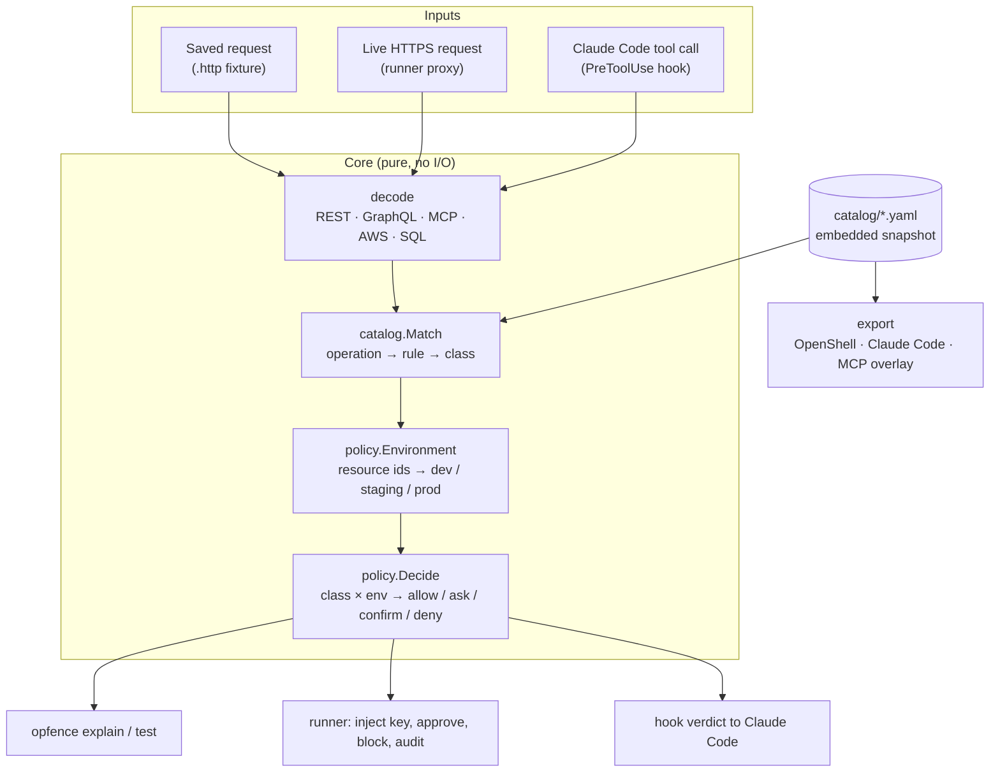
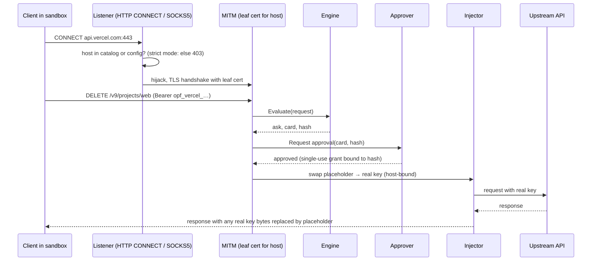

# Opfence architecture and design

16 Oct 2026 · companion to [PLAN.md](PLAN.md) (the why) and [BUILD_PLAN.md](BUILD_PLAN.md) (the order of work)

> This document is the engineering contract. When code and this document disagree, fix one of them in the same change.

## 1. Shape of the system

Opfence is one Go binary with three layers that share one core. The core turns an HTTP request (or an agent tool call) into a list of **operations**, looks each one up in the **catalog** to get a **risk class**, and asks the **policy** what that class means in the target **environment**. Everything else is an adapter around that core.



Design rules that follow from the threat model in PLAN.md:

1. **The core is pure.** `decode`, `catalog` and `policy` do no network, disk or clock access, so they are trivially testable, fuzzable and identical in every adapter.
2. **Fail closed everywhere.** A body that is too large, compressed in an unknown way, unparseable, or a batch we cannot fully expand produces an operation of class `unknown`, never `read`. A hook that crashes exits 2 (Claude Code treats any other non-zero code as "carry on").
3. **The strictest operation wins.** One request can carry many operations (GraphQL root fields, aliases, batches, JSON-RPC batches). Each is decided separately and the request gets the strictest decision; the approval card lists all of them.
4. **Agent text never reaches a decision or a card unlabelled.** Cards are rendered from decoded arguments only.
5. **Few dependencies.** Each dependency is a supply-chain risk in a security tool. Prefer the standard library; every added module needs a reason in this document.

## 2. Packages

```text
cmd/opfence/            main; wires cobra commands to internal packages
internal/classes/       risk classes and decisions, their ordering
internal/request/       Request model, .http fixture parser, body limits, decompression
internal/decode/        Operation model; rest, graphql, mcp, aws, git decoders; WebSocket upgrades and message sessions; SQL classifiers (Postgres, MySQL, SQLite) and libSQL bodies
internal/catalog/       rule model, YAML loader, validator, matcher, embedded snapshot
internal/policy/        opfence.yaml model, environment resolver, decision table, merge
internal/engine/        glue: Request → []Evaluation (decode + match + decide)
internal/fixture/       `opfence test`: replay fixtures and compare expectations
internal/drift/         `opfence catalog check-sources`: rules against providers' published schemas
internal/export/        openshell, claudecode, mcpannotations
internal/hook/          `opfence hook claude-code`: PreToolUse adapter
internal/proxy/         CONNECT + SOCKS5 listeners, MITM, upstream transport, WebSocket relay
internal/websocket/     RFC 6455 frame reader and writer for the relay (no handshake, no extensions)
internal/ca/            per-machine CA, leaf cache
internal/secrets/       store interface, OS keychain backend, placeholders, discovery
internal/inject/        placeholder swap, host binding, SigV4 re-sign, response scrubber
internal/approve/       grants, channels (desktop dialog, control socket, phone via ntfy), timeouts
internal/audit/         hash-chained JSONL log, verifier
internal/launch/        Claude Code --settings and srt settings, CA files, child environment, env placeholders
internal/trust/         CA install/uninstall in the OS trust store, with a manifest
catalog/                provider folders: rules + fixtures (embedded with go:embed)
schema/                 JSON Schema for catalog files and opfence.yaml
docs/
```

`catalog/` is embedded through a tiny package beside the YAML files (`catalog/embed.go`, imported as `catalogdata`) because `go:embed` cannot reach parent directories; `schema/embed.go` does the same for the JSON Schemas. When the catalog moves to its own repository before Launch 1, that package becomes a Go module dependency and nothing else changes.

### Dependencies

| Module | Used by | Why it is worth the risk |
| --- | --- | --- |
| `github.com/spf13/cobra` | CLI | Help, completions and nested commands users expect; one transitive dependency (`pflag`) |
| `go.yaml.in/yaml/v3` | catalog, policy | Maintained fork of `gopkg.in/yaml.v3`; strict decoding (`KnownFields`) catches typos in rules |
| `github.com/vektah/gqlparser/v2` | decode/graphql | Real GraphQL parser; aliases, fragments, variables. Hand-rolled parsing is decoder-evasion risk #11 |
| `github.com/santhosh-tekuri/jsonschema/v6` | tests only | Proves the published JSON Schema accepts every catalog file, so editor validation never drifts from the loader |
| `github.com/zalando/go-keyring` | secrets | macOS Keychain and Linux Secret Service without cgo; brings `godbus/dbus` and `golang.org/x/sys`. Checked on 16 Oct 2026 that v0.2.8 passes values to `security` on stdin, not in process arguments |
| `github.com/aws/aws-sdk-go-v2` (signer only) | inject (stage 10) | Official SigV4 signer; re-implementing signing is a footgun |
| `github.com/rqlite/sql` | decode/sql_sqlite (stage 16) | A SQLite parser held to accept exactly what the `sqlite3` binary accepts; pure Go with no runtime dependencies. Its two differences from SQLite's tokenizer (NUL ends the text; non-ASCII spaces are identifier characters) are emulated before parsing. Checked against real SQLite: in 160,000 generated statements, nothing it reads as a read changed a database |
| `vitess.io/vitess` (`go/vt/sqlparser` only) | decode/sql_mysql (stage 16) | The parser PlanetScale's vtgate parses every query with, so a MySQL statement is read as the server reads it, versioned comments included. Pure Go, 5 ms process start. It brings protobuf, a little of gRPC and MySQL collation tables: the stripped binary grew from 22.8 MB to 33.9 MB. TiDB's parser was the alternative (as large, with zap) and is not what PlanetScale runs |
| `github.com/yuin/goldmark` | `tools/sitegen` only (stage 24) | Renders the docs for the site. CommonMark-compliant, pure Go, no dependencies of its own, with an AST the generator rewrites links in. It lives in the generator's own module, so the opfence binary and `go install` never fetch it |
| `github.com/multigres/multigres` (`go/common/parser` only) | decode/sql (stage 11) | Supabase's Go port of Postgres' grammar: pure Go, so the binary stays static and cross-compiled, and a process starts in milliseconds, which the per-call hook needs. `pg_query_go` needs cgo; `go-pgquery` (the same parser in WebAssembly) took 1.5 s to start. The package links `testify` through a helper file, about 6 MB of binary in all |

Dropped from the original plan, with reasons:

- **gitleaks as a library:** large transitive tree. Opfence can only inject keys for providers it has rules for, so discovery is catalog-driven (each provider lists its env var names and token prefixes). Generic secret scanning is a different product.
- **cel-go:** no adapter needs arbitrary expressions yet, and exporters cannot translate CEL into OpenShell or Claude Code rules. The catalog uses a small declarative `when` instead (§4.4).
- **charmbracelet/huh:** the agent owns the terminal while `opfence run` is active, so a terminal prompt in the same TTY fights the agent's UI (§9).
- **elazarl/goproxy:** the standard library covers CONNECT, TLS and HTTP/2; owning the code keeps body buffering and fail-closed paths explicit.

## 3. Core model

### 3.1 Risk classes and decisions

```go
type Class string    // read, write, delete, irreversible, money, credential, access, unknown
type Decision int    // Allow < Ask < Confirm < Deny
```

`Confirm` is "ask, and the human must type the resource name". `unknown` is a class, not an error: it is what decoders emit when they cannot be sure, and the default table maps it to `ask`.

Classes have no total order; decisions do. Combining operations combines **decisions**, never classes.

### 3.2 Request

```go
type Request struct {
    Method  string
    Scheme  string            // https unless a fixture says otherwise
    Host    string            // lower-case, no port for 443
    Path    string            // raw path, not unescaped
    Query   url.Values
    Header  http.Header
    Body    []byte            // decompressed, at most MaxBody (64 KiB)
    BodyErr error             // set when the body was too large, truncated or undecodable
}
```

`request.ParseHTTP` reads the `.http` fixture format: an HTTP/1.1 request as it appears on the wire, with an optional leading comment block of `# key: value` metadata (description, captured-on). It is the same text `mitmproxy` exports with "Copy as raw request", so fixtures can be captured from real traffic. MCP servers that run on the user's machine have no host to route by, so their rules use tool-call fixtures instead: a `.json` file holding `{"description", "tool", "arguments"}`, which `opfence test` evaluates the way the agent hook does. Messages on a WebSocket (stage 28, §3.5) use socket fixtures: a `.ws` file holding the upgrade request, then each message the agent sends after a line `>>> text` or `>>> binary` (binary messages written as Go string literals, `"Q\x00\x00\x00\x0d"`). `opfence test` replays the messages through the protocol's session, each earlier one as if forwarded, and checks the decision on the last; `opfence explain` shows the upgrade's and every message's.

Body handling (shared by fixtures and the proxy):

- `Content-Encoding`: v0 decodes `gzip` and `deflate` (standard library). Brotli would need a dependency, so `br` and any other encoding set `BodyErr` and decoders fail closed.
- Bodies over 64 KiB set `BodyErr`. The proxy still forwards nothing until a decision is made.

### 3.3 Operation

```go
type Operation struct {
    Protocol string            // rest | graphql | mcp | aws | cli
    Host     string
    // REST
    Method, Path string
    // GraphQL
    GraphQLType  string        // query | mutation | subscription
    Field        string        // root field name (not the alias)
    // MCP
    Server, Tool string
    // AWS
    Service, Action string
    // Shared
    Args  map[string]any       // GraphQL args with variables resolved, MCP arguments,
                               // AWS params, REST path params + query params
    Error string               // non-empty means the decoder could not be sure → class unknown
}
```

Decoders return `[]Operation`. A request decodes as:

| Detection | Decoder | Operations |
| --- | --- | --- |
| A `GET` whose `Upgrade` header names `websocket` (stage 28), before any other reading, since the path may also take GraphQL or MCP | `websocket` | One, `connect`, on the provider's websocket path the request's path is (normalised as GraphQL paths are), with the query's parameters as `query.*`. An upgrade on a path the provider does not list fails closed. What the socket carries afterwards is decoded message by message (§3.5) |
| Provider has `sigv4: true` | `aws` | One per request. Service from the SigV4 (or SigV4A) credential scope. S3 is resolved from method, bucket (virtual-hosted or path-style), key and sub-resource (`?delete`, `?policy`, …) and never from an `Action` parameter or `X-Amz-Target`, which S3 ignores. Other services: JSON protocol only on `POST /` with `X-Amz-Target`; Query protocol only on `/` for services known to speak it, with exactly one `Action`; anything else is a REST call (Lambda, API Gateway) matched by `aws: {service, method, path}`. Unsigned requests fail closed |
| Provider has an `mcp` block, and the path is under one of its `mcp.paths` (when it lists any) | `mcp` | One per JSON-RPC message (batches expand). `tools/call` carries the tool and its arguments; other methods keep their name, and the engine treats the known housekeeping methods (`initialize`, `tools/list`, `ping`, …) as reads. `GET`/`DELETE` (stream, session end) carry no tool call |
| Host is one of the provider's `git` hosts and the path is `/{owner}/{repo}/info/refs`, `/git-upload-pack`, `/git-receive-pack` or `/info/lfs/…`, where the owner may be several segments (GitLab's nested groups, stage 29) as long as the repository then ends in `.git`, as GitLab serves it: gitlab.com also serves its REST API, and `POST /api/v4/projects/1/repository/files/git-upload-pack` creates a file. A path with two `info/lfs` places is not git | `git` | Service (`upload-pack`, `receive-pack`, `lfs`) and command, with args `owner` (every segment before the repository), `repo` (without `.git`), `repository` (both, the project's whole path) and, for pushes, `ref`, `old` and `new`. Every upload-pack request (protocol v0, v1 and v2, the ref advertisement included) is a `fetch`. A push decodes into one operation per ref update from the pkt-lines before the pack: `create` (old id zero), `update` or `delete` (new id zero); only the command section is read, from the body's first 64 KiB even when the pack makes the body larger (`request.Prefix`), so commands that do not end there, signed pushes (`push-cert`), compressed oversized bodies, malformed ids or invalid ref names fail closed. The ref advertisement for a push, and the empty push git sends to check credentials before a large upload, are `list`. LFS: the batch API by its `operation` (`download`, `upload`), and the locks API (`list-locks`, `lock`, `unlock`). A forced push looks exactly like a fast-forward on the wire |
| Path matches the provider's `graphql` paths (after normalisation) | `graphql` | One per root field of **every** operation in the document, not only the one `operationName` selects; fragment spreads and inline fragments are flattened; aliases resolve to the field; variables (and their defaults) are substituted into args; batches expand; `@skip`/`@include` are ignored (a field that might run counts as running). Persisted queries without text, parse errors, multipart uploads and more than 200 operations fail closed |
| A `POST` to one of the provider's `batch` paths (after normalisation), such as Google's `/batch/compute/v1` (stage 27b) | `rest`, once per part | A Google API batch: a `multipart/mixed` body whose parts are `application/http` requests, each sent as if on its own. gcloud compute sends one whenever a command makes more than one request (deleting two VMs), and the client libraries batch Cloud Storage calls. Every part is decoded as a REST request on the same host, so it meets the rules a request of its own would, and the batch gets the strictest decision. It fails closed: a body that is not `multipart/mixed` with a boundary, too large or unreadable; a part that is not `application/http` or has a transfer encoding other than binary, 7bit or 8bit; a request line or header block that does not parse; a target that is not a path (an absolute URL); an inner `Host` that is not the batch's own; `Transfer-Encoding`; a `Content-Length` that matches neither the part's body nor the body without its trailing newline; a part that is itself a batch; no parts; or more than 200 operations. An inner body is decoded like any other, `Content-Encoding` included, so a body Opfence cannot read fails only the conditions that read it |
| Anything else | `rest` | One: method and raw path, and on a provider with `format_suffix` (stage 29) a second with the last segment's extension removed (below). Args are namespaced: `query.<name>`, `body.<field>` and, added by the matcher, path parameters at the top level. A body that starts like JSON is parsed as JSON whatever its `Content-Type` (GitHub and others parse it anyway); a form body is parsed as a form, and in forms and query strings bracket keys nest the way Stripe, Rails and PHP read them (`metadata[plan]` is `body.metadata.plan`, `expand[]=a` makes `expand` a list, `items[0][price]` a list of objects; a name used both as a value and with nested keys fails closed, and a `[]` before the end of a key leaves it flat); a `multipart/form-data` body is parsed by part name (JSON parts such as a Cloudflare Worker upload's `metadata` are parsed, file parts are present but empty, and a part with a transfer encoding fails closed). `X-HTTP-Method-Override` and its variants add one operation per overriding method next to the real one, since only some servers honour them, and the strictest decides. An unreadable body, or one that is neither JSON nor a form, sets `BodyErr`; rules whose conditions read `body.*` then classify as unknown |

**Format suffixes (stage 29).** Grape and Rails, which serve GitLab's API, route a last segment `x.json` (any one extension, also written `%2E`) as `x` with a response format: `POST /api/v4/projects/1/archive.json` archives the project. A rule for `…/merged_branches` would miss `…/merged_branches.json`, which would then be unknown (ask) where the rule says irreversible (confirm). A provider with `format_suffix: true` has such a request decoded twice, at the path as sent and with the extension removed (`decode.StripFormatSuffix`), and the strictest decision wins, as for method overrides; MCP and GraphQL paths are recognised either way, so `/api/v4/mcp.json` cannot reach a REST reading. Nothing is removed when what is left would be a dot segment (`..0` is not `..`). Since the reading only adds operations, it can never decide more loosely than the path as sent.

JSON bodies are parsed with a strict reader that rejects duplicate keys anywhere (`{"query":"safe","query":"mutation …"}` would otherwise be read differently by Opfence and by servers that keep the first value), trailing data and nesting deeper than 64 levels. Numbers stay as `json.Number`; GraphQL literals are converted to the same Go types, so conditions behave the same for both.

Path normalisation (`request.NormalizePath`) collapses `//`, drops `.` and trailing slashes, and resolves `..` the way servers route, so an agent cannot dodge a rule with `/v9//projects/x/`. Percent-encoded slashes stay inside their segment.

### 3.4 SQL inside tools

`decode` classifies a SQL string for tools like Supabase `execute_sql`, in the dialect the server speaks. Postgres SQL is parsed with multigres' Go port of Postgres' own grammar (stage 11), MySQL with Vitess' parser and SQLite with rqlite/sql (stage 16), so comments, quoting, dollar-quoted bodies and statement boundaries are read as each server reads them. SQL that does not parse is unknown, and so is every statement type not listed. The table is the same in every dialect; the dialects' own additions follow it.

| Statement | Class |
| --- | --- |
| `SELECT`, `VALUES`, `TABLE`, `SHOW`, `EXPLAIN` (without `ANALYZE`), transaction control, cursors, harmless `SET` | read |
| `INSERT`, `UPDATE` with a limiting `WHERE`, `MERGE` without `DELETE`, `CREATE …`, most `ALTER …`, `COMMENT`, `VACUUM`, `SELECT … INTO`, `COPY … FROM` | write |
| `DELETE` with a limiting `WHERE`, `MERGE … DELETE` | delete |
| `DROP …`, `TRUNCATE`, `DELETE` or `UPDATE` without a limiting `WHERE`, `ALTER TABLE … DROP COLUMN`, `ALTER COLUMN … TYPE … USING`, `DROP OWNED` | irreversible |
| `GRANT`, `REVOKE`, roles, policies, `ALTER DEFAULT PRIVILEGES`, owners, `SET ROLE` / `SESSION AUTHORIZATION` / `session_replication_role` / `row_security` / `request.jwt.*` (also through `set_config` and `ALTER DATABASE … SET`), `RESET ALL`, `DISCARD ALL`, `DISABLE` or `NO FORCE ROW LEVEL SECURITY`, `SECURITY DEFINER` functions | access |
| Reading `vault.decrypted_secrets` (Supabase Vault) | credential |
| `DO`, `CALL`, `EXECUTE`, `LOAD`, `ALTER SYSTEM`, a trigger whose function the batch doesn't define, `COPY … PROGRAM`, `COPY … TO 'file'`, anything else | unknown |

What the parse tree adds:
- A `WHERE` limits rows only if it reads a column (or is `CURRENT OF`): `WHERE true`, `WHERE 1 = 1`, `WHERE $1`, `WHERE EXISTS (SELECT 1)`, an `OR` with any such branch (`WHERE id = 5 OR true`), an `AND` with no limiting branch, and the common tautologies count as no `WHERE`. The tautologies are `id IS NOT NULL` (and, since stage 23b, `NOT id IS NULL`, `id IS DISTINCT FROM NULL` and MySQL's `NOT id <=> NULL`), `id = id`, `id IN (id, …)`, and patterns that match every value (`LIKE '%'`, `SIMILAR TO '%'`, the regex operators with `''` or `.*`, SQLite's `GLOB '*'`), with parentheses around any of them. A filter like `WHERE deleted_at IS NOT NULL` is therefore irreversible, stricter than it needs to be. A subquery limits the rows only if it refers to them. `WHERE EXISTS (SELECT 1 FROM admins a WHERE a.id = 7)` deletes every row, because every column it reads is qualified with one of its own tables. An unqualified column in a subquery counts as the outer table's, since the inner tables may not have it, and so does one qualified with the outer table or with a name the subquery does not define. The same rules apply to MySQL and SQLite. A join's `ON` condition is not read as limiting.
- Data-modifying CTEs are classified at any depth, since Postgres runs them even under a `SELECT`.
- Functions with side effects are caught anywhere in a statement: server control (`pg_terminate_backend`, `pg_reload_conf`, replication slots), files (`pg_read_file`, `pg_ls_dir`, `lo_*`, `pg_file_*`), network (`dblink*`, `http*`, `net.http_*`), `set_config` (also access when it sets a privileged setting or one it can't read), and `query_to_xml` (which runs a query from a string) are unknown; `nextval` and `setval` are writes.
- A function created in the same batch is classified by its body when it is SQL, and as unknown in any other language, so `CREATE FUNCTION f … AS $$ DELETE … $$; SELECT f()` is not a read. `CREATE TRIGGER` and `CREATE EVENT TRIGGER` add the class of their function when the batch defines it, and unknown otherwise. `CREATE RULE` adds the class of its actions; `PREPARE` the class of what it prepares; `EXPLAIN ANALYZE` and `COPY (query) TO` the class of the statement they run.

Multiple statements take the strictest decision. SQL longer than 1 MB is unknown without parsing, because nesting that deep can overflow the parser's stack.

**What the card says** (stage 25a). A rule's card is a template ("Run SQL on project {project_id}"), so on its own it reads the same for a `SELECT` and a `DROP TABLE`. When a rule reads SQL, the engine adds what the SQL does, from the same parse and the same `WHERE` analysis as the class: `Run SQL on project p1: DELETE from orders (every row)`. Each statement gets its verb, the tables or objects it acts on (at most three, then "and N more"), `(every row)` for an `UPDATE` or `DELETE` whose `WHERE` limits nothing, and what runs inside it: data-changing CTEs (`SELECT from d, which also runs DELETE from users (every row)`) and calls to the side-effect functions listed above or to functions the same batch creates. A card lists at most three statements, then counts the rest, and is cut at 300 characters. The SQL's own text never reaches the card, so a comment such as `/* read only */` cannot either. Names that are not plain identifiers are double-quoted, so a table called `"reads only"` shows as a name, and control characters are replaced, as in every card. Text that parses in none of the rule's dialects is "SQL Opfence cannot read". The summary is added only when the class came from the SQL: when a rule's `when` condition decides instead, as it does for DynamoDB's PartiQL with a block comment (which the Postgres parser reads differently from DynamoDB), the parse may not be what runs, and the card stays as its template. The summary appears wherever the card does: `explain`, approval dialogs, `opfence approve`, phone pushes, the hooks' reasons (where the class now follows a dash), block messages and the audit log. A test checks, for every dialect and fourteen `WHERE` shapes, that `(every row)` appears exactly when the class is irreversible.

**MySQL** (PlanetScale's Vitess databases):
- Versioned comments (`/*!80000 … */`) run only on servers of at least that version, and Opfence cannot know the version, so the SQL is parsed once for each range of versions its comments mark out (below the lowest, then at each one) and every reading counts. Parsing only the oldest and newest readings would miss `WHERE id = 5 /*!80000 OR TRUE */ /*!90000 AND id = 6 */`, which matches every row on MySQL 8 alone. More than 15 distinct versions is unknown.
- DDL that Vitess parses only in part (vtgate passes it to MySQL as text) is unknown, as is anything that changes how the server reads later SQL: `sql_mode` (which can turn backslash escapes off), `SET NAMES`, character sets and collations.
- Unknown: `SELECT … INTO OUTFILE` or `DUMPFILE`, `LOAD DATA`, `LOAD_FILE()`, `GET_LOCK()` and `RELEASE_LOCK()`, `sys_exec()`/`sys_eval()`, `CALL`, `EXECUTE`, `PREPARE … FROM @variable` (`PREPARE … FROM 'text'` is classified by its text), `DO`, `KILL`, `FLUSH`, `REPAIR`, `OPTIMIZE`, `SET GLOBAL`/`PERSIST`, Vitess' `ALTER VSCHEMA` and migration commands, and statements Vitess does not parse (`GRANT`, `CREATE USER`, `SET ROLE`).
- Irreversible beyond the table: `ALTER TABLE … ENGINE=BLACKHOLE` (which keeps no rows), `DROP`/`TRUNCATE`/`DISCARD PARTITION`, `DISCARD TABLESPACE`, `DROP PROCEDURE`, `PURGE BINARY LOGS`. `DROP INDEX` and `DROP PRIMARY KEY` are writes: no data goes.
- Reading `mysql.user` or `mysql.global_priv` (password hashes) is credential; writing a privilege table in `mysql` is access, as are `sql_log_bin` and `foreign_key_checks`.
- `REPLACE` is a write and a delete, because it deletes every row the new one conflicts with on any unique key.

**SQLite** (Cloudflare D1, libSQL and Turso):
- SQLite stops reading at the first NUL even when given the length, so text after one is dropped before parsing: `DELETE FROM t\0 WHERE id = 1` deletes every row. Non-ASCII spaces (U+00A0 and kin) are identifier characters to SQLite, and become a letter before parsing.
- A bare double-quoted name does not count as a column in a `WHERE`, because SQLite reads it as a string when no column has that name (`WHERE "1"` is true for every row).
- `EXPLAIN` is a read, since SQLite never runs the statement. Read-only pragmas (`table_info`, `index_list`, `integrity_check` and the like) are reads, a setting read without a value is a read, setting one is a write; `foreign_keys`, `ignore_check_constraints`, `trusted_schema` and `query_only` are access, `writable_schema` and setting `schema_version` irreversible, and a pragma Opfence does not know is unknown.
- Writing `sqlite_schema` (or `sqlite_master`) or `sqlite_dbpage` is irreversible. `ATTACH` (which opens or creates a file), `VACUUM INTO`, virtual tables with modules other than FTS, R-Tree and Geopoly, `load_extension()`, `fts3_tokenizer()` and the shell's file functions are unknown.
- `CREATE TRIGGER` adds the class of its body, which runs on every later statement it fires on. `INSERT OR REPLACE`, `REPLACE` and `UPDATE OR REPLACE` are a write and a delete.
- libSQL's HTTP bodies are read whole (`classify.format: libsql`): every statement of `execute`, `batch` and `sequence` requests and of a cursor's batch, the legacy API's `statements`, and `store_sql` texts, as if they ran, since a later request on the stream can run one by its `sql_id`. A `sql_id` the body did not store, a request type Opfence does not know, and Protobuf bodies are unknown.

**GoogleSQL** (BigQuery and Spanner, stage 27c). No pure Go parser reads all of it (memefish reads Spanner's dialect but not BigQuery's window functions, `MERGE`, `TRUNCATE` or scripts), so `decode.ClassifyGoogleSQL` reads it the way the classifier needs to:
- A lexer that follows the GoogleSQL lexical reference, so statements end where BigQuery ends them: strings in single, double or triple quotes, where a backslash always takes the next character with it (raw strings too, which cannot end in a lone backslash); single-quoted strings that cannot span lines; backtick-quoted names; `#`, `--` and non-nesting `/* */` comments; `@param`, `@@variable` and `?`. Anything else (a stray `$`, letters outside ASCII outside quotes, an unterminated string or comment) is unknown.
- Statements are classed by their leading words, with the table above: queries (`SELECT`, `WITH`, pipe syntax's `FROM`), `ASSERT`, `DECLARE`, `SET` and transaction control read; `INSERT` and `LOAD DATA` write; `DELETE` delete; `UPDATE` write; each irreversible without a limiting `WHERE`, read with the Postgres rules (a column outside a subquery, not a known tautology: `x IS NOT NULL`, `NOT x IS NULL`, `x IS DISTINCT FROM NULL`, `x = x`, `x IN (…, x, …)`, `LIKE` patterns of only `%`, `REGEXP_CONTAINS` with a pattern that matches anything; `OR`, `AND`, `NOT`, `BETWEEN … AND` and `CASE` read as Postgres reads them). `TRUNCATE`, `DROP`, `LOAD DATA OVERWRITE`, `CREATE OR REPLACE TABLE` (which replaces the table's data), `ALTER … DROP COLUMN`, options that delete data later or shorten the time travel window (`expiration_timestamp`, the partition and default expirations, `max_time_travel_hours`, Spanner's `version_retention_period`) and Spanner's row deletion policies are irreversible. A `MERGE` with a `DELETE`, or with an `UPDATE` of rows not in the source, is irreversible, since its `ON` condition and source decide how many rows it reaches. Row access policies, roles, `GRANT` and `REVOKE` are access; capacity commitments, reservations and assignments are money; `EXPORT DATA` and `EXPORT MODEL` are access, since they write to a location that can belong to another project. A script with control flow or dynamic SQL (`IF`, `LOOP`, `BEGIN … END`, `EXECUTE IMMEDIATE`, `CALL`) is unknown, since Opfence does not follow its blocks.
- Functions: `EXTERNAL_QUERY` (which runs SQL on another database) and calls to persistent functions (any of which may be a remote function that calls an HTTP endpoint) are unknown; Cloud AI functions (`ML.GENERATE_TEXT` and the others that call a model, everything under `AI.`) are money; AEAD decryption, which returns encrypted values in plain text, is credential. Built-in namespaces (`SAFE.`, `NET.`, `ML.PREDICT` and the like) and table functions after `FROM` are not calls that change anything. Creating a function, procedure or view does not run its body.
- Legacy SQL cannot change data, so reading every BigQuery query as GoogleSQL never decides one more loosely: a legacy `SELECT` is a read either way.

**Redis** (stage 20). `decode.ClassifyRedis` reads one command at a time from a table generated from Valkey's own command definitions (`tools/redisgen`, from `src/commands/*.json`; the commit is recorded in the file): read-only commands are read; writes whose key specs remove keys or their contents (`DEL`, `UNLINK`, `HDEL`, `LTRIM`, pops, `ZREMRANGEBY*`, `XTRIM`, `RENAME`) are delete; other writes are write; transactions, pub/sub subscriptions and connection commands are read. Reviewed overrides cover what flags do not say:

| Commands | Class |
| --- | --- |
| `FLUSHALL`, `FLUSHDB`, `FUNCTION FLUSH` | irreversible |
| `EXPIRE`/`PEXPIRE` (and `HEXPIRE`/`HPEXPIRE`) with a TTL of zero or less, every `EXPIREAT`/`PEXPIREAT`, `FUNCTION DELETE` | delete |
| `PUBLISH`, `SPUBLISH`, `SCRIPT LOAD`, `SCRIPT FLUSH`, `SORT … STORE` | write |
| `AUTH`, `HELLO … AUTH`, `ACL SETUSER/DELUSER/LOAD/SAVE` and role changes | access |
| `ACL LIST/GETUSER`, `CONFIG GET`, `MONITOR` | credential |
| `EVAL*`, `FCALL*`, `SCRIPT KILL`, `MIGRATE`, `CONFIG SET/REWRITE/RESETSTAT`, `CLIENT KILL/PAUSE`, and every other administration command not listed as a read (`DEBUG`, `SHUTDOWN`, replication, cluster changes, modules, `SAVE`) | unknown |

Upstash's RedisJSON commands are listed by hand from its docs (`JSON.GET` read, `JSON.SET` write, `JSON.DEL`/`CLEAR`/`ARRPOP`/`ARRTRIM` delete). A command name Opfence does not know is unknown. A pipeline gets every command's classes.

### 3.5 WebSocket messages

A provider lists the paths where it takes WebSocket upgrades and the protocol their messages speak (`websocket:`, §4.2). After an upgrade is allowed, the proxy relays the socket (§8.8) and gives each data message the agent sends to the protocol's session (`decode.WSSession`), which has no I/O, so `opfence test` replays the same code. A session returns a *step* for each message: what to decide, what to forward when it is allowed, and, when it is blocked, the protocol's own error reply and whether the socket must close. Steps that carry only protocol control (a ping, an acknowledgement) pass undecided; a message the session cannot read is an operation with `Error` set, so it is unknown. A session's state changes (a statement stored for later) count only once the step is forwarded. Operations on a socket get the provider's host argument from the upgrade but not its header arguments, which name where an HTTP request is routed (Neon's connection string) while a socket goes where its host says, and an approval binds to the message as sent.

| Protocol | Messages decided | Blocked message |
| --- | --- | --- |
| `postgres`: the Postgres protocol as a byte stream in binary messages (stage 28b), as Neon's serverless driver sends it (`Pool`, `Client`; the socket is the TLS, so the protocol inside is plain) | Frontend messages are read across socket messages, and forwarded only once whole. `Query` and `Parse` are `query`, with the SQL as `sql` (classified as Postgres, with the stage 25a summary) and `connection` (`host` from the upgrade, `user` and `database` from the startup message, as the HTTP driver's `Neon-Connection-String` gives them); a `CancelRequest` is `cancel`. Bind, Execute, Describe, Sync, the copy messages and the password pass: they run only what a `Parse` brought. A `FunctionCall`, TLS or GSS encryption inside the socket, SQL over 64 KiB and any message Opfence does not know are unknown, and once one of those is let through nothing after it is read. The server's messages are reassembled so each is scrubbed whole | an `ErrorResponse` (SQLSTATE 42501) with the reason, then the socket closes: the messages after a blocked one may depend on it, and closing rolls back a transaction it was in |
| `phoenix`: Phoenix channels as Supabase Realtime speaks them (stage 28c), serializer 1.0.0 (JSON objects) or 2.0.0 (JSON arrays, and a binary frame for broadcasts), by the upgrade's `vsn` | `phx_join` is `join` (args `topic`, `config`, which names the tables `postgres_changes` streams), `broadcast` is `broadcast` (`topic`, `event`, `payload`), `presence` is `presence` (`topic`, `event`: track or untrack). `heartbeat`, `phx_leave` and `access_token` pass. The token in a join or an `access_token` message is swapped in like a header | a `phx_reply` with status error for the push's ref; the channel stays open. A message without a ref closes the socket |
| `hrana`: libSQL's Hrana over WebSocket, JSON only (stage 28c) | `execute`, `batch`, `sequence` and `open_cursor` are `request`, with the request as `request` in the shape of an HTTP pipeline body (`{"requests": [...]}`), so `classify: {format: libsql}` reads it as SQLite. `store_sql` passes, and its text is kept once forwarded (up to 8 MiB per connection), so a later request naming its `sql_id` is decided by that text; `close_sql` forgets it, and a text not kept is unread when it runs. Stream and cursor housekeeping, `describe` and `get_autocommit` pass. `hello`'s `jwt` is swapped in like a header | `response_error` for the request's id; the stream carries on |
| `graphql-ws`: `graphql-transport-ws` and the older `graphql-ws` (subscriptions-transport-ws), told apart by the subprotocol the API accepted | `subscribe` (or `start` in the older protocol) carries a GraphQL request, decided exactly as if posted to the socket's path with the upgrade's headers, so a mutation sent over the socket meets the mutation's rule. `connection_init`, `ping`, `pong`, `complete` (and `stop`, `connection_terminate`) pass. The path must also be one of the provider's `graphql` paths. Subscriptions are classified by `defaults.graphql_subscription` | an `error` message for the operation's id; the socket stays open. A message without an id closes it |

## 4. Catalog

### 4.1 Layout

```text
catalog/
  railway/
    provider.yaml          provider metadata: hosts, auth, defaults, detection
    volume.yaml            rules (any number of files)
    fixtures/volume-delete.http
  supabase-mcp/
  ...
```

One provider per folder. Rule files and fixtures sit side by side so a contributor's PR touches one folder.

### 4.2 Provider file

```yaml
# catalog/railway/provider.yaml
provider: railway
title: Railway
docs: https://docs.railway.com/integrations/api
hosts: [backboard.railway.com, backboard.railway.app]
graphql: [/graphql/v2]               # paths that carry GraphQL
websocket:                            # paths that take WebSocket upgrades (stage 28)
  - path: /graphql/v2
    protocol: graphql-ws              # what its messages speak (§3.5)
# batch: [/batch/compute/v1]          # paths that take a Google API batch (stage 27b)
auth:
  - header: Authorization
    scheme: Bearer
  - header: Project-Access-Token
detect:                               # used by `opfence init` (stage 7)
  env: [RAILWAY_TOKEN, RAILWAY_API_TOKEN]
defaults:                             # classify unlisted operations
  graphql_query: read                 # every GraphQL query is a read on this API
  graphql_subscription: read          # every subscription too (stage 28)
  rest_safe_methods: read             # GET/HEAD/OPTIONS (off unless declared)
  # aws_read_actions: read            # sigv4 providers: Describe*, Get*, List*, Head*, BatchGet*, Scan, Query
  # graphql_secret_fields: [password] # selecting one at any depth adds credential
  # mcp_tools: irreversible           # MCP tools no rule names, for servers whose tools the user names
```

`defaults` is how the catalog classifies **every** operation without listing thousands of them (review suggestion 1): GraphQL queries and safe HTTP methods are reads on most APIs, and the exceptions (a `GET` that returns a decrypted secret) get explicit rules, which always beat defaults. Anything not covered by a rule or a default is `unknown`. GraphQL rules match root fields, but a query can reach a secret through a nested selection (`app { addOns { password } }`); `graphql_secret_fields` names the fields that hold secrets in the provider's schema, and an operation that selects one anywhere (aliases and fragments followed) also gets `credential`. Exporters, which cannot see selection sets, treat every query on such a provider as possibly `credential`.

`mcp_tools` (stage 22d) is for MCP servers whose tools the user names, such as the AWS Lambda tool server, which offers one tool per Lambda function. No catalog can list those tools, so every call would be unknown. With `mcp_tools` set, a tool call no rule names gets that class as a rule the engine makes for it, `<provider>.tool.<tool>`, with the tool name as its resource (kind `tool`). An approval in production that needs confirming therefore asks for the function's name, a user's config can override one function by that rule id, and `environments:` can map function names with the argument path `tool`. That path comes from the tool name, never from an argument called `tool`. The class may not be read, since nobody has read the tool, and a tool name that could not be part of a rule id (glob characters, a slash) stays unknown. The Claude Code settings export writes no static rule for these tools; the hook decides them.

Hosts are exact names, `*.suffix` (any name under suffix) or, since stage 18, `label.*.suffix`: a name whose first label is label and that ends under suffix, with at least one label between. Neon's serverless driver sends SQL over HTTPS to `api.<region>.aws.neon.tech`, while `ep-<id>.<region>.aws.neon.tech` serves the database's own protocol; `api.*.neon.tech` claims the first without the second. Since stage 28b the label may end in `*` for a prefix of the first label: `ep-*.*.neon.tech` claims Neon's endpoint hosts, whose WebSocket transport is now read, and not `api.` hosts. Two providers' hosts may not overlap in any form, except a fallback's (stage 27d): a provider marked `fallback: true` covers every API on a domain that no other provider claims, such as `google-apis` for `*.googleapis.com`, applies only to hosts no other provider matches, takes REST defaults and auth only, and is not exported to OpenShell, whose host globs would let the broadest rule through. Its hosts must all be `*.` patterns, and two fallbacks may not overlap. A provider may also list `database_ports:` where its hosts speak a database's own protocol (PlanetScale serves MySQL on 3306 from the hosts its HTTP driver uses); §8.2 says what the proxy does with them.

A provider may turn the non-secret parts of a request header into an argument with `header_args` (stage 19): `parse: url` reads a connection string's host, port, user and database, `parse: basic` the username of HTTP Basic auth. Passwords are never read, so they never reach a card, an approval or the audit log. Neon's serverless driver names the endpoint a query runs on only in its `Neon-Connection-String` header, and PlanetScale's `database-js` only in the Basic-auth username (a password belongs to one branch of one database); with `header_args` their rules name that as the resource, and `opfence.yaml` can map it to an environment.

A provider whose hosts include a `*.` pattern may name an argument with `host_arg` (stage 26b) that holds the part of the host the `*` stands for. Each Supabase project serves its own API on `<ref>.supabase.co`, so `supabase-project` sets `host_arg: ref`, its rules name the ref as their resource, and the user's config maps it like any argument (`supabase-project: { ref: [...] }`, the same name the Management API uses). The name may not be a header argument's or a path parameter's.

A provider lists under `websocket:` the paths where it takes WebSocket upgrades and the protocol their messages speak (stage 28, §3.5). Only those upgrades are relayed; any other upgrade on a catalog host is blocked, since what it carries could not be read. The upgrade itself is decided by a rule matching `websocket: {path, message: connect}`, and each message by the rules its protocol names. Paths are plain (no templates), must be unique, and a `graphql-ws` path must also be a `graphql` path. SigV4, MCP and fallback providers take none.

A provider whose hosts also serve git lists them under `git:`; GitHub has `hosts: [api.github.com, github.com]`, `git: [github.com]` and `auth: [{header: Authorization}, {basic: password}]`, since git sends the token as a Basic-auth password. GitLab serves its REST API, GraphQL, OAuth, git and its MCP server on one host (`hosts: [gitlab.com]`, `git: [gitlab.com]`, `graphql: [/api/graphql]`), and sets `format_suffix: true` (§3.3), because its routers read `/x.json` as `/x`.

MCP providers name the servers they describe so both the proxy (by host) and Claude Code (by `mcp__<server>__<tool>`) can find them:

```yaml
provider: supabase-mcp
hosts: [mcp.supabase.com]
mcp:
  names: [supabase]        # common names users give the server in .mcp.json
  package: "@supabase/mcp-server-supabase"
```

A hosted server that shares its host with another API lists where it speaks MCP (stage 22e): GitHub's server is `api.githubcopilot.com/mcp` and everything under it, and the same host serves the Copilot API (`/chat/completions`, `/models`, coding agent jobs). With `mcp.paths: [/mcp]`, only those paths are read as MCP and every other path is read as REST, so `github-mcp` has REST rules for the Copilot API beside its tool rules. A path counts as MCP if it is under one either as sent or with its percent-encoding decoded first. So `/models/%2e%2e%2fmcp`, which a server that decodes before routing would read as `/mcp`, is still read as MCP and cannot reach a REST rule. The catalog rejects REST rules on an MCP provider without `mcp.paths` (every request there is MCP) and REST rules whose path is under an MCP path.

### 4.3 Rules

```yaml
# catalog/railway/volume.yaml
operations:
  - id: railway.volume.delete
    match: { graphql: { type: mutation, field: volumeDelete } }
    class: irreversible
    resource: { arg: volumeId, kind: volume }
    card: "Delete Railway volume {volumeId} and all data on it"
    status: verified          # verified | community | draft
    verified: 2026-10-16      # last time a human checked the source
    sources: ["https://github.com/railwayapp/cli/blob/master/src/gql/schema.json"]
    notes: "Railway can restore deleted volumes for 48 h from its dashboard, not via the API"
    tests:
      - fixture: fixtures/volume-delete.http
        expect: irreversible
        resource: vol-pg-data   # optional: the resource value the fixture must yield
```

`status` decides how a rule is used: `verified` and `community` rules drive decisions; `draft` rules are loaded and validated but ignored by the engine and exporters unless the user opts in, because an unreviewed rule could under-classify. `notes` records nuance a reviewer needs (why a class was chosen).

Matchers, exactly one per rule:

| Matcher | Fields | Notes |
| --- | --- | --- |
| `rest` | `method`, `path` | Path template with `{name}` segments (captured into args), a trailing `{name*}` for the rest of the path, and `{name}:verb` for custom methods (`/clusters/{name}:pin`, as MongoDB Atlas and Google APIs use; it counts as a literal when ranking, and the OpenShell export widens it to `*` in deny rules). Matching is on the raw path, segment by segment, case-sensitive. Most specific template wins (fewest wildcards, then longest) |
| `graphql` | `type`, `field` | Root field name; aliases are resolved to the field |
| `mcp` | `tool` | Server is the provider |
| `aws` | `service` plus either `action`, or `method` and `path` | `service` is the SigV4 signing name (`rds`, `s3`, `iam`). `action` for Query/JSON services and S3; `method` + `path` template for REST-JSON services such as Lambda |
| `git` | `service`, `command`, optional `refs` | `refs` lists full ref names, with a trailing `*` for a prefix (`refs/tags/*`); only for push commands. A rule with `refs` beats one without, and the refs of two rules for one command must not overlap (validation error). GitHub's rules: fetch and ref listing `read`; create and update `write`; updating `refs/heads/main` or `master` and moving a tag `delete`, because the push may be forced and the worst case is history that has to be pushed back from a clone; delete `delete`; LFS download `read`, upload, lock and unlock `write` |
| `cli` | `command` | Advisory only: used by the Claude Code exporter to write `Bash(<command>:*)` rules, never by the proxy; cannot have request fixtures |
| `websocket` | `path`, `message` | `path` is one of the provider's websocket paths; `message` is `connect` (the upgrade) or a message name the path's protocol defines (§3.5). Operations a protocol hands to other rules (a GraphQL subscription) match those instead |

Rule ids are `provider.resource.verb`, globally unique, stable forever (users reference them in overrides; renames keep the old id under `aliases`).

### 4.4 Conditional classes

Some operations are only dangerous with certain arguments: RDS `DeleteDBInstance` with `SkipFinalSnapshot=true` is irreversible, without it a recoverable delete. Supabase `execute_sql` depends on its SQL.

```yaml
  - id: aws.rds.db-instance.delete
    match: { aws: { service: rds, action: DeleteDBInstance } }
    class: delete
    when:
      - if: { arg: SkipFinalSnapshot, equals: "true" }
        class: irreversible
  - id: supabase.sql.execute
    match: { mcp: { tool: execute_sql } }
    class: unknown
    classify: { sql: query }        # derive the class from args.query
```

Every `when` entry whose condition holds adds its class (so entry order can never hide a stricter class); the rule's own `class` applies only when none holds. A rule that also reads SQL or Redis commands gets both since stage 27c: the conditions' classes and the commands' (a BigQuery job that writes its results to a table is a write, and its SQL may still drop one); the card then shows no SQL summary, since a condition may say the parse is not what runs. An operation with several classes gets the strictest decision among them, as SQL does. Conditions: `equals`, `in`, `present`, `absent`, `empty` (absent, null, `""`, `{}` or `[]`, for filters where an empty one selects everything), `matches` (RE2). `classify.sql` hands an argument to the SQL classifier (§3.4): a string, or a list of strings classified one by one (a transaction). It may name several arguments when the SQL can be in any of them (D1 takes `sql` or `batch[].sql`). `classify.dialect` names the SQL the server speaks: `postgres` (the default), `mysql`, `sqlite` or `googlesql`, or a list when the server could speak any of them and the request does not say which (PlanetScale's MCP server looks the database kind up itself), in which case every dialect's classes count. `classify.format: libsql` reads a libSQL HTTP request body instead of SQL text. `classify.redis` (instead of `sql`) hands an argument to the Redis classifier: a list of commands, each a list of words, or a single command.

`classify: { postgrest: query }` (stage 26b) decides a PostgREST `PATCH` or `DELETE` (Supabase's `/rest/v1`) by its filters, as SQL is decided by its `WHERE`: PostgREST changes every row when no query parameter filters them. The rule's class holds when a filter limits the rows, and the class is irreversible when none does. Filters that match every row do not count: `not.is.null` and `is.not_null`, `like` and `ilike` patterns made only of wildcards, regex matches that match anything, `isdistinct.null`, `not.in.()`. Neither does an `or=(…)` group with such a branch, a negated group (`not.or`, `not.and`), a filter on an embedded resource (`actors.name=eq.x`, which filters the embedded rows), or `limit` (a large one changes every row). An `and=(…)` group limits if any branch does. The card adds the filters (`where id=eq.5`) or `(every row)`. The rule must match `PATCH` or `DELETE`.

`classify: { aws_cli: <arg>, provider: aws }` (stage 21) decides tools that run AWS CLI commands, such as the AWS API MCP server's `call_aws`. Each command line is split as the server splits it (POSIX shell words) and read with awscli 1.46.0's own command table (`internal/decode/awscli.json.gz`, written by `tools/awscligen` from the awscli the server parses with): the CLI service and operation give the API action, and for the twelve services `catalog/aws` has rules for, each argument gives an API member with its wire location. Opfence then builds the request the SDK would send (JSON, Query, EC2 or REST protocol) and decodes it with the proxy's own AWS decoder, so the operation reaches `catalog/aws`'s rules with the arguments their conditions read, and is decided with that provider's environments and rule overrides. The high-level `aws s3` commands map to the S3 operations they make (`rm --recursive`, `sync --delete` and `rb --force` to `DeleteObjects`, `cp` to `PutObject` with its `--acl` and `--grants` headers), and awscli customizations to their effect (`ecr get-login-password`, `eks get-token` and `rds generate-db-auth-token` return credentials; `wait` reads). The call gets the strictest result over every command, with that operation's environment and resource. What cannot be read (an unparsable command, `--cli-input-json`, `file://` values, nested shorthand, an argument Opfence does not know, a command the server refuses) is unknown and keeps the rule's own class. A test checks that every `catalog/aws` rule is reachable from some CLI command and that every argument its conditions and resource read can come from the command line. A value of any other shape, or no SQL at all, leaves the rule's own class. When the SQL is unknown the rule's own class is added too: a rule's class is its worst case, so a rule that classifies SQL never decides more loosely than it would with a fixed class.

```yaml
  - id: cloudflare.d1.query
    class: irreversible                       # the worst case, kept for SQL Opfence cannot read
    classify: { sql: [body.sql, body.batch.sql], dialect: sqlite }
  - id: planetscale-mcp.database.execute-write-query
    class: irreversible
    classify: { sql: query, dialect: [mysql, postgres] }
  - id: turso.sql.pipeline
    class: unknown
    classify: { sql: body, format: libsql }
``` Exporters that cannot evaluate conditions use the **strictest** class the rule can produce.

Some reads return secrets next to ordinary data. A rule can say what the proxy does to such a response, and what the operation is once it has:

```yaml
  - id: netlify.site.get
    match: { rest: { method: GET, path: "/api/v1/sites/{site_id}" } }
    class: credential                 # the hook and every export
    response:
      redact: [password, deploy_hook, build_settings.env, repo.env, default_hooks_data]
      class: read                     # the proxy, which removes them
  - id: mongodb-atlas.oauth-token.create
    match: { rest: { method: POST, path: "/api/oauth/token" } }
    class: credential
    response: { mint: [access_token], class: read }
  - id: vercel.project.read
    match: { rest: { method: GET, path: "/{version}/projects/{idOrName}" } }
    class: credential
    response: { clear: [protectionBypass], class: read }   # an object keyed by secrets
```

`response.class` replaces the rule's own class only in the proxy (and in `explain`, which shows the proxy's decision), and only when no `when` condition or SQL decided the class. A verified rule with a transform needs a test with a recorded response (`response: fixtures/<name>.json`), and `opfence test` fails when a path finds nothing in it, so a transform cannot quietly miss the field it exists to hide. §8.4 describes what the proxy does.

**Held values (stage 27b).** Redacting breaks clients that read an object, change one field and write the whole object back: `gcloud run deploy` reads the Cloud Run service, changes the image and sends the service back with every environment variable, so a redacted read would store `[redacted by opfence]` as each value. For such secrets a rule holds them instead, and the write that carries them back says where they may go:

```yaml
  - id: google-cloud-run.services.get
    match: { rest: { method: GET, path: "/v2/projects/{project}/locations/{location}/services/{service}" } }
    class: credential                                  # the hook and every export
    response: { hold: ["**.env.value"], class: read }
  - id: google-cloud-run.services.patch
    match: { rest: { method: PATCH, path: "/v2/projects/{project}/locations/{location}/services/{service}" } }
    class: write
    restore: ["**.env.value"]                          # where held values may come back
    response: { hold: ["**.env.value"], class: write } # the API echoes them, in an operation
```

The proxy replaces each non-empty string at or below a `hold` path with a token, `opfence-held-` and 26 random base32 characters, and keeps the value in memory for the session, bound to the provider, the object (the request path it was read from, dot segments resolved) and the hold path. The same value read from the same place gets the same token, so a client that polls an object sees stable values. A request to a provider with hold rules that carries a token is forwarded only when every string containing `opfence-held-` is a whole token this session holds, read from this same request path by this provider, found at or below one of the request rule's `restore` paths, which is the path it was held under (with `**` steps, anywhere that pattern matches in the object); the proxy then swaps the values in, byte for byte elsewhere, and sends the body decoded with a new `Content-Length`. Anything else is blocked with a message: a token taken to another object (a public service that would print it) or another field (an annotation the agent could read back), a token from an earlier session or edited, one inside a longer string or a key, one written with JSON escapes, a body that is not one JSON value, a part of a batch, or a body too large or encoded in a way Opfence cannot read while the session holds values. Values never reach the agent, the audit log, approval cards or the request hash, which all see tokens. A rule with `restore` must match `PUT`, `PATCH` or `POST` and hold its own response, because APIs echo what was written; `hold` is for REST rules. A session holds at most 10,000 values; a response that would hold more is withheld. The audit entry counts values held (`held`) and swapped back (`restored`).

### 4.5 Classification conventions

The catalog applies the same judgement everywhere, so a reviewer can check a rule against a rule, not against taste:

- **When the API hides the state that decides the class, assume the worse case.** S3 `DeleteObject` is `irreversible` because Opfence cannot see whether the bucket is versioned; DynamoDB `BatchWriteItem` is `delete` because a batch can carry deletes.
- **Reading a secret value is `credential`, wherever it hides.** Lambda `GetFunction` and `ListFunctions` return environment variables, as Cloud Run, Cloud Functions and App Engine reads do (the proxy holds those values, §4.4), Railway's `variables` query returns values, SSM `GetParameter` with `WithDecryption` returns plain text. Listing metadata about secrets stays `read`.
- **Setting a value in a store meant for secrets is `credential`; setting a generic variable is `write`.** GitHub Actions secrets, Secrets Manager values, SSM `SecureString` and Vercel `encrypted`/`sensitive` variables are secrets. Railway variables and Vercel `plain` variables are not marked as secrets, so setting one is a write (it reveals nothing); deleting any variable is `irreversible` because no API keeps the old value.
- **Deleting a secret is `irreversible`.** No provider returns a secret's value, so it cannot be put back.
- **Running arbitrary commands is `irreversible`.** SSM `SendCommand` and `StartSession` can do anything the machine can, and so can what Compute Engine runs from metadata (startup scripts run as root at boot; SSH keys let their holders log in), VM extension policies, App Engine's debug access, and a Cloud Run job run whose overrides change its command.
- **Exposing something to the internet is `access`.** A public domain or TCP proxy for a Railway service, a public function URL, a public ACL, a public gist.
- **`delete` means it can be restored or rebuilt** (a deployment from its commit, a branch from any clone, a scheduled project deletion that can be cancelled); **`irreversible` means the data is gone** (volumes, backups, snapshots, tables, environments with their secrets).
- **Turning off a safety net is as dangerous as what it protects**: RDS `BackupRetentionPeriod=0` deletes existing automated backups and DynamoDB disabling point-in-time recovery discards the window, so both are `irreversible`.
- **Exchanging a credential the caller already holds for a short-lived token is `read`; acting as another identity is `credential`.** gcloud trades its refresh token for an access token at `oauth2.googleapis.com/token` before most commands, which gives it nothing it could not do already, and every call made with the token is decided by that API's rules; denying the exchange would only stop gcloud working. Minting a token for another service account (`generateAccessToken`, `signJwt`) grants new power.
- **Recording analytics about the caller is `read`.** glab reports a usage event to GitLab (`POST /api/v4/usage_data/track_event`) after each command, and feature flag clients report which flags they evaluated; nothing in the user's projects or settings changes, and asking about them would interrupt every command.
- **Old API versions match too.** Vercel keeps serving older versions of an endpoint, so its rules use a `{version}` first segment.

### 4.6 Validation

`opfence catalog validate` (and a unit test over the embedded catalog) enforces:

- Strict YAML: unknown keys are errors.
- Ids unique and well-formed; exactly one matcher per rule; known classes; templates parse; `when` regexes compile.
- `status: verified` requires at least one test, at least one source and a `verified` date.
- Every fixture file referenced exists, and every fixture file is referenced by some rule.
- No two rules in a provider can match the same operation with the same specificity (ambiguity is an error, not a silent first-wins). Two providers cannot claim the same host, and a wildcard host cannot overlap another provider's host.
- Every problem is reported at once with `file:line`, so a contributor fixes a rule file in one pass.

**Lazy loading (stage 17).** Parsing all 5,770 rules takes about 600 ms, almost all of it YAML, and the hook runs once per MCP tool call. So the hooks load the embedded catalog lazily: `LoadLazy` reads and checks every `provider.yaml` (hosts, MCP names, auth, schemas, overlaps between providers), and `(*Catalog).LoadRules` parses one provider's rule files on first use and runs the per-rule checks above, which also compile its templates and conditions. A lazy load skips what only protects the catalog's authors: fixtures and their tests, rule ids unique across providers, and line numbers. The embedded catalog is loaded whole by a unit test on every run, and a `--catalog` folder is always loaded whole, so those checks still gate everything a lazy load decides with. Tests prove a lazy load gives every provider the same rules as a full one, that every fixture passes through it, that 2,062 MCP tool calls get byte-identical hook output, and that a call reads only its provider's files. The engine calls `LoadRules` before matching (a no-op on a full catalog) and classifies an operation as unknown if it fails; the hooks call it themselves and exit 2. Since stage 23d the proxy (`opfence run`, `opfence proxy`) and `opfence explain` load the embedded catalog lazily too: they decide one request at a time, so starting takes milliseconds instead of parsing every rule (an `explain` went from about 800 ms to 30 ms), and a provider's rules are parsed the first time a request reaches it (about 80 ms for Cloudflare, the largest). Concurrent requests to different providers load them in parallel; a provider's rules are checked before any request uses them. `opfence test`, `catalog validate`, the exports, `policy check` and `doctor` still load the whole catalog.

**Tool rules only (stage 29b).** GitLab's MCP server shares its host, and so its provider, with GitLab's REST API: a hook deciding one of its tool calls would parse 1,167 rules to use 80 of them (105 ms a call). A hook therefore calls `ToolRulesOnly(p)` before `LoadRules(p)`, and the lazy loader then skips every rule file of that provider without an `mcp:` key (a byte search, then a regular expression for the key in flow or block style, quoted or not), so GitLab's tool calls take about 20 ms, as other servers' do. Other providers a tool reaches (`catalog/aws` through `call_aws`) still load whole. A test proves that, for every provider, a tools-only load gives exactly the MCP rules of a full load, in order.

`schema/provider.schema.json` and `schema/rules.schema.json` describe the same shapes for editors; a test validates every embedded catalog file against them, and checks that they reject the same mistakes the loader does.

### 4.7 Drift against published schemas

Fixtures prove a rule classifies the request it was written for; they cannot notice that the provider added a dangerous endpoint, or removed the one a rule describes. A provider names the machine-readable schemas its rules were built from, and `opfence catalog check-sources` downloads them and compares:

```yaml
# catalog/github/provider.yaml
schemas:
  - kind: openapi        # openapi (OpenAPI 3 or Swagger 2), graphql (SDL or introspection JSON),
    url: https://raw.githubusercontent.com/github/rest-api-description/main/descriptions/api.github.com/api.github.com.json
    coverage: partial    #   heroku (JSON hyper-schema), botocore (AWS service model, needs service),
                         #   discovery (a Google API discovery document)
  - kind: graphql
    url: https://raw.githubusercontent.com/octokit/graphql-schema/main/schema.graphql
    coverage: partial
```

- **Stale**: a REST, GraphQL or AWS rule that overlaps no operation in its provider's schemas (same method, and a path either side matches) fails the check. A rule the schemas leave out on purpose says why with `unlisted: <reason>` (an endpoint the official CLI calls but the spec omits, a removed endpoint older API versions still serve); when the schema later gains it, the check lists the rule so the reason can go.
- **Uncovered**: an operation that is not a read (GET, HEAD, OPTIONS, a GraphQL query or subscription, an AWS read action, all of which provider defaults classify) and that no rule covers (the rule matches the operation's sample path) fails the check for `coverage: full` schemas, the default. `coverage: partial` lists them only with `-v`: the provider's rules cover the riskiest operations and the rest are `unknown`, which asks.
- **Elsewhere**: an OpenAPI operation whose own `servers` (on the operation or its path, or in the file an operation `$ref` points to) are on hosts the provider does not list is served out of the provider's view and skipped. DigitalOcean's spec puts its inference and agent gateway hosts in one file this way.
- **Discovery documents** (stage 27a): every method of every resource, at the document's `servicePath` followed by the method's `flatPath`, and the paths its media uploads go to. Google's `{+name}` parameters, which may hold slashes, become `{name*}`.
- MCP and git rules are not compared; an MCP server's tool list is read from its source when the rule is written. Operations at or under a provider's `mcp.paths` (GitLab's `POST /api/v4/mcp`, on its REST API's host) count as covered by its MCP rules.
- **Grape's optional segments** (stage 29): GitLab's description writes some routes as `/groups/{id}/(-/)epics`, which Grape serves both with and without `/-/`. A parenthesised group that ends in a slash stands for both paths, and each needs a rule; other parentheses (NuGet's `Packages(Id='{id}')`) are literal.

CI does not run the check (it needs the network and upstream schemas change under it); the nightly workflow does, so drift shows up as a red nightly run with the rules to fix. Its first run found DigitalOcean's new Insights signals endpoint, now `digitalocean.insights-resource.signals-update`.

## 5. Policy

### 5.1 Environment resolution

The catalog says *what* an operation is; the environment says *where* it lands. Rules point at a resource argument (`resource.arg`); the user's policy maps resource ids, and other argument values, to environments:

```yaml
# opfence.yaml
version: 1
default_environment: production      # used when nothing matches; fail-safe default
environments:
  production:
    railway:  { environmentId: [e-prod-123], projectId: [p-abc] }
    vercel:   { target: [production], projectId: [prj_web] }
    supabase-mcp: { project_id: [abcd1234] }
  development:
    supabase-mcp: { project_id: [devproj99] }
```

Header arguments map the same way: `neon-sql: { connection.host: [ep-cool-darkness-123456.us-east-2.aws.neon.tech] }`, `planetscale-sql: { credentials.username: [r8m2k1x] }`.

An operation is in environment E if any of its args matches any listed value for its provider under E. Production is checked first, then staging, then development, so an operation that names both a dev and a prod id is production. When nothing matches, `default_environment` applies, and it defaults to `production`. That is noisy on purpose until the user maps their ids, and `opfence explain` says "environment: production (default; map ids in ~/.config/opfence/config.yaml to change)". The runner's read-only lookups (resolving a Railway volume id to its environment) arrive in stage 9.

### 5.2 Decision table

The defaults from PLAN.md, encoded once in `policy.DefaultTable`:

| Class | development | staging | production |
| --- | --- | --- | --- |
| read | allow | allow | allow |
| write | allow | allow | ask |
| delete | allow | ask | ask |
| irreversible | ask | ask | confirm |
| money | ask | ask | ask |
| credential | ask | ask | deny |
| access | ask | ask | ask |
| unknown | ask | ask | ask |

### 5.3 Overrides and the "repo can only tighten" rule

Two policy files, merged in a fixed way:

| File | Lives in | Written by | May |
| --- | --- | --- | --- |
| `opfence.yaml` | the repository | anyone with commit access, **including the agent** | tighten only |
| `~/.config/opfence/config.yaml` | user config, outside the sandbox's write paths | the human | tighten or loosen |

Both accept `decisions:` (class × environment → decision) and `rules:` (rule id or glob → decision). Merge:

```text
user   = user override for (rule, env) ?? user override for (class, env) ?? DefaultTable
final  = max(user, repo override for (rule, env), repo override for (class, env))
```

So a repository can turn `write` in development into `ask`, but cannot turn `irreversible` into `allow`; a loosening entry in `opfence.yaml` is reported as a warning by `opfence explain` and `opfence policy check` and ignored. The same holds for every other setting: a repository may set a stricter `default_environment`, `mode: strict` and a shorter approval timeout, never the reverse.

An environments key may also be a prefix ending in `*` (stage 27a): `google-cloud-*: { project: [acme-dev] }` maps a project for every Google Cloud API, and `supabase*` covers all three Supabase providers. A provider's own key is read before prefixes, and longer prefixes before shorter ones; production is still checked first. `opfence policy check` warns about a prefix no provider id starts with.

Environment *mappings* follow the same rule: a repository mapping is honoured only when it makes the result stricter than the user's mappings and the default would. With the default `default_environment: production`, a repository can mark ids as production but cannot mark anything as development. Teams that keep their id mappings in the repository and accept that the agent can edit them set `trust_repo: true` in the user config, which treats `opfence.yaml` as user config; it is off by default and documented as weaker.

Settings only the user config may hold: `include_draft` (use draft rules), `trust_repo`, and `servers` (MCP server name → catalog provider, for servers a user named differently).

Conditions in rules compare case-insensitively (`SkipFinalSnapshot=True` still matches `equals: "true"`); an explicit `null` counts as present, because in a PATCH body it usually clears a setting (`"ssoProtection": null` turns Vercel deployment protection off). When the argument is a list (a repeated query parameter, or a path that runs through a list such as `input.refUpdates.force`), a condition holds if it holds for any element, so `?decrypt=false&decrypt=true` cannot hide the second value. Rules therefore use `when` only to make a class stricter.

## 6. Engine

```go
type Evaluation struct {
    Op          decode.Operation
    Rule        *catalog.Rule     // nil when unmatched
    Class       classes.Class
    Environment string
    EnvSource   string            // "matched projectId=p-abc" or "default"
    Decision    classes.Decision
    Card        string            // rendered from decoded args only
}
type Result struct {
    Evaluations []Evaluation
    Decision    classes.Decision  // strictest
    Hash        [32]byte          // over canonical (provider, rule, args) of every op; grants bind to it
}
func (e *Engine) Evaluate(r *request.Request) Result
func (e *Engine) EvaluateTool(p *catalog.Provider, tool string, args map[string]any) Result  // hook path
```

Card templates substitute `{arg}` with the decoded value, truncated to 80 characters and stripped of control characters, line breaks, zero-width characters and Unicode bidi overrides, so a crafted argument cannot fake the card layout. Operations with no rule get a generic card ("Vercel POST api.vercel.com/v9/projects").

`Hash` covers the host, each operation's provider, rule, protocol fields and arguments, and the exact request body bytes, so a grant for one body can never cover another sent to the same operation.

Unmatched operations are classified by provider defaults (`DefaultClass`): GraphQL queries, safe REST methods and AWS read actions where the provider declares them, MCP housekeeping messages as `read`, everything else `unknown`. An operation the decoder could not read never matches a rule.

## 7. Exporters

All exporters read the same catalog and the same policy and write deterministic output (sorted, stable), so diffs in a user's repo are reviewable. Exports are static: they cannot see a call's arguments. Two helpers in `internal/export` turn a rule's possible classes (its own class, each `when` class, and the SQL classes for `classify: sql`) into one static decision:

- `Ceiling(rule, env)`: the strictest decision the rule can get in one environment. Used where the export must never allow something the engine would stop (OpenShell).
- `Floor(rule)`: the most lenient decision the rule can get in any environment. Used where a static rule must never be stricter than the live answer (Claude Code permission rules).

| Target | Output | How decisions map |
| --- | --- | --- |
| `openshell` | One network policy per provider, for one `--environment` (default production), as YAML with explanatory comments. GraphQL endpoints match `operation_type` and `fields`, REST endpoints `method` and a path glob, MCP endpoints JSON-RPC `method` and `tool` (on `mcp.paths`, or `/mcp`). A REST API sharing an MCP server's host gets a REST endpoint beside the MCP one, with only reads allowed by wildcard paths: a wildcard write such as `POST /search/*` would also match `/search/%2e%2e%2fmcp`. A host that also serves GraphQL and git (gitlab.com) gets its GraphQL endpoint, and its git routes on the REST endpoint | OpenShell has allow and deny only. Ceiling `allow` → allow rule, `deny` → deny rule, `ask`/`confirm` → left out of the allow-list, so OpenShell blocks it and its proposal flow can ask a human. All endpoints use `enforcement: enforce` |
| `claude-code` | A settings fragment: a `PreToolUse` hook (`matcher: "^mcp__"`, `onFailure: "block"`) running `opfence hook claude-code`, plus `permissions.deny` and `permissions.ask` for MCP tools under every server name (`mcp__supabase__delete_branch`) and `Bash(<command> *)` rules from `cli` matchers | Floor `deny` → deny rule, floor `ask`/`confirm` → ask rule, floor `allow` → nothing. The hook decides everything else live |
| `mcp-annotations` | JSON: `{server: {tool: {readOnlyHint, destructiveHint, idempotentHint, opfenceClasses, rule}}}` | `readOnlyHint` only when every possible class is read; `destructiveHint` when any possible class is delete or irreversible; `idempotentHint` always false, since the catalog does not record it |

**Why Claude Code static rules use the floor.** Claude Code applies `deny` and `ask` permission rules whatever a hook returns (rules are checked deny, then ask, then allow; a hook's `allow` does not bypass them). A static `ask` on `execute_sql` would prompt even for a `SELECT` the hook allows, and a production-only `deny` would block a development call. So the static rules hold only what is true for every argument in every environment: they keep the always-dangerous tools gated if the hook is ever removed, and never contradict it. In the shipped catalog that is the money tools; everything argument- or environment-dependent is the hook's job.

**OpenShell carve-outs.** A provider default can allow broad traffic: every GraphQL query, or `GET`/`HEAD`/`OPTIONS` on `/**` when `rest_safe_methods` is read. An operation that Opfence would only *ask* about but that such an allow rule (or an overlapping allow glob from another rule, checked by `globsOverlap`) would let through is written as a deny rule with a comment naming the rule that would have covered it. A rule whose class depends on arguments is denied outright when any argument could make it denied (for example `vercel.env.list`, credential with `decrypt=true`), with a comment, because OpenShell does not check those arguments. The export is therefore never looser than the engine and sometimes stricter; `opfence run` is the precise path.

**git hosts in OpenShell.** OpenShell cannot read the ref updates inside a push, so each git route (`POST /*/*/git-receive-pack`, `/git-upload-pack`, the LFS batch and lock paths) gets the strictest decision of the rules that share it: pushes are allowed only where every kind of ref update would be. Routes are written for repositories two segments deep and, ending in `*.git` as the decoder requires, for deeper ones up to eight segments (GitLab's nested groups); a deeper repository matches no allow rule, so OpenShell blocks it. Deny rules widen `*.git` to `*`, as they widen `*:verb`. The API's REST rules are not applied to github.com, whose API is on its own host; when every host of a provider serves git (gitlab.com), one REST endpoint carries the API's rules and the git routes together, beside the GraphQL and MCP endpoints.

**What OpenShell does not get.** AWS (`sigv4: true` providers) is not exported: Query and JSON actions travel in the body or the `X-Amz-Target` header, which OpenShell's REST matchers cannot see. The output's footer says so. The schema was checked against the OpenShell policy schema reference on 2026-10-16 (`OpenShellSchemaChecked`); tests decode every export into strict structs that reject unknown fields, check that `access` and `rules` are never combined and that no key starts with `_provider_`, and model OpenShell's matching to prove no exported allow covers an operation the engine would stop.

**The hook.** `internal/hook` reads Claude Code's PreToolUse JSON on stdin (capped at 4 MiB, numbers kept exact), maps `mcp__<server>__<tool>` to a provider through the user's `servers:` aliases, then the catalog's `mcp.names`, then the `claude_ai_<name>` (claude.ai connector) and `plugin_<plugin>_<name>` (plugin) forms, and evaluates with the repository's `opfence.yaml` from the `cwd` Claude Code reports. It prints `hookSpecificOutput` with `permissionDecision` `allow`/`ask`/`deny`; `confirm` becomes `ask` with "check that <resource> is the one you mean" in the reason. Other tools, other events and unknown servers produce no output (exit 0), so Opfence does not interfere with tools it knows nothing about; an unknown tool on a known server is `unknown` and asks. It loads the embedded catalog lazily (§4.6): provider metadata, then the rules of the one provider the call reaches, so a call takes 10 to 40 ms depending on the provider's size rather than about 640 ms for all of them. Any error (bad JSON, an alias to a missing provider, a broken policy file, rules that fail to load) exits 2, and the exported settings add `onFailure: "block"` so a crash or timeout also blocks instead of silently allowing.

`opfence policy check` cross-checks the policy against the catalog and warns about rule overrides that match no rule, and environment mappings or server aliases naming providers the catalog does not have, since each would otherwise do nothing silently.

## 8. Runner

### 8.1 Data path



### 8.2 Listeners

Claude Code's docs warn that a sandboxed command can reach **both** the HTTP and the SOCKS proxy ports, and that setting only one leaves the other uncontrolled. Opfence therefore listens on both, on loopback only (`opfence proxy` refuses any other address, because the proxy acts with the user's authority), and `opfence run` sets both `httpProxyPort` and `socksProxyPort`. Both front ends feed the same routing code (`internal/proxy`).

Per destination host:

| Host is | Mode `strict` (default) | Mode `open` |
| --- | --- | --- |
| A catalog provider host, port 443 | intercept | intercept |
| A catalog provider host, any other port, or plain HTTP | refuse (Opfence only inspects HTTPS on 443) | refuse |
| A catalog provider host, one of its `database_ports` | as for a host outside the catalog: refuse unless the user lists it under passthrough | tunnel |
| On the passthrough list | tunnel without TLS interception | tunnel |
| Anything else | refuse | tunnel, logged |

The passthrough list is a built-in set of package registries and source hosts (`policy.DefaultPassthrough`: npm, PyPI, Go proxy, crates.io, RubyGems, Maven Central, and GitHub's download hosts), so installs work in strict mode, plus the user config's `passthrough:` (exact names or `*.suffix`). Only the user config may add hosts; a repository may set `passthrough_defaults: false` to drop the built-in set, never turn it back on. github.com is a catalog host, so git over HTTPS is decoded like any API; git over SSH (`github.com:22`) cannot be inspected and is refused like any catalog host on another port, so remotes need HTTPS under `opfence run`. A blocked push is answered with git's own report-status rather than a 403, so git prints `! [remote rejected] main (Blocked by Opfence: …)` and the agent sees why.

Routing rules that close tunnel tricks:

- For TLS on 443 to a catalog host or to an IP address, the proxy reads the ClientHello first (with crypto/tls's own parser, then replays the bytes). A server name that differs from the CONNECT host is refused, so a tunnel cannot be opened under one name and used for another. A tunnel to an IP is decided by its server name and then dials that *name*, so the name that was allowed is the one reached.
- Inside an intercepted connection, a request whose `Host` differs from the TLS server name gets `421 Misdirected Request` (HTTP/2 clients then open a new connection, which gets its own decision).
- What a passthrough tunnel carries is not visible: a client could send a different `Host` header inside the encrypted session (domain fronting). Requiring a matching server name stops the SNI form; the `Host` form gains nothing once stage 7 keeps real keys out of the agent's reach. The built-in passthrough hosts are tunnelled on port 443 only, where the server name is checked; hosts the user lists, and open mode, are tunnelled on any port without inspection.
- A request whose `Connection` header names anything but the usual hop-by-hop tokens (`close`, `keep-alive`, `te`, `upgrade`) is blocked: the reverse proxy would drop the named headers, so the API would see a request other than the one decided.
- Upstream dials refuse loopback, private, link-local, CGNAT and other non-public addresses after DNS resolution, in every mode, so the proxy cannot become a way around the sandbox to local services or cloud metadata (`169.254.169.254`). A host the user lists by exact name under `passthrough:` (an internal registry) is exempt.
- **Behind a corporate proxy.** When Opfence starts with `HTTPS_PROXY` (or `HTTP_PROXY`) set, every upstream connection, intercepted or tunnelled, goes out with `CONNECT` through that proxy (`http://` or `https://`, with `user:password` sent as `Proxy-Authorization`), except to hosts its `NO_PROXY` lists (names, domain suffixes, IPs, CIDR ranges, `*`). It reads them before setting the child's variables to point at itself, and the banners name the proxy with its password hidden. The upstream proxy resolves names, so the private-address check then covers IP literals only; a name that resolves to a private address inside the corporate network is the corporate proxy's call. SOCKS upstreams are refused with a clear error.

Intercepted connections are served by one `net/http` server, which negotiates HTTP/2 or HTTP/1.1 by ALPN; upstream requests go out over HTTP/2 where the server offers it. HTTP/3 never happens because the proxy only offers TCP. A WebSocket upgrade to one of a provider's websocket paths is decided like any request and then relayed message by message (§8.8); every other `Upgrade` request on an intercepted host is blocked. The first 64 KiB of a body is read for the decision and the whole body is then forwarded unchanged; larger bodies cannot be inspected and are decided as `unknown`. The forwarded path and query are byte-for-byte the ones that were evaluated (a path that cannot be forwarded unchanged is blocked). Responses stream without buffering, so MCP's server-sent events work.

A request that is not forwarded gets a `403` with a JSON body naming the card, class, environment, rule and reason. A single MCP JSON-RPC request gets a JSON-RPC error instead (`code -32001`, with the same message), because agents show that to the model as the tool's result, so the agent learns why and can tell the user. `ask` and `confirm` go to an `Approver`; until stage 8 the only one is `NoApprover`, which blocks with "Opfence needs a human to approve this, and no approval channel is running."

### 8.3 Certificate authority

- ECDSA P-256 root, 10-year validity, `CN=Opfence local CA (<hostname>)`.
- Name constraints (critical): permitted DNS names limited to the hosts of the catalog at generation time (`*.amazonaws.com` becomes `amazonaws.com`), so a leaked key cannot impersonate other sites to clients that enforce constraints (Go, OpenSSL, macOS do). Creating an unconstrained CA is an error. A catalog host the CA does not cover is refused with a message to regenerate it, not served with a certificate that would fail.
- Leaf certificates: one P-256 key per CA instance, a certificate per host valid 24 h, cached in memory (renewed in the last hour, the cache capped at 1024 hosts).
- Stage 6: `opfence proxy` generates a CA per run and writes only its certificate; the key never leaves memory. From stage 9 the certificate (`ca.pem`) and a bundle of the system roots plus the CA (`ca-bundle.pem`, built from the user's own `SSL_CERT_FILE` when set) live in the cache folder (`~/.cache/opfence`), outside the state folder the sandbox may not read. Stage 7 stores one long-lived root in the OS keychain (`ca.Load` / `KeyPEM`), and `opfence trust` (stage 9) installs it: macOS login keychain via `security add-trusted-cert`; Linux: the runtime CA variables, plus the distro trust store only with `--system`. `opfence trust --uninstall` reverses every step it took, recorded in a manifest. A per-run CA is not enough on its own because Go programs on macOS verify through the system trust store and ignore `SSL_CERT_FILE`.

### 8.4 Secrets and placeholders

- Real values live in the OS keychain (`go-keyring`), service `opfence`: one item per secret (account `secret/<provider>/<name>`, holding provider, name, value, placeholder and the files it came from), an `index` item because keychains cannot list, and a `ca` item with the CA's certificate and key.
- **Placeholders keep the token's shape.** A placeholder has the real value's length, its known prefix (`ghp_`, `sbp_`, `github_pat_`, or a generic `abc_`), its alphabet (hex stays hex) and its punctuation positions, with every other character random. A JSON Web Token keeps its (non-secret) header and payload and gets a random signature. This replaces the earlier `opf_<provider>_<random>` design for two reasons found while building: clients that check a token's format (the Supabase CLI insists on `sbp_` plus 40 hex characters) keep working, and swapping a value for its placeholder never changes a body's length, so the scrubber never has to rewrite `Content-Length`. Only the alphabet and punctuation carry over, never which character class sits at which position, so a placeholder reveals nothing about the secret part of the value. Values shorter than 16 characters are not held: they are not API tokens, and scrubbing them would hit ordinary text.
- **Injection** (`internal/inject`) happens after the decision, so the engine and the request hash never see real values. A placeholder is swapped in only in the auth locations the provider declares (`auth:` header with its scheme, query parameter, Basic auth, or, since stage 27d, a field of a form-encoded body such as an OAuth token request's `refresh_token`, swapped only in a body Opfence read whole and that is not compressed), and only for that provider's own secrets and those of the providers it lists in `secrets_from` (stage 23a). That field is for a hosted MCP server that takes its vendor's API token: `stripe-mcp` takes the keys `stripe` found, and `github` takes the PAT that `github-mcp` found for GitHub's local server. `supabase` (the Management API) and `supabase-mcp` take each other's, since one `sbp_` token serves both; detection moved to `supabase` in stage 26a, and keys stored for `supabase-mcp` before then keep working. The listing works one way, the catalog lists both ways where both are true, and a detected variable or prefix belongs to one provider only, so `opfence init` always knows where a key goes. A placeholder for any other provider is forwarded unchanged (the API rejects it) and the audit entry says so; the audit entry names the secrets injected, never their values.
- **Google credentials (stage 27d).** gcloud keeps a refresh token for its active account (in `legacy_credentials/<account>/adc.json`, or the file its `auth/credential_file_override` property names), and `gcloud auth application-default login` keeps another for the client libraries (`application_default_credentials.json`, or the file `GOOGLE_APPLICATION_CREDENTIALS` names). Either lets its holder act as the user, from anywhere. When `opfence run` starts a sandboxed session (`claude`, `--srt`), `launch.GoogleCredentials` copies gcloud's settings (the configurations and global properties, never `credentials.db`, `access_tokens.db` or the credential files) into a folder of the session's own, writes each user account's credentials there with a placeholder refresh token of the same shape, and points gcloud (`CLOUDSDK_CONFIG`, `CLOUDSDK_AUTH_CREDENTIAL_FILE_OVERRIDE`) and the libraries (`GOOGLE_APPLICATION_CREDENTIALS`) at the copies. The real tokens are held in memory as `google-oauth` session secrets, and the real folder and file are denied to the sandbox and, by permission rules, to Claude Code's file tools, which run outside it. `google-oauth` declares `refresh_token` and `token` as form-field auth locations, so the proxy swaps the real token in at `oauth2.googleapis.com/token` and nowhere else; the access token (and the refresh token an authorization code returns) that comes back is minted (§4.4), so the agent gets a placeholder that every Google provider takes (`secrets_from: [google-oauth]`), the `google-apis` fallback and Artifact Registry's Docker sign-in included. An access token in `CLOUDSDK_AUTH_ACCESS_TOKEN` or `GOOGLE_OAUTH_ACCESS_TOKEN` becomes a placeholder too. Service account keys and external accounts are left as they are, and the banner says what was hidden; the session's folder is removed when it ends, so gcloud settings changed during it are not kept. `real_google_credentials: true` in the user config turns this off. In `--weak` sessions nothing keeps the program out of the real files, so they are not replaced, but access tokens are still minted.
- **AWS re-signing.** AWS keys never travel as tokens: the client signs each request with its secret key, so a placeholder secret produces a signature AWS rejects. When a request's SigV4 credential names a placeholder access key ID, `inject.SigV4` signs it again with the real key ID, secret key and (when the request carries a placeholder `X-Amz-Security-Token`) session token, using `aws-sdk-go-v2`'s signer. It signs exactly what is forwarded: the same method, path, query and date, the region and service from the credential scope, and only the headers the client signed that are still present (hop-by-hop headers and any the proxy dropped, such as `Accept-Encoding`, are left out). The payload hash is the client's `X-Amz-Content-Sha256` (S3's `UNSIGNED-PAYLOAD` and `STREAMING-UNSIGNED-PAYLOAD-TRAILER` included), or the SHA-256 of the body, read into memory up to 16 MiB when it is larger than the decoder's 64 KiB. S3 paths are not escaped again. Keys are paired by `Group`, the file `init` found them in or `env`: the group's one other AWS secret that is neither a key ID nor a token, or, when a file holds several profiles, the one whose name matches (`PROD_AWS_ACCESS_KEY_ID` with `PROD_AWS_SECRET_ACCESS_KEY`). A request signed with a key Opfence does not hold (from `~/.aws/credentials`, SSO or a role) passes unchanged. Hosts under `amazonaws.com` that their creators run rather than AWS (API Gateway's `execute-api`, load balancers' `elb`, EC2 public names under `compute`, VPC endpoints under `vpce`) are never re-signed, because the owner would receive the real key ID, session token and a valid signature. At most four requests buffer a body to re-sign it at once; others wait. The request is blocked, never sent half-signed, when Opfence cannot re-sign it: chunk-signed streaming uploads (`STREAMING-AWS4-HMAC-SHA256-PAYLOAD`), presigned URLs and SigV4A (multi-Region) signatures made with a placeholder, a body over 16 MiB without a hash header, a key ID with no matching secret, or a session token placeholder for another provider. The tests check signatures with a verifier written from AWS's documentation, not with the SDK, for JSON (DynamoDB), Query (STS, EC2), S3 with an escaped key, and an S3 streaming upload.
- **Scrubbing.** When Opfence holds any secret, every intercepted response has every known secret value replaced by its placeholder, in headers and in the streamed body (values split across reads included). That covers a provider echoing a token, and one provider returning another's key (`vercel env pull` returning a Railway token). To make bodies readable the proxy removes the client's `Accept-Encoding`, so Go's transport asks for gzip and decodes it; a response in any other encoding is refused with `502`. Informational (`1xx`) responses and trailers are scrubbed too. Each value is also scrubbed URL-encoded and base64-encoded (standard and URL-safe alphabets, at each of the three alignments it can have in a longer encoded string), which covers an echoed Basic `Authorization` header; up to two bytes at each end of a base64 form share characters with their neighbours and stay. Base64 broken into lines is not recognised. A client's `Range` header is removed on every API except AWS, so a key cannot be read in pieces that are each too short to match; S3's ranged downloads need it.
- **Response transforms** (§4.4) run before scrubbing, on responses to rules that declare one. The proxy removes `Accept-Encoding` and `Range` for them as it does for scrubbing, reads the whole body (up to 8 MiB) and parses it as JSON. Every string at or below a `redact` path becomes `"[redacted by opfence]"`; a path steps into each element of a list on the way, so a list of sites is covered by the same paths as one site. A `**` step stands for any number of keys (`**.env.value` is every `env.value` at any depth), for responses whose shape varies, such as a Google long-running operation that carries the resource it acts on in untyped `metadata` and `response` fields; `**` cannot be a path's last step. The value at a `clear` path becomes the empty value of its type (`{}`, `[]`, `""`), for secrets redaction cannot reach: Vercel keys a project's `protectionBypass` object by its bypass secrets. Each string at a `mint` path is a credential the response created: the proxy makes a placeholder of the same shape, holds the real value in memory for the session as if it were a stored secret of that provider (never in the keychain), starts scrubbing it, and gives the agent the placeholder, which later requests to that provider carry and get swapped like any other. The audit entry names minted credentials (`<provider>/minted/<rule>/<n>`), never their values. Each non-empty string at or below a `hold` path becomes a held value's token (§4.4), which the proxy swaps back only into a write of the same field of the same object; unlike minted credentials, held values are not scrubbed from other responses, since environment values are often too short to scrub without hitting ordinary text. The body is re-encoded and `Content-Length` set; digest headers are dropped. It fails closed: a successful response that is not one JSON value, is encoded in a way Opfence cannot read, or exceeds 8 MiB is replaced with a `502` that says Opfence withheld it. An unsuccessful response that is not JSON (a provider's HTML error page) carries none of the data a rule describes and passes unchanged; one that is JSON is transformed.
- **`opfence init`** reads `.env` files anywhere in the repository (not `.env.example` and other templates; not `node_modules`, `vendor` and similar), `.claude/settings*.json` and the MCP config files, and recognises credentials by each provider's `detect.env` names and token prefixes, and by the auth header of a remote MCP server whose URL is a catalog host. It skips references (`${VAR}`), values with escape sequences, short values, and existing placeholders. Each stored secret records the file it came from as its `Group`, which pairs an AWS key ID with its secret key. It stores each value and reads it back before changing any file, then rewrites files atomically, keeping their mode and every other byte. The same value found twice gets one placeholder. `opfence init --undo` writes the real values back; `opfence secrets list | rm` manage the items (`rm` refuses while a file still holds the placeholder).
- **Keys in MCP server configs stay in place for now.** The agent starts MCP servers outside its sandbox, and both they and remote MCP connections reach their APIs without the Opfence proxy (a local Supabase MCP server calls `api.supabase.com`, which is not even in the catalog). A placeholder there would break the server, so `init` reports these keys and leaves them; the PreToolUse hook still decides every tool call. Routing MCP traffic through the proxy is stage 9's job, after which `init` can move these keys too.
- After `init`, anything that reads those `.env` files needs the proxy to get real keys, including the user's own dev server. `opfence run -- <command>` (stage 9) sets the proxy and CA variables for any command, including `NODE_USE_ENV_PROXY=1` for Node's built-in `fetch`.
- The CA key is kept in the keychain item `ca` and reused while it covers every catalog host; otherwise a new CA is made (and must be trusted again). Without a keychain, the proxy runs with a per-run CA and no injection, and says so.
- **Keychain exposure.** On macOS, go-keyring creates items through `/usr/bin/security` (passing values on stdin, never in arguments), so any process running as the user that can run `security` can read them without a prompt. On Linux, any process that can reach the session D-Bus can read Secret Service items. The sandbox is therefore what keeps the agent away from the keychain: stage 9's launcher denies the sandbox access to the D-Bus socket on Linux, and `opfence doctor` checks from inside the sandbox that the items cannot be read. If that check fails on macOS, a cgo Keychain backend with an ACL bound to the Opfence binary replaces go-keyring behind the same `Store` interface.
- Headless Linux without Secret Service: `opfence` refuses to store secrets and explains how to run a Secret Service (gnome-keyring, KeePassXC). An explicit `--store file` with an age-encrypted file and a passphrase prompt is a later option; it is never chosen silently.

### 8.5 Approvals

The agent owns the terminal during `opfence run`, so approvals never use the agent's TTY. `internal/approve` holds each `ask` or `confirm` request in a broker, shows it on every channel at once, and the first valid answer wins.

| Channel | How | Default |
| --- | --- | --- |
| Desktop dialog | macOS `osascript`; Linux `zenity` or `kdialog` when a display is available. Default button Deny. The card reaches the dialog as an argument, never as script source, and is escaped for zenity's Pango markup | on when available |
| Control socket | `opfence approve` in a second terminal watches and asks about each request, or `opfence approve --list` / `opfence approve ID --yes [--typed X] [--for 10m]` / `--deny`, over a `0600` Unix socket per session in the state folder (`control-<session>.sock`); `opfence approve` finds every live session, `--list` merges them, an answer goes to the session holding that request, and interactive mode also picks up sessions that start later | always on |
| Phone (ntfy) | `opfence phone setup` stores an ntfy server, a push topic and a reply topic (each random, 128 bits) in the keychain and proves a round trip; each request is then a push with Deny, Approve and, for scopable `ask`s, Approve 10 min. A confirm push has Deny only | on once set up |

- **Single use, bound to the request.** An answer names one waiting request; approving it releases that request only, and the same answer cannot be replayed (the request is gone once answered, timed out or cancelled). Channels show the first 12 hex digits of the request hash so two similar requests can be told apart.
- **Confirm** requires typing the resource name exactly (the host when a rule names no resource). A wrong text leaves the request waiting; the dialog shows again. Resources come from the request, so they are sanitised like cards before they are shown.
- **Scoped grants** ("this operation on this resource for 10 minutes", at most an hour) cover later requests with the same rules, resource, environment and host, and the same operations: each operation's rule, environment, resource and top-level string arguments, leaving out a git push's old and new ids. A grant for deleting `refs/heads/tmp` therefore never covers `refs/heads/main`. They are never offered for `confirm`, for anything that can be `credential`, or for operations no rule matched.
- **Dialogs** open one at a time and list the operations strictest first, at most ten, with a count of the rest, so a harmless-looking batch cannot hide the operation that needs approval.
- **Timeouts** deny (60 s by default, `approvals.timeout`). At most 20 requests wait at once; more are denied, so an agent cannot bury the human in prompts. With no channel at all, requests are denied at once with a message saying so.
- **Phone answers.** Each button makes the ntfy app post a fresh random 128-bit token to the reply topic, which only Opfence reads. A token stands for one answer to one request; the first one used drops every token for that request, and tokens are forgotten when it ends, so a token cannot answer another request, a deny cannot become an approve, and a replay or forgery finds nothing. Anyone who knows the push topic sees the buttons and could tap them, which is why the topics live in the keychain the sandbox cannot read. The push carries the cards, method, host, path, resource and hash (never bodies, headers or keys) and is deleted from the phone when the request ends anywhere (ntfy can delete on Android and the web, not iOS); the publish is not tied to the request, because on a fast network the phone can answer before ntfy replies to it. A request is pushed only after it has waited 1.5 s, so connections an agent opens and drops cost nothing; pushes are rate-limited (10 at once, then one per 2 minutes) with at most four publishes in flight, because each request costs two ntfy messages (the push and its removal) and ntfy.sh allows 250 a day. The push body is encoded without HTML escaping and kept under ntfy's 8 KB JSON limit, with the host, path, hash and warnings written whole and the cards shortened. Stream lines over 16 KB are skipped rather than stopping the stream, and network errors name the server, never a topic. Plain `http://` servers are accepted only on loopback. A scoped approve adds its grant only if it is the answer that settles the request. The answer stream reconnects with backoff, resumes from the last message id so nothing posted during an outage is lost, and is replaced after 2 minutes without a keepalive. With the phone on and no timeout configured, requests wait 90 s instead of 60 s, never longer than a repository's `approvals.timeout`. Requests the PreToolUse hook sends to Claude Code's own prompt (MCP tool calls) are answered in the terminal, not on the phone. A server that needs a login gets an access token for publishing, subscribing and deleting; the buttons post with a separate button token when `phone setup --button-token-stdin` gives one (a user that may only write the reply topic), so the access token never travels in a push.
- **Who can answer.** The socket and the state folder must be out of the agent's reach, or it could approve its own requests: stage 9's launcher denies the sandbox the state folder, and `opfence doctor` checks it. A process running as the user outside the sandbox (an MCP server, for example) can reach the socket; Opfence does not defend against malicious local code that already runs with the user's privileges.

### 8.6 Audit log

Append-only JSONL at `$XDG_STATE_HOME/opfence/audit.jsonl` (default `~/.local/state/opfence/audit.jsonl`), file `0600` in a `0700` folder. Each line: time, session, event (`request`, `tunnel`, `refused`), host, port, method, path **without the query string** (queries can carry tokens), one item per operation (rule, class, environment, decision, card), overall decision, outcome (`forwarded`, `approved`, `blocked`, `tunneled`, `refused`, `error`), reason, approver channel, request hash for approvals, upstream status, and `prev`: the SHA-256 of the previous line, empty for the first. Bodies, headers and secrets are never written.

A forwarded request is logged when the upstream's response headers arrive, before any body streams, so a long stream is logged at once. An advisory file lock (`flock`) keeps the chain intact when several Opfence processes share the file. A failed write is reported on stderr and does not stop traffic; the next successful line still chains to the last one on disk.

`opfence log` prints the last entries; `opfence log --verify` checks the chain and exits 1 at the first line that does not follow its predecessor, which catches edited, inserted, reordered and deleted lines, including deletions at the start. Lines cut from the end cannot be detected from the file alone; anchoring the latest hash elsewhere is a later option.

### 8.7 Launcher

`opfence run` starts one session (engine, audit log, credentials, CA, approvals, a control socket) and runs a command behind it. Problems during the run go to `opfence.log` in the state folder, because the agent owns the terminal.

**`opfence run -- claude [args]`** (Claude Code's own sandbox):

1. Two listeners for the sandbox (HTTP and SOCKS5, the policy's mode, strict by default) and one **agent listener** (HTTP, open). Claude Code itself, its MCP servers and its hooks run outside the sandbox and could connect directly, so strict mode would only break them; what matters is that their cooperative traffic to catalog APIs is decided and gets keys injected. The agent listener therefore tunnels other hosts (private addresses included) and still intercepts every catalog host. Claude Code's process gets `HTTP(S)_PROXY` pointing at it, with `NO_PROXY` for localhost and `NODE_USE_ENV_PROXY=1` (Node 22.21 and 24 honour the proxy variables only with it).
2. A settings JSON passed with `claude --settings <json>` (nothing in the user's files changes; a `--settings` of the user's own is refused). Golden files in `internal/launch/testdata`.
   - `sandbox.enabled`, `failIfUnavailable: true`, `allowUnsandboxedCommands: false`. Turning off unsandboxed retries from `--settings` makes the sandbox admin-required, so a repository's settings cannot add `excludedCommands`, proxy ports or socket access (Claude Code 2.1.285 and later; older versions get a warning).
   - `network.httpProxyPort` / `socksProxyPort`: the two sandbox listeners only.
   - `filesystem.denyRead`: the state folder (audit log, control sockets, trust manifest) and, on Linux, the session D-Bus socket and gnome-keyring's folder (the keychain's way in; abstract D-Bus addresses are already cut off by the network namespace).
   - `filesystem.denyWrite`: the user config folder, the state and cache folders, the opfence binary the hook runs, and the project's `.claude/settings.json` and `.claude/settings.local.json`. Hooks in those files run outside the sandbox on the next start, so an agent that could write them could escape it.
   - `enableWeakerNetworkIsolation` on macOS, so Go CLIs can verify Opfence's CA through trustd.
   - `permissions.deny`: `Read` of the state folder and, on Linux, of `/proc` (Opfence's own environment there holds the real keys it replaced), and `Edit` of the protected paths, because Claude Code's file tools run outside the sandbox. `opfence run` also marks itself non-dumpable on Linux, so its `/proc` files are readable by root only.
   - The PreToolUse hook for `^mcp__` tools, run by absolute path with the session's catalog, policy and user config passed by absolute path, `onFailure: block`. Left to itself the hook would find the user config through `OPFENCE_CONFIG` or `XDG_CONFIG_HOME`, which a project's settings could set. The floor permission rules of `opfence export` are left out: the hook decides every call. Claude Code shows it as its own prompt, so a `confirm` decision there is a plain ask with nothing to type.
   - `disableAllHooks: false` and an `env` block with the proxy, CA, session and config variables. `--settings` outranks a project's settings, so a project cannot turn the hook off or point Claude Code and its MCP servers elsewhere.
3. Child environment: the CA variables (`SSL_CERT_FILE`, `REQUESTS_CA_BUNDLE`, `CURL_CA_BUNDLE`, `GIT_SSL_CAINFO`, `AWS_CA_BUNDLE`, `DENO_CERT` and gcloud's `CLOUDSDK_CORE_CUSTOM_CA_CERTS_FILE` get the bundle; gcloud also gets `CLOUDSDK_PROXY_TYPE`, `_ADDRESS` and `_PORT`, because its own proxy properties, which a corporate setup may set, come before `HTTPS_PROXY`; `NODE_EXTRA_CA_CERTS` gets the CA alone because it adds to Node's roots; without a system roots file only the additive variable is set), `OPFENCE_SESSION`, and `OPFENCE_AGENT_PROXY_PORT` for the doctor probe.
4. **Keys in the environment become placeholders.** A value equal to a stored secret gets its placeholder under any variable name. Any other key for a catalog provider becomes a *session secret*: a placeholder made for this run, held in memory only and added to the proxy's set; every variable holding that key gets it. Nothing is written to the keychain. Session secrets share the group `env`, so AWS keys in the environment are re-signed like stored ones. GitHub tokens included: git over HTTPS to github.com is decoded, and the token is swapped in for its placeholder in Basic auth.
5. Warnings for the user's or administrator's Claude Code settings that undo this (`excludedCommands`, managed proxy settings, allowed unsandboxed commands, `disableAllHooks`), for hooks or environment variables in the project's settings files, and for an old Claude Code.
6. The child runs in the foreground. Ctrl-C reaches it from the terminal and Opfence ignores it; SIGTERM and SIGHUP are passed on; Opfence exits with the child's code and closes the session.

**`opfence run --srt -- <agent>`** writes a settings file for Anthropic's sandbox runtime (the same sandbox) to the cache folder: the proxy ports, empty allowed and denied domain lists, the same `denyRead` / `denyWrite`, `allowWrite` for the working and temporary folders, and `enableWeakerNetworkIsolation` on macOS. The agent's own traffic is all sandboxed, so there is no agent listener.

**Agent presets** (`internal/launch/agents.go`). Under `--srt`, a command named `codex`, `cursor-agent` (or `agent`) or `gemini` gets a preset, because in strict mode the sandbox would otherwise refuse the agent's own model backend:

- Its backend hosts (Codex: `api.openai.com`, `chatgpt.com`, `auth.openai.com`, `ab.chatgpt.com`; Cursor: `cursor.com` and its `*.cursor.com`, `*.cursor.sh`, `*.cursorapi.com`, `*.cursor-cdn.com` hosts; Gemini CLI: the four `googleapis.com` hosts it signs in and talks to) are tunnelled for this session like the built-in passthrough hosts: port 443 only, TLS server name checked, never inspected. None is a catalog API, and Cursor pins its certificates. The audit log and banner call them the agent's backend.
- `allowWrite` for its state folder (`CODEX_HOME` or `~/.codex`, `CURSOR_CONFIG_DIR` or `~/.cursor`, `~/.gemini`), created `0700` if missing, and `denyWrite` for what there, or in the project, changes what the agent runs or trusts at its next start outside Opfence: Codex's `config.toml`, `hooks.json`, `.env`, `requirements.toml` and `rules/` (command approvals), and a trusted project's `.codex/config.toml`, `.codex/hooks.json` and `.codex/rules/`; Cursor's `cli-config.json`, `hooks.json`, `mcp.json`, `mcp-approvals.json` and `sandbox.json`, and the project's `.cursor/cli.json`, `hooks.json`, `mcp.json` and `sandbox.json`; Gemini's `settings.json` in both places. Settings the agent saves during a session (a model choice, a trusted folder) therefore fail to save.
- The sandbox runtime keeps a missing path from being created by showing an empty file at its first missing component. Where a whole folder is missing (no `.codex` in the project) that is harmless. A missing folder whose parent exists (`~/.codex/rules`) is created empty first, because Codex refuses to start when `rules` is a file. A missing file in an existing folder is denied only for Codex, which reads an empty file as no config (checked under srt); Gemini CLI refuses to start on an empty `settings.json`, and Cursor is unverified, so for them such a file is left writable and `opfence run` warns after the session if it was created.
- Its own sandbox off, because srt is the sandbox and a nested one cannot start: Codex gets `-s danger-full-access` (its approval prompts stay as configured) and Cursor `--sandbox disabled`, unless the user passed a sandbox flag of their own before any `--`. The flags go first, before a subcommand such as `codex exec`.
- Codex also gets `CODEX_CA_CERTIFICATE` (the CA alone; Codex adds it to its native roots and reads it before `SSL_CERT_FILE`).

**Codex's MCP servers and hook.** Codex gives stdio MCP servers a fixed environment without the proxy variables, so `opfence run` reads the configured servers with `codex <the user's -c, -p, --enable, --disable options> mcp list --json` (30 s timeout) and passes, per enabled stdio server, `-c mcp_servers.<name>.env_vars=[...]` (the server's own list plus the proxy, CA and session variables and every variable holding a placeholder) and `-c mcp_servers.<name>.default_tools_approval_mode="prompt"`, so a call Opfence asks about reaches Codex's prompt instead of Codex's own automatic approval. A name `-c` cannot address is skipped with a warning.

`opfence hook codex` is installed for `PreToolUse` and `PermissionRequest`, matching `^mcp__(?:<the stdio servers>)__`. Remote servers are left to the proxy, which reads their traffic, so nothing is asked twice; when the list cannot be read, or a stdio server's name was skipped, the matcher widens to `^mcp__`. Codex's `PreToolUse` can only deny and `PermissionRequest` can allow or deny (any deny wins), so the hook gives:

| Opfence | `PreToolUse` | `PermissionRequest` |
| --- | --- | --- |
| deny | deny with the reason | deny with the reason |
| allow | nothing | allow (no prompt) |
| ask, confirm | nothing, so Codex prompts; deny when `permission_mode` is `bypassPermissions` (approval policy `never`), since nobody would be asked | nothing (Codex prompts) |

An error exits 2 with the message on stderr, which Codex treats as a deny. Codex runs a hook from config only with a recorded trusted hash, so the trust goes in with `-c hooks.state={"/<session-flags>/config.toml:<event>:0:0"={trusted_hash="sha256:..."}}`; the hash is SHA-256 over the hook's identity as compact JSON with sorted keys (`event_name`, `matcher`, `hooks: [{async, command, timeout, type}]`), checked against the value Codex 0.163.0 printed. Nothing is written to the user's Codex files. A nightly job runs the integration test (`OPFENCE_CODEX`) against the latest Codex: every `-c` option accepted, both hooks loaded and `trusted`, the variables on the server.

**Cursor and Gemini CLI hooks are not installed.** Cursor's CLI reads hooks only from files (no flag), and whether it enforces `beforeMCPExecution` is unverified; Gemini CLI's hooks live in `settings.json`. Their remote MCP servers' traffic goes through the proxy, but tool calls to their local servers are not decided (LIMITS).

**`opfence run --weak -- <command>`** is for the user's own tools (a dev server reading `.env` placeholders) and agents that cannot be sandboxed: proxy and CA variables only, one open listener, and every audit entry and approval card says the program is not sandboxed. Any other non-Claude command without `--srt` or `--weak` is refused with both options explained.

**Labels.** Each listener's `via` (`sandbox`, `agent`, `srt`, `weak`) is written to every audit entry and shown in approval cards when the request did not come from a sandbox.

**`opfence trust [--system] / --uninstall`** (`internal/trust`). Needs the keychain CA, since a per-run CA would need trusting every run. macOS: `security add-trusted-cert -r trustRoot` into the login keychain; undone with `remove-trusted-cert` and `delete-certificate -Z <SHA-1>`. Linux: nothing system-wide by default; `--system` installs into the distribution's anchor folder with sudo and runs its refresh command (Debian/Ubuntu/Alpine, Fedora/RHEL, Arch, openSUSE layouts). Windows: `certutil -user -addstore Root`. Every step and its undo commands go in `trust.json` in the state folder (`0600`) with the certificate; `--uninstall` reverses them last first and keeps only the steps that failed. A newer CA in the keychain makes `trust` remove the old one first.

**`opfence doctor [--probe] [--json]`.** Outside a session: catalog and policy, keychain, CA, CA trust, Claude Code version, sandbox dependencies (bubblewrap and socat on Linux, `sandbox-exec` on macOS), srt, Claude Code settings, state folder permissions, the audit chain and approval channels; then the sandbox checks, run through srt with a temporary session when srt is installed. Inside a session (`OPFENCE_SESSION` set, for example when Claude runs `opfence doctor`), or with `--probe`, only the sandbox checks: the keychain, approval sockets and state folder are unreachable, the config folder and the opfence binary are unwritable, the proxy answers as Opfence (a plain-HTTP request for `probe.opfence.invalid`, which every listener answers without dialling), the CA bundle holds Opfence's CA, direct connections fail, and the agent listener is unreachable. Exit 1 when a check fails.

**MCP servers.** Under `opfence run -- claude`, MCP servers reach catalog APIs through the agent listener, so `opfence init` now moves keys in Claude Code's configs (`.mcp.json`, `.claude/settings*.json`) too; keys in `.cursor/mcp.json`, `.vscode/mcp.json`, `.gemini/settings.json` and `.codex/config.toml` are reported and stay, because those tools also start their servers without `opfence run`. The last two are read line by line (TOML, or JSON with comments), which is enough for a report. A server that ignores the proxy variables fails with the placeholder rather than leaking. The hook still decides every MCP tool call, including remote servers the proxy also sees, because Opfence cannot confirm from inside Claude Code that a given server's traffic uses the proxy; a dangerous call may be asked twice.

### 8.8 WebSocket relay

Stage 28. An allowed WebSocket upgrade is not handed to the reverse proxy, which would splice the two connections and see nothing after the handshake. Instead the proxy:

1. **Sends the upgrade as decided.** It dials the API itself over TLS (HTTP/1.1, through the corporate proxy when there is one), and sends the request with the same path and query that were evaluated, placeholders swapped in the provider's auth locations, and no `Sec-WebSocket-Extensions`: a compressed frame (permessage-deflate) could not be read. Only the subprotocols the path's protocol reads are offered (`decode.WebSocketSubprotocols`: Hrana's `hrana3-protobuf` is dropped, so the API picks JSON); an upgrade that offers none of them is blocked.
2. **Checks the answer.** A refusal (any status but 101) goes back to the client, scrubbed. A 101 must be a WebSocket handshake whose `Sec-WebSocket-Accept` matches the client's key, with no extension (an API that turns one on anyway is refused, 502) and a subprotocol the client offered. Only then is the client's connection taken over and given the 101, scrubbed. The upgrade is an audit entry with status 101.
3. **Relays frames** (`internal/websocket`). Control frames pass as they come, scrubbed toward the agent; data messages are joined from their fragments and re-sent as one frame, masked toward the API. A reader fails closed on anything RFC 6455 forbids (a reserved bit or opcode, a fragmented or long control frame, a stray continuation, a frame masked the wrong way for its direction) with a 1002 close, and on a message over 16 MiB with 1009 before reading its payload, so memory per connection is bounded; the other side is told the relay is going away (1001).
4. **Decides each message the agent sends.** The protocol's session (§3.5) turns it into a step; a step that decides something is evaluated (`engine.EvaluateStep`) and goes through the same decision and approval as a request (`Pending.Method` is `WebSocket <message>`), with an audit entry of its own (`event: message`). While one waits for approval, the messages behind it wait too; the API's messages keep flowing to the agent. A blocked message never reaches the API: the agent gets the protocol's error reply, or a 1008 close with the reason when the protocol has none or the session says the connection cannot go on.
5. **Scrubs what the API sends** message by message: a secret value inside a message is replaced by its placeholder.

Where a protocol carries the connection's credential in a message rather than a header (a Realtime join's `access_token`, a Hrana `hello`'s `jwt`), the session names it (`WSStep.Swap`) and `inject.Message` swaps its placeholder in, under the same rule as headers: only a placeholder of the provider's own secrets (or `secrets_from`), and only as plain JSON string text.

When one side closes, its close frame is forwarded and the relay waits up to five seconds for the other side's before closing both connections. A hijacked connection is not tracked by the inner server, so `Close` leaves open sockets running, as it does tunnels.

## 9. Testing strategy

| Layer | Tests |
| --- | --- |
| decode, catalog, policy | table tests; Go native fuzzing (`FuzzGraphQL`, `FuzzMCP`, `FuzzHTTPFixture`, `FuzzSQL`) with seeds from fixtures; CI runs each fuzzer for a short budget, nightly for longer |
| catalog content | `opfence test` replays every fixture; CI fails on any miss; a schema test validates every file; `opfence catalog check-sources` runs nightly against the providers' published schemas, with unit tests over small schemas and a fake fetcher |
| exporters | golden files for every target and environment; OpenShell output decoded into strict schema structs and checked by a model of OpenShell matching (never looser than the engine) |
| hook | decision tests over the embedded catalog (SQL, aliases, plugin and claude.ai names, unknown servers and tools), bad input → error; CLI test that errors exit 2 |
| proxy, CA, inject, approve | end-to-end tests with `httptest` TLS upstreams (HTTP/2 and HTTP/1.1, CONNECT and SOCKS5), an in-memory keyring and a scripted approver; a PocketOS replay test asserts the upstream is never contacted; tunnel tricks (server name mismatch, IP tunnels, Host mismatch, private addresses) each have a test |
| launcher | settings golden files (Claude Code on Linux and macOS, srt); env placeholder tests; `opfence run --weak` end to end with the test binary as the child, which runs the doctor probe and must find every way out (it is not sandboxed); `opfence run -- claude` with a stand-in `claude` script; trust install and uninstall with a recording runner on real files; doctor reports each check. A manual run of `opfence run --srt -- opfence doctor --probe` under the real sandbox runtime passed every check |

## 10. Decisions made in this document

| Decision | Alternatives | Why |
| --- | --- | --- |
| Catalog classifies every operation via provider `defaults` plus explicit rules | Deny-list of dangerous operations only | Allow-list engines (OpenShell) need to know what is safe, not only what is dangerous (review finding 2) |
| Unresolved environment defaults to production | Default to development | Fail safe; noisy until ids are mapped, and `explain` tells the user how to map them |
| `Confirm` is a separate decision | A flag on `Ask` | Keeps "strictest wins" a plain max over an ordered enum |
| Ambiguous rules are a validation error | First match wins | Silent precedence bugs are how a destructive op gets misclassified |
| Listen on both HTTP and SOCKS ports | HTTP only | Claude Code docs: an unset port stays reachable and uncontrolled |
| Approvals via desktop dialog and a control socket, not the agent's terminal | Terminal prompt as in PLAN.md | The agent's TUI owns the terminal during `opfence run` |
| Catalog-driven secret discovery, no gitleaks | gitleaks library | Only catalogued providers can be injected; far fewer dependencies |
| Hook fails closed (exit 2, `onFailure: "block"`) | Exit 1 | Claude Code treats other exit codes and timeouts as non-blocking unless the hook sets `onFailure: "block"` |
| Claude Code static rules use the floor decision | Strictest class, production column | Claude Code applies ask/deny rules over a hook's allow, so a stricter static rule would prompt for every safe call |
| OpenShell export denies ask-class operations a broad allow would cover | Leave them to the broad allow | An export must never be looser than the engine |
| AWS is not exported to OpenShell | Export by path | The action is in the body or a header OpenShell cannot match |
| Proxy refuses non-public upstream addresses in every mode | Trust the sandbox's own rules | The proxy runs outside the sandbox; without this, open mode (or a DNS name pointing at 127.0.0.1) would reach local services and cloud metadata |
| Built-in passthrough list of package registries | Strict means only catalog hosts | Installs must work in strict mode or users switch to open mode, which is weaker; the list is public registries only and can be turned off |
| Blocked MCP calls answer with a JSON-RPC error | HTTP 403 for everything | Agents show a JSON-RPC error to the model, so it can explain the block to the user instead of retrying blindly |
| Approval answers are single-use and name one waiting request | Grants keyed by hash that later identical requests reuse | A retry after a timeout is a new decision; reusable approvals exist only as explicit, short, scoped grants |
| Audit write failures are logged, not fatal | Stop all traffic | A full disk should not take the agent down; the chain stays verifiable |
| Stage 6 CA lives for one run | Persist the key in a file | Keys never touch disk; from stage 7 the root is kept in the keychain |
| Placeholders keep the token's length, prefix and alphabet | `opf_<provider>_<random>` | Format-checking clients keep working, and scrubbing never changes lengths |
| `init` left keys in MCP configs in place until stage 9; since then it moves those in Claude Code's configs | Move every MCP config's keys | Before `opfence run` routed MCP traffic a placeholder would have broken the servers; Cursor's and VS Code's servers still are not started by `opfence run` |
| Responses are refused when Opfence cannot decode them and holds secrets | Pass them through | An undecodable body could carry a real key back to the agent |
| `gzip`/`deflate` only; other encodings fail closed | Add brotli dependency | Clients send compressed request bodies rarely; fail-closed is safe; revisit with data |
| A separate, open agent listener for Claude Code itself and its MCP servers | Leave them unproxied; or send them through the strict sandbox listener | Unproxied, MCP keys could never become placeholders; strict would break them while buying nothing, since they run outside the sandbox and can connect directly |
| Keys in the environment become session placeholders, held in memory | Deny the variables in the sandbox; or store them in the keychain | Denying breaks the tools; writing to the keychain unasked is surprising; a session placeholder keeps tools working and the agent never sees the key |
| AWS keys become placeholders and the proxy re-signs requests made with them | Keep AWS keys real (stages 7 to 9) | A real AWS key in the agent's environment is the most damaging key it can hold; re-signing with the official signer, over only what is forwarded, keeps the decision and the signature on the same bytes |
| github.com is a catalog host and git's smart HTTP protocol is decoded (stage 10) | Keep tunnelling github.com uninspected; or classify pushes by path only | Uninspected, an agent could force-push or delete branches unseen and GitHub tokens had to stay real; by path, every push would look alike. Decoding the ref updates gives one operation per ref, binds an approval to the exact old and new ids, and lets GitHub tokens be placeholders |
| Updates to `main`/`master` and tag moves are `delete`, other branch updates `write` | Treat every update as a possible force push | A forced push is invisible on the wire; assuming the worst on every feature branch would make rebase workflows ask constantly, while the default branch and tags are where a rewrite hurts |
| Honour the user's own HTTPS_PROXY as Opfence's upstream | Connect directly and warn | On networks that only allow their own proxy, direct connections fail, and users would turn Opfence off |
| git over SSH to github.com is refused | Tunnel port 22 uninspected | SSH cannot be inspected; a tunnel would undo the push rules. Sandboxed tools cannot reach SSH without a proxy command anyway |
| One control socket per session; `opfence approve` finds them all | One fixed socket | Two agents in two repositories are common; a fixed socket allowed only one session |
| The hook keeps deciding MCP calls under `opfence run` | Defer to the proxy for remote servers | Opfence cannot confirm a server's traffic uses the proxy; asking twice is better than not asking |
| Both the real method and any override header's method are decided (stage 10d) | Trust the override header, as before | Servers differ on honouring overrides; deciding both means neither can be used to make a `DELETE` look like a `GET` |
| JSON bodies are parsed whatever their Content-Type; other non-form bodies fail body rules closed (stage 10d) | Parse only `application/json` | GitHub and others parse a JSON body sent as `text/plain`, which would hide `force: true` from a rule |
| The sandbox may not write the project's Claude Code settings files (stage 10d) | Rely on Claude Code's own protection | Hooks in those files run unsandboxed at the next start; a write from inside the sandbox would be an escape |
| AWS re-signing refuses customer-run hosts under amazonaws.com (stage 10d) | Re-sign for every AWS host | API Gateway, load balancers, EC2 names and VPC endpoints are run by whoever made them; IAM-authenticated API Gateway calls with a placeholder key are the cost |
| Built-in passthrough hosts on port 443 only (stage 10d) | Any port | Off 443 nothing checks the server name, so a registry's shared CDN address could carry anything |
| SQL over HTTP gets its own providers, `label.*.suffix` hosts and `database_ports` (stage 18) | Add `*.neon.tech` and `*.connect.psdb.cloud` to the existing providers | The proxy refuses every non-HTTPS connection to a catalog host and blocks upgrades, so claiming the databases' whole domains would have refused Postgres on 5432, MySQL on 3306 and Neon's WebSocket transport, which work in open mode and with passthrough today. The narrower forms claim only what Opfence can read |
| Hooks load only the provider a call reaches (stage 17) | A prebuilt JSON or gob snapshot of the parsed catalog; a long-lived hook process | A snapshot is a generated file to keep in step and still costs tens of milliseconds to decode per call; a daemon adds a socket, a lifetime and trust questions to fix latency. Lazy loading keeps one source of truth and brings a call to 10 to 40 ms |
| MySQL and SQLite are classified with their own parsers, not the Postgres one (stage 16) | Keep a fixed class for their tools | A fixed irreversible class made every read through D1 or PlanetScale's write tool need the database id typed in production; reading their SQL as Postgres would misread quoting and comments (`'a\'` ends a string in MySQL and not in Postgres). Each parser is the server's own grammar or held to it, and unknown SQL keeps the rule's worst case |
| SQL a rule cannot read keeps the rule's class as well as unknown (stage 16) | Unknown alone, as before | Unknown asks; irreversible needs the name typed. Without the floor, moving a rule from a fixed class to the classifier could lower its decision for SQL crafted to fail the parse |
| SQL is classified from a real Postgres parse tree (stage 11) | Keep the keyword tokenizer | Keywords cannot see structure: `WHERE id = 5 OR true` has a `WHERE`, and side-effect functions hide outside `SELECT`. Failing closed on anything unparsed or unlisted keeps a young parser library from loosening decisions |
| Doctor checks the sandbox from inside it | Trust the settings | Settings keys change between Claude Code versions; only a probe from inside shows what an agent can actually reach |
