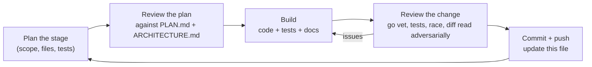
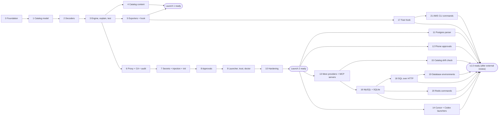

# Opfence build plan

16 Oct 2026 · how the work in [PLAN.md](PLAN.md) gets built, stage by stage. Design detail is in [ARCHITECTURE.md](ARCHITECTURE.md).

## How each stage runs

Every stage goes through the same loop, and the stage table below is updated as each one closes.

A stage is done only when: `go build ./...`, `go vet ./...` and `go test -race ./...` pass; new code has tests; ARCHITECTURE.md matches what was built; and the stage's exit criteria below are met.

Work lands on the branch `claude/opfence-build-u92kub` with one pull request into `main`; each stage is one or more commits on it.

## Review of PLAN.md (16 Oct 2026)

The plan is sound: the catalog-first order, the threat model and the two-launch strategy hold up. The review found gaps that would have caused rework later. Each is resolved in ARCHITECTURE.md; the owner delegated these calls ("choose what is best for the product").

| # | Gap in PLAN.md | Resolution | Where |
| --- | --- | --- | --- |
| 1 | Review suggestion 1 (classify every operation, not only dangerous ones) was still pending | Adopted. Provider `defaults` classify unlisted GraphQL queries and safe HTTP methods; explicit rules override; everything else is `unknown` | ARCHITECTURE §4.2 |
| 2 | Approvals are shown as a terminal prompt, but during `opfence run -- claude` the agent's TUI owns the terminal | Desktop dialog plus `opfence approve` over a control socket; terminal prompt dropped | §8.5 |
| 3 | Claude Code docs: a sandboxed command can use **both** proxy ports, and setting only `httpProxyPort` leaves SOCKS uncontrolled | Runner listens on both and sets both ports | §8.2 |
| 4 | Claude Code treats hook exit 1, crashes and timeouts as "carry on" | Hook exits 2 on any internal error | §7 |
| 5 | "Repository policy can only tighten" had no merge rule | Defined: `final = max(user-effective, repo)`, also for environment mappings | §5.3 |
| 6 | Unmapped environment was undefined (a Railway `volumeDelete` carries only a volume id) | Defaults to production; `explain` says how to map ids; runner lookups later | §5.1 |
| 7 | Some operations are dangerous only with certain arguments (RDS final snapshot, `execute_sql`) | Declarative `when` conditions and `classify: {sql: arg}`; exporters use the strictest outcome | §4.4 |
| 8 | gitleaks as a dependency is heavy, and only catalogued providers can be injected anyway | Catalog-driven discovery (`detect.env`, token prefixes) | §2 |
| 9 | A per-session proxy token cannot be passed through Claude Code's `httpProxyPort` | Dropped; placeholders are random per install and host-bound, listener is localhost-only | §8.4 |
| 10 | Force-push detection over git smart HTTP needs the object graph, which a proxy does not have | Ref deletion and pushes to configured protected branches are detectable; plain force-push is documented as a gap, covered by GitHub branch protection | stage 10 |
| 11 | `opfence run` modifying the user's Claude Code settings files is fragile and leaves residue | Pass everything with `claude --settings <json>`, a trusted scope for proxy ports and credentials | §8.7 |
| 12 | Phase 0 (interviews, maintainer outreach) can't be done by Claude | Drafts in [docs/outreach/](outreach/); the owner sends them. Building does not wait on them | stage 0 |

Not changed: Go; Apache-2.0; OpenShell, Claude Code and MCP annotation exporters for Launch 1; Agent Vault dropped; runner replaces Claude Code's proxy; one repository until Launch 1.

## Stages

| # | Stage | Delivers | Exit criteria | Status |
| --- | --- | --- | --- | --- |
| 0 | Foundation | Go module, CLI skeleton (`opfence version`), Makefile, CI (build, vet, test, race, lint), LICENSE, README, SECURITY.md, CONTRIBUTING.md, outreach drafts | CI green on the PR | done |
| 1 | Catalog model | `classes`, `catalog` types, strict YAML loader, validator, JSON Schema, embedded catalog, `opfence catalog validate` and `catalog list` | Validator rejects every invalid case in its table tests; schema test passes | done |
| 2 | Decoders | `request` (fixture parser, body limits, gzip/deflate), `decode` rest, graphql, mcp, aws, sql; fuzz targets | Decoder tests incl. aliases, fragments, batches, variables, JSON-RPC batches, AWS JSON + Query; fuzzers run clean for 60 s each | done |
| 3 | Engine, explain, test | `catalog.Match`, `policy` (opfence.yaml, environments, table, merge), `engine`, `opfence explain <file.http>`, `opfence test` | PocketOS fixture explains as irreversible/confirm in production; tighten-only merge tests; `opfence test` fails on a deliberately broken rule | done |
| 4 | Catalog content | 60+ rules across Railway, Vercel, Supabase MCP, GitHub, AWS, each from a primary source and with a fixture | `opfence test` passes; every `verified` rule has a source and date | done (445 rules) |
| 5 | Exporters + hook | `opfence export --target openshell / claude-code / mcp-annotations`; `opfence hook claude-code` | Golden tests; hook tests incl. fail-closed; OpenShell output matches its published schema | done |
| 6 | Proxy + CA + audit | CA generation, leaf cache, HTTP CONNECT + SOCKS5 listeners, MITM with HTTP/1.1 + HTTP/2, strict/open modes, enforcement (deny/allow; ask = deny until stage 8), audit log with hash chain, `opfence proxy`, `opfence log` | End-to-end test: PocketOS request blocked and upstream never contacted; allowed request reaches a TLS upstream; `log --verify` detects tampering | done |
| 7 | Secrets + injection + init | Store interface + keychain backend, placeholders, host-bound injector, response scrubber, `opfence init` (catalog-driven discovery in `.env` and MCP configs), `opfence secrets list/rm` | Placeholder never injected to a foreign host; scrubber removes echoed keys; init rewrites a sample repo correctly | done |
| 8 | Approvals | Grants bound to request hash, timeouts, desktop dialog channel, control socket + `opfence approve`, confirm-by-typing, scoped grants | Grant for A can't be replayed for B; timeout denies; confirm requires the resource name | done |
| 9 | Launcher, trust, doctor | `opfence run -- claude` (settings via `--settings`), srt wrapper, weak mode, `opfence trust` / `--uninstall`, `opfence doctor`, CA env vars | Settings golden test; doctor reports each check; trust manifest reverses cleanly | done |
| 10 | Hardening | SigV4 re-signing, git smart-HTTP ref decoding, longer fuzzing, GoReleaser config, docs ("What this does not protect against") | No known high-severity issues; release dry-run builds macOS and Linux binaries | done |
| 11 | Postgres parser | `decode.ClassifySQL` on a real Postgres grammar instead of the keyword tokenizer | Every tokenizer case keeps its class or gets a stricter, correct one; cases the tokenizer got wrong are fixed; unparsable SQL and unhandled statement types are unknown; the hook starts in milliseconds; fuzzer clean | done |
| 12 | Phone approvals | ntfy channel: push with Approve / Deny action buttons, answers verified before they count | An answer for request A cannot approve B; a forged or replayed answer is refused; confirm still needs the typed name; works with ntfy.sh and a self-hosted server | done |
| 13 | More providers and MCP servers | Catalog to 15 providers and 25 MCP servers, each rule checked against the provider's own schema | Every rule has a fixture; `opfence test` green; source check passes | done (13a to 13e) |
| 14 | Cursor and Codex | `opfence run --srt` presets for Cursor's CLI agent and Codex CLI, their MCP configs in `init` | Each starts behind the proxy in srt with keys as placeholders; doctor probe passes inside | done (Codex checked end to end; Cursor and Gemini from docs) |
| 15 | Catalog drift check | `opfence catalog check-sources` compares rules with providers' published schemas; nightly job | A renamed or removed operation fails the job | done |
| 16 | MySQL and SQLite | SQL classifiers for MySQL (Vitess) and SQLite (libSQL, D1), `classify.dialect`, libSQL HTTP bodies | D1, Turso and PlanetScale reads are reads; every Postgres case keeps its class; each dialect's lexing traps tested; fuzzers clean | done |
| 17 | Fast hook | The hook loads provider metadata and only the rules of the provider a call reaches | Hook decisions identical to a full load for every MCP fixture; the hook reads one provider's rule files; a hook call well under 100 ms | done |
| 18 | SQL over HTTP | Neon's serverless driver and PlanetScale's database-js decided by their SQL; `label.*.suffix` host patterns; `database_ports` | A `SELECT` sent by either driver is a read and a `DROP` irreversible; Postgres, MySQL and Neon's WebSocket connections behave as before in both modes | done |
| 19 | Database environments | `header_args`: the database a Neon or PlanetScale HTTP query reaches, without its password, as the resource | A mapped Neon endpoint or PlanetScale username decides as development; no password in cards, block messages, `explain` or the audit log | done |
| 20 | Redis commands | `decode.ClassifyRedis` from Valkey's command table plus reviewed overrides; `classify: {redis: …}`; Upstash's command tool decided per command | `GET` is a read, `DEL` a delete, `FLUSHALL` irreversible, `EVAL` unknown; every Valkey command classified; the table regenerates from source | done |
| 21 | AWS CLI commands | `classify.aws_cli`: AWS API MCP's `call_aws` decided by `catalog/aws`'s rules, from awscli 1.46.0's own command table | `aws s3api list-buckets` a read, `aws rds delete-db-instance --skip-final-snapshot` irreversible with its resource, environments and overrides of `aws.*` applied; every `catalog/aws` rule reachable from the CLI | done |
| 22 | Catalog gaps | The follow-ups earlier stages left: HashiCorp's Terraform MCP server, Stripe Connect OAuth, Heroku's Data API, a default class for MCP servers whose tools the user names, the Copilot API on GitHub's MCP host, Atlas App Services, Cloudflare's uncovered families | Each gap has rules from the provider's own source or spec, every rule a fixture; `opfence test` and the source check green | done (22a to 22g) |
| 23 | Smaller fixes | Tokens a hosted MCP server shares with its vendor's API (`secrets_from`), more SQL tautologies, an optional button-only ntfy token, providers loaded on first use in the proxy | A Stripe key reaches mcp.stripe.com; `DELETE … WHERE x LIKE '%'` is irreversible in every dialect; pushes carry no publish token; the proxy starts without parsing every rule | done (23a to 23d) |
| 24 | Documentation site | `tools/sitegen` builds a static site from the docs and the catalog, with a quick start guide and a page per provider; GitHub Pages workflow | Every page, asset and in-site link resolves in CI; the home page's examples are decided by the engine when the site is built; the catalog is searchable with no server | done |
| 25 | Clearer approval cards | Cards of rules that read SQL say what the SQL does, from its parse | A `DELETE` with no limiting `WHERE` says `(every row)` exactly when it is irreversible, in every dialect; no SQL text, and so no comment, reaches a card | done (25a) |
| 26 | Supabase's own APIs | The Management API (`api.supabase.com`), which the Supabase CLI and the local MCP server call; then each project's API (`<ref>.supabase.co`): rows through PostgREST, storage, auth admin, edge functions | Every Management API operation that is not a GET has a rule with a fixture, and the GETs that return secrets are credential; the source check passes; a PostgREST `DELETE` with no limiting filter is irreversible | done (26a, 26b) |
| 27 | Google Cloud | Rules generated from Google's discovery documents, starting with the services where one call destroys data or hands out keys, then Compute, GKE, Cloud Run, BigQuery and the rest; gcloud working under `opfence run`; keys kept from the agent | Every method that is not a GET, and every GET that returns a secret, has a rule with a fixture; the source check passes for each API; real gcloud commands are decided through `opfence run` | done |
| 28 | WebSocket inspection | Upgrades on catalog hosts decided by rules and relayed by Opfence message by message: GraphQL subscriptions (Railway's CLI), Postgres over WebSocket (Neon's `Pool` and `Client`), Supabase Realtime, libSQL's Hrana over WebSocket | `railway logs` works behind Opfence and a mutation sent over its socket is decided as one sent over HTTP; a `DROP TABLE` through Neon's `Pool` is blocked before it leaves the machine while a `SELECT` returns its rows; every message of each protocol is decided or passed by name, anything else is unknown | done (28a to 28c) |
| 29 | GitLab | gitlab.com's REST API from GitLab's published OpenAPI description, git over HTTPS with nested groups, the OAuth token endpoint, and GitLab's own MCP server on the same host | Every REST operation that is not a GET has a rule with a fixture, and the GETs that return secrets are credential; the source check passes; a `.json` suffix cannot dodge a rule; real `glab` commands are decided through `opfence run` | done (29a, 29b) |
| 32 | Agent setup and packaging | MCP tool calls of Cursor's and Gemini CLI's local servers decided by their hooks; `opfence setup` adds Opfence's hook to Claude Code's, Cursor's or Gemini CLI's settings in one command; a Homebrew formula; the catalog generators in the repository | Each hook's decisions tested over the embedded catalog; real Gemini CLI asks, denies and allows through the hook in and out of `opfence run`; setup keeps every other setting and undoes cleanly; `brew install` builds a working binary; each generator reproduces its provider's files | 32a done |

v1.0 also needs an external security review of the proxy and approver (PLAN.md phase 5), which the owner arranges, and the catalog split into its own repository, which needs the owner's GitHub account. What only a Mac, signed-in agents and a phone can check (the macOS sandbox and keychain, desktop dialogs, Cursor and Gemini CLI, phone approvals through ntfy.sh, publishing the site) is listed in [MAC_CHECKS.md](MAC_CHECKS.md).

Stages 4 and 5 can interleave; stage 6 does not depend on 4 or 5. The order above front-loads Launch 1 (catalog + exporters), matching PLAN.md's roadmap.

### What each stage review checks

- **Plan review:** does the stage serve a user story in PLAN.md; does it contradict ARCHITECTURE.md; is anything in it speculative (cut it); are tests named before code.
- **Change review:** `gofmt`, `go vet`, `go test -race`; fail-closed paths covered by tests; no agent-controlled text reaches a decision or card unlabelled; no secret written to disk or logs; new dependencies justified in ARCHITECTURE.md §2; docs updated.

## Stage log

Each closed stage gets a short entry: what shipped, what changed from the plan, and follow-ups.

**Stage 0 · Foundation (done 16 Oct 2026).** Go module, cobra CLI with `opfence version`, Makefile (`check`, `lint`, `fuzz`), CI on Linux and macOS, licence and project docs, outreach drafts. Changed from plan: minimum Go is 1.26, because Go 1.27 is current and 1.25 no longer gets security fixes.

**Stage 1 · Catalog model (done 16 Oct 2026).** `internal/classes`, `internal/catalog` (types, strict loader, validator with 40 table-tested failure cases, REST path templates with normalisation), JSON Schemas with a test that keeps them in step with the loader, the embedded catalog, and `opfence catalog validate | list | providers` with a global `--catalog DIR`. The first real rule, `railway.volume.delete`, is checked against Railway's public GraphQL schema (the mutation exists and takes `volumeId`), which settles the open question in PLAN.md's review notes. Added beyond plan: `notes` on rules, wildcard host overlap checks, and the rule that `draft` rules don't drive decisions.

**Stage 2 · Decoders (done 16 Oct 2026).** `internal/request` (fixture parser, live-request reader, gzip/deflate with a decompressed-size cap, path normalisation) and `internal/decode` (REST, GraphQL via gqlparser, MCP JSON-RPC, AWS SigV4 with an S3 resolver, SQL tokenizer-classifier). Four fuzz targets ran 60 s each; the fixture fuzzer found one bug (an empty host from `A://.`), fixed and kept as a regression seed. The change review found and fixed a real bypass: an agent could add `?Action=ListBuckets` or `X-Amz-Target` to an S3 or Lambda delete, which those services ignore, to make it look like a read. S3 is now resolved only from method, bucket, key and sub-resource; JSON protocol only counts on `POST /`; Query protocol only on `/` for known Query services. Also added from review: method-override headers, duplicate-key rejection in JSON, and evaluating every GraphQL operation in a document. The catalog gained `aws: {service, method, path}` matchers and an `aws_read_actions` default.

**Stage 3 · Engine, explain, test (done 16 Oct 2026).** Catalog matching (host lookup with wildcards, REST specificity with a positional tie-break, GraphQL, MCP, AWS action and method+path), provider defaults, `when` conditions and SQL classification; `internal/policy` (strict `opfence.yaml` and user config, the default table, tighten-only merge for decisions, rule overrides, environment mappings and every other setting); `internal/engine` (evaluations, strictest decision, sanitised cards, a hash bound to operations and body bytes); `internal/fixture`; and the commands `opfence explain [--json]`, `opfence test` and `opfence policy check`, with global `--policy` and `--user-config`. The PocketOS replay explains as `irreversible`, production by default, `CONFIRM`. Added beyond plan: `trust_repo` for teams that want repository id mappings honoured, and case-insensitive condition matching after the review noticed `SkipFinalSnapshot=True` would have slipped past `equals: "true"`.

**Stage 4 · Catalog content (done 16 Oct 2026).** 445 verified rules with 496 fixtures: Railway 72 (GraphQL), Vercel 70 (REST), Supabase MCP 33 (every tool the server ships), GitHub 134 (REST and GraphQL) and AWS 136 (RDS, S3, EC2, IAM, STS, CloudFormation, Secrets Manager, SSM, KMS, DynamoDB, Lambda, Route 53). Every rule was written against the provider's own machine-readable source (Railway's introspection dump in its CLI, the OpenAPI spec the Vercel SDK is built from, the Supabase MCP tool definitions, GitHub's OpenAPI description and GraphQL schema, botocore's service models), and a script checked each operation, path, method and argument name against that source before any fixture was written; it caught wrong argument names and a Route 53 URI parameter. The judgement calls are written down as conventions in ARCHITECTURE.md §4.5. The rule review changed the engine in four places: a condition now holds if any element of a list matches (a repeated `?decrypt=false&decrypt=true` used to slip past `equals: "true"`); an explicit `null` counts as present (`"ssoProtection": null` turns Vercel protection off and was being classified as a plain write); every matching `when` entry adds its class instead of only the first, so entry order can't hide a stricter class; and Query-protocol list parameters (`InstanceId.1`, `Tags.member.1.Key`) decode into lists that rules and cards can name. Vercel rules match any version prefix, because older versions of an endpoint keep working. Follow-ups: record the Vercel and Railway CLIs' real traffic once the proxy exists (stage 6), to catch undocumented endpoints that return secrets behind a `GET`; turn the source check into a Go command (`opfence catalog check-sources`) for the nightly drift job in PLAN.md.

**Stage 5 · Exporters and hook (done 16 Oct 2026). Launch 1 ready.** `internal/export` (OpenShell network policies per environment, a Claude Code settings fragment, MCP tool annotations), `internal/hook` (the Claude Code PreToolUse hook for MCP tools), and the commands `opfence export --target openshell | claude-code | mcp-annotations` and `opfence hook claude-code`. Formats were checked against the current OpenShell schema reference and Claude Code hook and permission docs on 16 Oct 2026. Changed from the plan after checking those docs: Claude Code applies ask and deny rules over a hook's allow, so the static rules now hold only each tool's floor decision (what it gets for every argument in every environment) instead of the strictest production class, which would have prompted for every `SELECT`; the hook is installed with `onFailure: "block"` because Claude Code otherwise lets a crashed or timed-out hook through. The review of the OpenShell output found that a broad default allow (every GraphQL query, `GET /**`) or an overlapping allow glob would let through operations Opfence only asks about, so those are now written as deny rules with a comment saying why; argument-dependent rules that can be denied are denied outright, also with a comment. AWS is not exported to OpenShell (the action is in the body or a header). Added beyond plan: `opfence policy check` warns about rule overrides, mappings and aliases that match nothing in the catalog, after a test showed a typo'd rule id silently did nothing. Follow-ups: OpenShell has no ask, so its export is stricter than the engine for argument-dependent rules; `opfence run` (stages 6 to 9) is the precise path.

**Stage 6 · Proxy, CA and audit log (done 16 Oct 2026).** `internal/ca` (name-constrained P-256 root, cached 24 h leaves), `internal/proxy` (HTTP CONNECT and SOCKS5 front ends sharing one router, TLS interception for catalog hosts served by one HTTP/2-capable server, streaming forwarding, an `Approver` interface with a deny-all default), `internal/audit` (hash-chained JSONL with a file lock and a verifier), and the commands `opfence proxy` and `opfence log [--verify]`. The PocketOS replay is blocked over HTTP/2, HTTP/1.1 and SOCKS5 with the upstream never contacted; an allowed query reaches a TLS upstream with its path, query, body and auth header unchanged and proxy headers stripped; a real `curl` run gets the 403 card. The change review closed four ways around the proxy, each now with a test: a passthrough tunnel carrying TLS for an API host (on a shared CDN that reaches the API uninspected), so every 443 tunnel must be TLS with a matching server name; a tunnel to an IP address, now decided and dialled by its server name; a request whose `Host` differs from the TLS name (now `421`); and tunnels to loopback, private or metadata addresses, refused after DNS resolution in every mode. A fuzz target found that SOCKS accepted an empty host name, now rejected. Added beyond plan: blocked MCP calls answer with a JSON-RPC error the model can read; a built-in passthrough list of package registries so strict mode stays usable (`passthrough_defaults: false` turns it off; only the user config can add hosts); the audit log omits query strings. Changed from plan: the CA lives for one run and only its certificate is written to disk, until the keychain arrives in stage 7. Known gaps, documented in ARCHITECTURE.md §8.2: `git push` to github.com is tunnelled uninspected until stage 10, non-443 tunnels are not inspected, and fronting by the encrypted `Host` header inside a passthrough tunnel cannot be seen (it gains nothing once stage 7 keeps real keys out of the agent).

**Stage 7 · Secrets, injection and init (done 16 Oct 2026).** `internal/secrets` (a `Store` interface with the OS keychain through go-keyring and an in-memory store for tests, a vault with an index item, shape-keeping placeholders, discovery and atomic rewrites), `internal/inject` (header, query and Basic auth injection bound to the provider, and a streaming scrubber), proxy wiring, the CA kept in the keychain, and the commands `opfence init [--yes] [--undo]` and `opfence secrets list | rm`. Exit criteria met by tests: Railway's placeholder sent to Vercel reaches Vercel unchanged and is flagged in the audit log; Vercel's placeholder reaches Vercel as the real key; both real keys echoed back, in plain and gzip responses and in headers, reach the client as placeholders; an undecodable response is refused; a sample repository with `.env` files in several folders, templates, `node_modules`, comments, quotes, CRLF, references, escapes, AWS keys and an MCP config is rewritten with every other byte kept, a second run changes nothing, `--undo` restores it byte for byte, and a failing keychain leaves every file untouched. Changed from plan: placeholders keep the real token's length, prefix and alphabet instead of `opf_<provider>_<random>`, because format-checking clients broke and same-length swaps keep bodies valid; keys in MCP configs are reported but left in place, because MCP servers do not reach their APIs through the proxy yet and a placeholder would break them. Follow-ups for stage 9: route MCP servers' and Claude Code's own MCP traffic through the proxy, then let `init` move those keys; `opfence run -- <command>` for the user's own tools; deny the sandbox the D-Bus socket and check keychain reachability in `doctor`.

**Stage 8 · Approvals (done 16 Oct 2026).** `internal/approve` (a broker that holds requests, single-use answers, typed confirmation, scoped grants, timeouts and a cap on waiting requests; desktop dialogs through osascript, zenity or kdialog; a `0600` control socket), the proxy wired to it, and `opfence approve` (interactive in a second terminal, or `--list`, `ID --yes [--typed] [--for]`, `--deny`). Exit criteria met by tests: an answer for request A leaves B waiting until it times out, and replaying A's answer does nothing; a request nobody answers is denied at the timeout; confirm accepts only the exact resource name (not a prefix, not another case), over the socket and in dialogs, and is never scopable; a scoped grant covers the same rule, resource and environment only, and expires. A manual run held the PocketOS call until `opfence approve ID --yes --typed vol-pg-data`. The review made the dialogs pass the card as an argument instead of script source (a card can hold quotes), escape zenity's markup, default every dialog to Deny, and refuse scoped grants for unknown operations as well as credential and confirm ones. Changed from plan: answers name one waiting request rather than creating a reusable grant keyed by hash, so a retry after a timeout is asked again. Follow-ups for stage 9: deny the sandbox the state folder (control socket, audit log) and check it in `doctor`.

**Stage 9 · Launcher, trust and doctor (done 17 Oct 2026).** `internal/launch` (Claude Code `--settings` and srt settings, CA files, the child's environment, environment keys turned into placeholders), `internal/trust` (CA install and uninstall with a manifest), and the commands `opfence run -- claude`, `opfence run --srt | --weak -- COMMAND`, `opfence trust [--system] [--uninstall]` and `opfence doctor [--probe]`; `opfence approve` now works across sessions. Settings were checked against Claude Code's current sandbox docs on 16 Oct 2026, and the srt file against the real `srt` (which rejected a file without `network.deniedDomains`). Exit criteria met by tests: golden settings for Linux, macOS and srt; doctor reports each check; trust install and uninstall leave the files as they were and run the mirror-image commands. `opfence run --weak` runs the test binary as its child, which sees a placeholder for its `VERCEL_TOKEN`, Opfence's proxy and CA, and runs the doctor probe, which (unsandboxed) finds the approval socket, state folder, config folder and a direct connection reachable. A manual run under the real sandbox runtime (`opfence run --srt -- opfence doctor --probe`, bubblewrap on Linux) passed every check, held a Railway volume delete sent with curl for approval, and refused example.com in strict mode. A run of the real Claude Code was not done here, because the only Claude Code in this environment is the session's own account. The review added a second, open **agent listener** for Claude Code itself and its MCP servers (they run outside the sandbox, so strict mode would only break them), session placeholders for keys found in the environment, per-session control sockets, a warning when an upstream `HTTPS_PROXY` is replaced, and quieter environment warnings. Changed from plan: `sandbox.credentials` deny entries were dropped, because placeholders keep tools working where denying would break them; GitHub tokens in the environment stay real until git traffic is decoded; init now moves keys in Claude Code's MCP configs but not in Cursor's or VS Code's. Follow-ups: forward to a corporate proxy; check on macOS that the sandbox cannot reach the keychain (doctor reports it); a cgo keychain backend if it can.

**Stage 10a · AWS re-signing (done 17 Oct 2026).** `inject.SigV4` re-signs requests made with a placeholder AWS key ID, with the real key, secret and session token, over exactly what is forwarded; `init` and `opfence run` now turn AWS keys into placeholders, paired by the new `Group` field. Fails closed on chunk-signed uploads, presigned URLs, SigV4A, large bodies without a hash header and unpaired keys. Tested against an independent verifier written from AWS's documentation (DynamoDB, STS, EC2, S3 GET and streaming PUT), end to end through the proxy. Change review: signing only the client's signed headers that are still present also fixes a latent break, where the scrubber's removal of `Accept-Encoding` would have invalidated a signature that covered it. Not covered: keys the AWS SDK reads itself (`~/.aws/credentials`, SSO, roles) stay real; `init` does not read `~/.aws`.

**Stage 10b · git over HTTPS to github.com (done 17 Oct 2026).** github.com left the passthrough list and joined the GitHub provider (`git: [github.com]`, Basic-auth password injection). A `git` decoder reads smart HTTP (fetch, ref listing, one operation per ref update in a push, read from the body's first 64 KiB even when the pack is larger) and the Git LFS batch and locks APIs; a `git` catalog matcher with optional `refs` patterns; 12 verified GitHub rules with 15 fixtures (457 rules in all); OpenShell export for git routes; GitHub tokens in the environment now become placeholders, which removed the last "kept real" case. Tested with a fuzz target (60 s, no findings) and end to end with the real git client against git's own `http-backend` behind the proxy: clone, a 2 MB push (probe plus streamed pack) put to the approver once, and a refused branch delete that never reaches the repository. Change review added: a blocked push answers with git's report-status, so git prints `[remote rejected] (Blocked by Opfence: …)` instead of "RPC failed; HTTP 403"; SSH to github.com is refused and documented. Gaps: force pushes look like fast-forwards (the default branch and tags assume the worst), signed pushes fail closed, GitHub Enterprise hosts need their own provider entry.

**Stage 10c · Corporate upstream proxy (done 17 Oct 2026).** `proxy.Upstream`: with `HTTPS_PROXY` set when Opfence starts, every upstream connection goes through it with `CONNECT` (Basic proxy auth, `https://` proxies, `NO_PROXY` bypass); `opfence run` and `opfence proxy` read it before pointing the child at Opfence, replacing the old "connects directly" warning with a banner line. Tested with a fake authenticating proxy (intercepted requests and tunnels both go through it with credentials, private IP literals never reach it, its refusals are logged), and by hand through this build container's real egress proxy. Found while testing: a control socket path over the 104/108-byte Unix limit fails with a bare "invalid argument"; fixed in 10d.

**Stage 10d · Release, limits and security review (done 17 Oct 2026).** GoReleaser builds macOS and Linux (amd64, arm64) and Windows (amd64) archives with checksums and a draft release; tags run `release.yml`, which adds GitHub build provenance; `nightly.yml` fuzzes for five minutes per target, runs `govulncheck` and a release dry run. `docs/LIMITS.md` lists what Opfence does not protect against, linked from the README. A control socket path too long for Unix sockets now fails with a message naming `XDG_STATE_HOME`.

Two independent security reviews (proxy and injection; launcher and approvals) found 15 issues, all fixed with tests:
- High: an `X-HTTP-Method-Override` could make a `DELETE` look like a `GET` (both methods are now decided, and a `Connection` header naming other headers is blocked); a JSON body sent as `text/plain` skipped body rules (JSON is parsed whatever the type; other bodies fail body rules closed); in srt mode the agent could write the project's `.claude/settings*.json`, whose hooks run unsandboxed (now denied for writes in both modes); a project's settings could point the hook at another config through `OPFENCE_CONFIG` or turn hooks off (the config is passed by absolute path, and `--settings` pins `disableAllHooks: false` and the environment).
- Medium: AWS re-signing for customer-run hosts (API Gateway, load balancers, EC2 names, VPC endpoints) is refused; grants now bind every operation, so approving a delete of one branch for 10 minutes never covers another; resources are sanitised before prompts show them; built-in passthrough hosts get port 443 only; SOCKS host names are validated and `opfence log` and `opfence init` sanitise what they print.
- Low: `1xx` responses and trailers are scrubbed, as are URL- and base64-encoded keys; `Range` is dropped on non-AWS APIs; at most four AWS bodies are buffered for re-signing at once; every key in a variable holding several is replaced; `opfence run` hides its environment (`PR_SET_DUMPABLE`, `Read(//proc/**)` denied); dialogs open one at a time with the strictest operation first.

**Stage 11 · Postgres parser (plan, 17 Oct 2026).** The v0 classifier reads SQL as keywords. It is careful, but keywords cannot see structure: a `WHERE id = 5 OR true` deletes every row yet has a `WHERE`; dangerous functions are only caught in `SELECT`; a statement shape it did not expect is guessed from its first word. The plan:
- Parser: [multigres](https://github.com/multigres/multigres)' `go/common/parser`, a Go port of Postgres' own grammar (`gram.y`) by Supabase, Apache-2.0, pure Go, one small dependency. Measured here: 0.2 ms to parse, a 4 ms process start. Rejected: `pg_query_go` (cgo, which breaks the static cross-compiled binaries), `go-pgquery` (Postgres' parser in WebAssembly: 1.5 s to start each process, and the hook is a process per MCP call), the CockroachDB-derived parser (a different dialect).
- Fail closed: a parse error is `unknown`; every statement type is listed explicitly and anything unlisted is `unknown`.
- Same table as ARCHITECTURE §3.4, with what structure adds: a `WHERE` that is constant, or has a constant branch at the top of an `OR`, counts as no `WHERE`; dangerous functions are caught anywhere in a statement (`INSERT … VALUES (pg_terminate_backend(1))`); data-modifying CTEs at any depth; `ALTER TABLE` read per subcommand; `CREATE FUNCTION … SECURITY DEFINER` is `access`; `PREPARE` is classified by the statement it prepares.
- Tests: all current cases kept, plus the cases above; the fuzzer keeps running.
- Plan review: serves the Supabase `execute_sql` story in PLAN.md (the most common way an agent wipes a database); does not contradict ARCHITECTURE (which already says a real parser replaces v0); nothing speculative. Risk: a young library. Mitigated by failing closed on anything it does not parse or we do not list.

**Stage 11 · Postgres parser (done 17 Oct 2026, PR #2).** `decode.ClassifySQL` now classifies multigres' parse tree as planned. Every tokenizer case kept its class or got a stricter one; the hook still starts in about 55 ms; the binary grew by about 6 MB. An independent adversarial review found no misparse but seven gaps in what the classifier looked at; six were fixed with tests: triggers take the class of their function (unknown unless the batch defines it); `WHERE id IS NOT NULL` and `WHERE id = id` no longer limit; `ALTER COLUMN … TYPE … USING` is irreversible; `request.jwt.*` settings (Supabase RLS impersonation), privileged `set_config`, `ALTER DATABASE … SET row_security`, `RESET ALL` and `DISCARD ALL` are access; SQL over 1 MB is unknown without parsing (deep nesting can overflow the stack). Kept as is: `ALTER PUBLICATION … DROP TABLE` and `ALTER EXTENSION … DROP` are writes, since neither deletes data. Follow-up: other tautologies (`WHERE id > 0 OR id <= 0 OR id IS NULL`) still count as limiting, listed in LIMITS.

**Stage 12 · Phone approvals (plan, 17 Oct 2026).** Desktop dialogs and `opfence approve` need the human at the computer; an agent left running gets every `ask` denied after a minute. ntfy (free, no account, self-hostable, Android, iOS and web apps) delivers a push with buttons. Checked against ntfy's docs: up to three action buttons; an `http` action makes the phone send a request (method, headers, body) when tapped; a message can be deleted later by its sequence id; no action can take typed text; ntfy.sh allows 250 messages a day per visitor.
- Setup: `opfence phone setup [--server URL] [--token tk_…]` makes two random topics (a push topic the phone subscribes to and a reply topic only Opfence reads), stores them with the server and token in the keychain (never in a config file the agent can read), prints a QR code and link to subscribe, then sends a test push and waits for its button to be tapped, so a working round trip is proven before it is relied on. `opfence phone test`, `opfence phone off`. Once set up, the phone joins the default channels.
- Each pending request publishes one push (title, cards strictest first, environment, resource, short hash, sequence id = request id) with Deny, Approve and, for scopable `ask`s, Approve for 10 min. Each button posts a fresh random 128-bit token to the reply topic; the token maps to exactly one request and one answer, is forgotten when the request ends, and anything else on the reply topic is ignored. So an answer for A cannot approve B, a deny token cannot approve, and a replay finds nothing waiting.
- Confirm: a phone cannot type, so a `confirm` push offers Deny only and says to approve at the computer by typing the name. The typed-name rule stays whole rather than being weakened to a tap.
- Scope: requests the proxy holds. MCP tool calls the PreToolUse hook decides `ask` still use Claude Code's own prompt, which only the terminal can answer.
- When the request is answered anywhere or times out, the push is deleted from the phone. Publishing failures go to `opfence.log`; the other channels still work.
- The default timeout becomes 90 s when the phone is on (unlocking a phone takes longer than clicking a dialog; Claude Code's Bash tool gives up at 2 minutes).
- Tests: a fake ntfy server in `httptest` plus a simulated phone that taps the published actions; tokens for another request, a deny token used as approve, a replayed token, a forged token and junk on the reply topic are all refused; confirm has no approve button; deletion after answer and timeout; reconnect after the stream drops without missing an answer. A manual round trip against ntfy.sh and a self-hosted ntfy binary.
- Plan review: meets PLAN.md's phone-approval row; ARCHITECTURE §8.5 gains the channel. One change to the stage's acceptance: "confirm still needs the typed name" is kept by not letting the phone approve a `confirm` at all. Risk: the push content (cards, host, resource, never bodies or keys) passes through the ntfy server and, on Android, Google's push service; documented in LIMITS with self-hosting as the answer. The push topic is a bearer secret: anyone who learns it can answer, which is why it lives in the keychain the sandbox cannot read.

**Stage 15 · Catalog drift check (plan, 19 Oct 2026).** Every rule is checked against its provider's published schema the day it lands; providers keep changing. A renamed endpoint leaves a rule that no longer matches anything (the new name is `unknown`, which asks, so nothing is waved through, but the card loses its description and the class its precision); a new destructive endpoint goes unlisted. The check makes both visible the night they happen:
- A provider may list the schemas its rules were built from: `schemas: [{kind, url, prefix, coverage}]`. Kinds: `openapi` (OpenAPI 3 and Swagger 2, JSON or YAML, with the base path from `basePath` or the first server URL unless `prefix` overrides it), `graphql` (SDL or introspection JSON), `heroku` (JSON hyper-schema links) and `botocore` (an AWS service model, with `service` naming the SigV4 service its rules match).
- `opfence catalog check-sources` downloads each schema and reports, per provider, **stale** rules (a REST rule whose method and path template overlap no operation of the schemas, a GraphQL rule whose field is not in the schema, an AWS rule whose action or path is not in the service model) and **uncovered** operations (a non-GET operation, mutation or non-read AWS action that no rule matches). Stale always fails. Uncovered fails for `coverage: full` providers (those whose rules claim every write, which is most of them) and is listed for `coverage: partial` ones (Cloudflare, GitHub, AWS, whose rules cover the risky families only).
- A rule for an operation that its provider's schemas leave out on purpose (a CLI-only endpoint, an older schema version) says why in `unlisted: <reason>`, and is exempt; the check reports when such an operation appears in the schema, so the exemption can go.
- Matching reuses the engine's path templates: a rule and a schema operation overlap when either one's template matches the other's path with sample values in place of its parameters, so `/v2/apps/regions` (a literal rule) and `/v2/apps/{id}` (a schema path) overlap both ways.
- The nightly workflow runs it. MCP servers have no machine-readable schema to compare against (their tool lists live in code), so they are out of scope; LIMITS.md says so.
- Plan review: the check reads only public schema URLs and writes nothing, so it can run unattended. Risk: schemas are large (GitHub's is about 12 MB) and slow to parse; downloads are capped at 100 MiB and time out. Risk: a false stale report from a schema quirk; the `unlisted` reason is the documented escape, reviewed like any other rule change.

**Stage 12 · Phone approvals (done 17 Oct 2026, PR #3).** `approve.Phone` and `opfence phone setup / test / off` as planned, with a QR code for the Android app's subscribe link. Tested against a fake ntfy with a simulated phone and against a real ntfy server built from source, with and without a login; ntfy.sh itself is blocked from the build container, so the first run against it is the owner's. The live run found a race: a phone answering before ntfy replied to the publish left the push on the phone, so the publish is no longer tied to the request. An independent review found no way to forge or move an approval and eight robustness and documentation issues, all fixed with tests: requests dropped within 1.5 s are not pushed and pushes are rate-limited, so an agent cannot spend the ntfy quota; oversized reply-topic lines are skipped; the push stays under ntfy's JSON size limit with host, hash and warnings intact; network errors no longer log topic URLs; a scoped approve that loses a race to a deny adds no grant; plain `http://` only on loopback; a repository timeout caps the 90 s phone default. Changed from the plan: none beyond these. Follow-up: an optional button-only ntfy token, so the token Opfence publishes with need not travel in pushes.

**Stage 13 · More providers and MCP servers (plan, 17 Oct 2026).** The catalog is the product: an API it does not know is either blocked (strict mode) or waved through (open mode). Five providers and one MCP server cover the incident stories, not the stacks people run agents on. The plan, in four PRs so each is reviewable:
- 13a databases: Neon, PlanetScale, MongoDB Atlas, Turso, each with its official MCP server.
- 13b hosting: Cloudflare, Fly.io, Render, Netlify, each with its official MCP server.
- 13c money and infrastructure: Stripe, DigitalOcean, Heroku, each with its official MCP server.
- 13d MCP servers for providers already covered (GitHub's, Vercel's, Railway's, AWS's) and widely used ones that can destroy data (Firebase, Upstash, Sentry, Linear, Notion), to reach 25 servers.
- Chosen by how often agents are pointed at them and how much an agent can destroy there: databases first, because a dropped database is the incident this project exists for.
- Same bar as stage 4: every rule checked against the provider's own published schema (OpenAPI files, SDK specs, the MCP server's source), every write, delete, irreversible, money, credential and access operation listed explicitly, reads by provider defaults with explicit `credential` rules for reads that return secrets, every MCP tool of the official server listed, a fixture per rule, conventions from ARCHITECTURE §4.5. A REST API and its MCP server are separate providers (`neon`, `neon-mcp`), as with Supabase, because the proxy sees one and the hook the other.
- Each provider is built in its own folder by a separate worker, then reviewed here against its sources before it lands.
- Plan review: matches PLAN.md's v1.0 target of 15 providers and 25 MCP servers. Risk: breadth invites shallow rules. Mitigated by the same validation as before (`opfence catalog validate`, `opfence test`, a fixture per rule) plus a review of each provider's judgement calls; any rule that cannot be checked against a published source stays `draft` and is ignored by the engine.

**Stage 13a · Databases (done 18 Oct 2026).** Neon (125 rules) and its MCP server (120), PlanetScale (185) and its MCP server (27), MongoDB Atlas (314, every non-GET operation of Admin API v2) and the MongoDB MCP server (53, every tool), Turso (67) and its MCP server (12): 13 providers and 1,360 rules. Each was built by a worker from the provider's own OpenAPI spec or MCP server source and reviewed here. The review changed the engine in four places: `classify.sql` reads a list of statements, each on its own (Neon's transactions were falling back to unknown); a placeholder inside an `<id>:<token>` auth header is swapped (PlanetScale service tokens); a new `empty` condition catches an empty MongoDB filter, which updates every document; and path templates take `{name}:verb` custom methods, so Atlas's `clusters/{name}:grantMongoDBEmployeeAccess` and its kin are exact rules instead of regexes on a captured segment (the OpenShell export widens them to `*` in deny rules, in case a gateway reads wildcards only as whole segments). PlanetScale's MCP SQL tools have fixed classes, because Vitess databases speak MySQL, which the Postgres classifier must not read: read for the read tool (the server uses a read-only role) and irreversible for the write tool (it runs as admin, and its own checks are regexes a leading comment gets past). Follow-ups: a MySQL and a SQLite classifier; one token shared by a REST provider and its MCP server (secrets belong to one provider today); capturing tokens minted by a held secret (Atlas's OAuth exchange) as placeholders, so the exchange need not be `credential`; Atlas App Services (triggers), which has no published spec.

**Stage 13b · Hosting (done 18 Oct 2026).** Cloudflare (977 rules over the API's riskiest families, from its OpenAPI file) and its MCP servers (175 tools across mcp-server-cloudflare and the code-mode server), Fly.io (218: every Machines API mutation and every GraphQL mutation in fly-go's schema) and flyctl's MCP server (60), Render (158, from the clients Render generates from its unpublished spec) and its MCP server (26), Netlify (132, every non-GET in its swagger) and its MCP server (39, every operation of its multi-operation tools): 21 providers and 3,145 rules. The review changed the engine in four places: `.json` tool-call fixtures let rules for MCP servers that run locally (flyctl's) be verified like any other; `graphql_secret_fields` makes a query that selects a secret field at any depth credential (Fly.io's `app { addOns { password } }` was a read), and the OpenShell export no longer allows such a provider's queries wholesale; `multipart/form-data` bodies are read, so a Cloudflare Worker upload that sets a secret binding is credential and one that drops the previous version's bindings is irreversible; and the OpenShell export leaves out a GraphQL endpoint with nothing to allow (and denies GET queries to it) instead of writing an endpoint OpenShell rejects. Netlify's site reads are `credential` because the site object carries the site password and deploy hook; stage 13e is what makes them usable in production. Follow-ups: Cloudflare families not yet covered (Magic, DLP, Cloudforce One, most device endpoints, API Shield) stay unknown; the code-mode server's per-endpoint tools (`?codemode=false`) have no rules.

**Stage 13c · Stripe and Heroku (done 19 Oct 2026; DigitalOcean follows with 13d).** Stripe (362 rules: every POST and DELETE in its OpenAPI file, v1 and v2, on api.stripe.com, files.stripe.com and meter-events.stripe.com) and its MCP server (25 tools from @stripe/agent-toolkit 0.7.12, the last release that defines them locally; the hosted server's three newer tools are draft), Heroku (153 rules: every non-GET link in its v6 hyper-schema) and its MCP server (all 36 tools of @heroku/mcp-server 1.2.12): 25 providers and 3,721 rules. The review changed the engine in one place: Stripe sends nested parameters as bracket keys (`expand[]=number`, `metadata[plan]=pro`), which conditions could not name, so form bodies and query strings now nest them (`query.expand`, `body.metadata.plan`); retrieving an Issuing card is a read unless it expands the card number or CVC, and a name used both as a value and with nested keys fails closed. One class changed in review: setting Heroku config vars is credential plus delete, not irreversible, because each release keeps its config vars and an old value can be read back. Follow-ups: Heroku's Data API (api.data.heroku.com: pg:reset, backups, credential rotation) has no published schema and is not claimed; Stripe Connect OAuth (connect.stripe.com) is not in the spec.

**Stage 13e · Secrets in responses (plan, 18 Oct 2026).** Some reads return secrets alongside ordinary data: Netlify's site object carries the site password, legacy build env values and the deploy hook; Atlas's OAuth exchange returns a fresh access token. Classed `credential`, such reads are denied in production, which breaks everyday tools (the Netlify CLI reads the site before every deploy). Classed `read`, they leak. The proxy can do better than either, because it sees the response:
- A rule may add `response: { redact: [paths], mint: [paths], class: <class> }`. `redact` replaces every string under each JSON path with `"[redacted by opfence]"`; `mint` replaces a token with a fresh placeholder of the same shape and remembers the real value for this session, for this provider, so later requests that carry the placeholder get the real token injected and responses that echo it are scrubbed. `class` is the class when the proxy transforms the response.
- Only the proxy uses `response.class`. The hook, `explain` without `--via proxy`, and every exporter keep the rule's own class, since they cannot touch responses.
- Fail closed: a response to such a rule that is not JSON, is encoded in a way Opfence cannot read, or exceeds the buffer limit is replaced with a 502 that says why. Error responses are transformed too when they are JSON.
- Minted secrets live in memory for the session only and are never written to the keychain.
- Plan review: keeps the class contract (a class describes what the agent can do with what it gets) and the never-looser rule for exports. Risk: a response shape the paths miss (a renamed field) leaks the value; mitigated by naming parent objects (`build_settings`) rather than leaves where the API nests secrets, and by fixtures with recorded responses. Risk: buffering large responses; the limit (8 MiB) is far above these endpoints' responses.

**Stage 13e · Secrets in responses (done 19 Oct 2026).** Built as planned: the `response` block, `inject.Transform`, minting into the session's secret set (now safe for concurrent additions, capped at 10,000) and a scrubber that takes new secrets copy-on-write while responses stream. Netlify's three site reads redact the password, deploy hook, build env values and hook token, and are `read` under the proxy; Atlas's token exchange hands out a placeholder and is `read` there too. Changes from the plan: `explain` always shows the proxy's decision and what it does to the response, since a saved HTTP request is what the proxy decides (there is no `--via proxy` flag); an unsuccessful response that is not JSON passes unchanged instead of becoming a `502`, because an HTML error page carries none of the data a rule describes and replacing it hid the real error; and `opfence test` checks every transform against a recorded response, failing when a path finds nothing. The review found and fixed one bug: a scrubber with no secrets returned past the end of its buffer, which an empty session never reached before because it had no scrubber at all.

**Stage 13d · MCP servers and DigitalOcean (done 19 Oct 2026).** DigitalOcean (449 rules: every non-GET in its OpenAPI spec, with GenAI agent and key reads redacted under the proxy) and its MCP servers (399 tools across the per-service hosted servers), and the MCP servers of GitHub (135, api.githubcopilot.com), Vercel (262, from Vercel's tools reference; the server has no published source), Railway (68 over its hosted, local and legacy surfaces), Firebase (76), Upstash (34), Sentry (66), Notion (80, hosted and local), Linear (33, 18 of them draft because only third-party listings name them) and eight AWS Labs servers (API, Cloud Control, DynamoDB, ECS, EKS, Lambda tool, Aurora PostgreSQL, S3 Tables): 43 providers, 15 APIs and 28 MCP servers, 5,397 rules. The review changed classes in two places: a Firebase deploy is also irreversible, because predeploy and postdeploy hooks in `firebase.json` run as local shell commands outside the sandbox and the agent can edit that file first; and Railway's `update_service` keeps start, build and pre-deploy commands a write, the same power as deploying code. Judgement calls kept: dispatcher tools (Sentry's `execute_sentry_tool`, AWS's `call_aws`) take the class of each tool they name and irreversible otherwise; tools that hand a free-form instruction to another agent (Railway's, Notion's Custom Agents, Vercel's sandbox commands) are irreversible; old Railway MCP releases that pass arguments to a shell unquoted make a shell metacharacter irreversible. Follow-ups: map `call_aws` CLI commands onto catalog/aws's rules (a botocore table per service); a provider-level default class for MCP servers whose tools are named by the user (the Lambda tool server has no rules, so every call is unknown); GitHub's MCP endpoint also serves the Copilot API, which is unknown; a Redis command classifier for Upstash; HashiCorp's Terraform MCP server.

**Stage 15 · Catalog drift check (done 19 Oct 2026).** `internal/drift` and `opfence catalog check-sources [--provider p,q] [-v]` as planned, with `schemas:` on 14 providers (every REST and GraphQL provider with a published schema, AWS as botocore models of its twelve services) and `unlisted:` reasons on 114 rules, most of them endpoints that official CLIs call but the specs omit (PlanetScale's workflows and vtctld, the turso CLI's, flyctl's login) and endpoints removed from the current spec that older API versions still serve (Atlas data lake pipelines and serverless instances). The first run found DigitalOcean's new Insights signals endpoint, now a rule (turning a signal off is a delete). Changed from the plan: OpenAPI operations whose own `servers` are on other hosts are skipped, read from the file an operation's `$ref` points to only when it would otherwise be uncovered (DigitalOcean's inference and agent gateway hosts, and a presigned upload URL); a path item that is itself a `$ref` to another file fails the check, asking for the bundled schema. Vercel and Railway are `coverage: partial` until their remaining writes have rules. Tested with small schemas of every kind and a fake fetcher; the nightly workflow runs the real check. MCP servers are out of scope (their tool lists live in code), as LIMITS says.

**Railway and Vercel at full coverage (19 Oct 2026).** Railway's rules now cover every mutation in its GraphQL schema (240 rules; `config`, `patch` and `secretAccessKey` are secret fields, and service-instance updates that change replicas or regions are money, registry credentials credential) and Vercel's every write in its OpenAPI spec (275 rules), so both are `coverage: full` and the drift check fails on any new write. Vercel keys each project's and alias's `protectionBypass` object by its bypass secrets, so reads that return it were credential, which denies them in production and breaks ordinary project reads. A new response transform, `clear`, replaces a value with the empty value of its type; under `opfence run` those 6 reads are read and the 4 writes that return the project (settings, avatar, microfrontends) are write, while elsewhere they stay credential. Drain reads redact the delivery secret and headers the same way.

**Stage 14 · Codex, Cursor and Gemini CLIs (plan, 19 Oct 2026).** `opfence run --srt -- AGENT` already sandboxes any agent, but in strict mode it refuses the agent's own model backend, so no agent but Claude Code works there today. Read from Codex 0.163.0's source and checked against its binary, from Cursor's SDK and docs (its CLI bundle could not be downloaded here) and from Gemini CLI 0.64.0's source:
- **Presets by command name** (`codex`; `cursor-agent` and `agent`; `gemini`), only under `--srt`, where the whole agent and everything it starts is sandboxed. Each preset adds, for this session only, the agent's backend hosts to the tunnelled list (port 443 with the TLS name checked, like the built-in registries; Cursor pins its certificates, and nothing there is a catalog API), `allowWrite` for its state folder (`~/.codex` or `CODEX_HOME`, `~/.cursor`, `~/.gemini`), and `denyWrite` for the files in it that change what the agent runs or trusts the next time it starts outside Opfence: Codex's `config.toml`, `hooks.json`, `.env` and `requirements.toml` (the user layer holds hook trust), Cursor's `cli-config.json`, `hooks.json`, `mcp.json`, `mcp-approvals.json` and `sandbox.json`, Gemini's `settings.json`.
- **Nested sandboxes off.** srt is the sandbox; Codex's bubblewrap and Cursor's own sandbox cannot run inside it. Codex gets `-s danger-full-access` (its approvals stay on) and Cursor `--sandbox disabled`, unless the user chose a sandbox flag themselves.
- **Environment.** `CODEX_CA_CERTIFICATE` for Codex (it reads its own variable before `SSL_CERT_FILE`); `NODE_USE_ENV_PROXY` and `NODE_EXTRA_CA_CERTS` are already set for Node agents.
- **Codex's MCP servers.** Codex starts stdio servers with a fixed environment that leaves out the proxy variables, so they would fail inside srt. `opfence run` reads the configured servers with `codex mcp list --json` and passes `-c mcp_servers.<name>.env_vars=[...]` with the proxy, CA and placeholder-carrying variables.
- **Codex hook.** Codex runs Claude-style hooks: a `PreToolUse` hook can deny, and a `PermissionRequest` hook can allow or deny an approval prompt (any deny wins). `opfence hook codex` gives both from the catalog: deny where Opfence denies; allow where it allows (no prompt); nothing for ask and confirm, so Codex asks; and deny for ask and confirm when Codex cannot ask (approval policy `never`, reported as `bypassPermissions`). The hooks and their trust are passed with `-c` (Codex ignores hooks without a trusted hash, a SHA-256 of their normalized JSON, which Opfence computes; checked against Codex's own value through its app server), and stdio servers get `default_tools_approval_mode = "prompt"` so a call Opfence asks about reaches the prompt instead of Codex's own auto-approval. Remote servers' traffic goes through the proxy, which decides it with confirm; they are left to it, so nothing is asked twice.
- **Cursor and Gemini hooks are not installed.** Cursor's CLI reads hooks only from files (no flag), its enforcement of `beforeMCPExecution` is unverified, and Gemini's hooks live in `settings.json`; under srt their remote MCP traffic goes through the proxy anyway. Their local MCP servers' tool calls are not decided, which LIMITS says.
- **init** reports keys in `.codex/config.toml` and `.gemini/settings.json` like Cursor's and VS Code's configs, left in place because those files also serve the agent outside Opfence.
- Tests: preset settings golden files; argument building (user sandbox flags kept, flags placed before subcommands); `opfence hook codex` decisions for each event and permission mode; the trust hash against values the real Codex printed; an integration test, run when `OPFENCE_CODEX` names a Codex binary, that asks Codex's app server whether Opfence's hooks are loaded and trusted and its MCP servers get the variables.
- Plan review: meets the stage table's row except "doctor probe passes inside", which needs each agent installed and signed in; the probe itself is agent-independent and already passes under srt. Risk: agents change their config surface often; every flag Opfence passes is checked by the integration test against a pinned Codex, and a Codex that rejects a flag fails loudly at start. Risk: tunnelling an agent's backend means its own traffic (prompts, code) is not inspected, which is the point: Opfence decides cloud API calls, not model calls.

**Stage 14 · done (19 Oct 2026).** Built as planned, with these changes from review:
- Codex's hooks match only its stdio servers' tools (`^mcp__(?:a|b)__`), so remote servers are decided once, by the proxy; the matcher widens to `^mcp__` when the server list cannot be read or a server's name cannot be addressed. The trust hash includes the matcher.
- `opfence init` reads `.codex/config.toml` and, when a JSON config has comments (VS Code and Gemini CLI allow them), the file line by line instead of failing; those files are only reported.
- A nightly `codex` job installs the latest Codex and runs the integration test, so a Codex release that changes hook trust or rejects an option fails the night it ships.
- Running under the real srt showed that a missing guarded path becomes an empty file inside the sandbox, which stopped Codex (`rules` must be a folder) and would stop Gemini CLI (an empty `settings.json` is a fatal error in its source). Missing folders are now created first, missing files are denied only where the agent tolerates an empty one (Codex), and the rest are watched: `opfence run` warns after the session if one was created. Trusted projects' `.codex`, `.cursor` and `.gemini` config files are guarded too, like `.claude/settings.json` for Claude Code.
- Settings are checked in `TestRunSrtCodex` (fake srt and Codex on `PATH`) rather than golden files.
- Checked end to end with the real Codex 0.163.0 exec, a fake model and a fake stdio MCP server through `opfence run --srt`: `select 1` reached the server, `drop table users` was blocked by the hook with Opfence's reason and never reached it. Through the real srt, Codex's app server listed both hooks as trusted with no errors.
- Not done here: Cursor and Gemini were not run (no signed-in accounts); their presets follow their docs and source. The doctor probe inside each agent waits for that.

**Stage 16 · MySQL and SQLite (plan, 21 Oct 2026).** Only Postgres SQL is read today. Six rules run SQL in other dialects and take a fixed class instead: Cloudflare D1's `query` and `raw` and the `d1_database_query` MCP tool (SQLite, irreversible, so every `SELECT` needs the database id typed in production), Turso's database HTTP API (`/v2/pipeline`, `/v3/pipeline`, `/v3/cursor`, the legacy `POST /`; libSQL, unknown, so every read asks), and PlanetScale's `execute_write_query` MCP tool (Vitess MySQL or Postgres, irreversible). The plan:
- **SQLite:** [rqlite/sql](https://github.com/rqlite/sql) (MIT, pure Go, no runtime dependencies), whose stated rule is to accept exactly what the `sqlite3` binary accepts. Two things SQLite's tokenizer does that the library does not are emulated before parsing: SQLite stops reading at the first NUL, so text after one is dropped rather than classified (`DELETE FROM t\0 WHERE id = 1` deletes every row); and SQLite counts non-ASCII spaces (U+00A0 and kin) as identifier characters, so they become a letter.
- **MySQL:** Vitess' parser (`vitess.io/vitess/go/vt/sqlparser`, Apache-2.0), the grammar PlanetScale's vtgate itself parses with; pure Go, 5 ms process start. Versioned comments (`/*!80000 … */`) run only on servers of at least that version, so the SQL is parsed once for each version range its comments name and every reading counts (two readings, oldest and newest, miss `WHERE id = 5 /*!80000 OR TRUE */ /*!90000 AND id = 6 */`). Partially parsed DDL, which vtgate passes on as text, is unknown, and so are statements that change how the server reads later SQL (`sql_mode`, `SET NAMES`, character sets).
- **Classes** follow ARCHITECTURE §3.4 in both dialects, including the limiting-`WHERE` rule. MySQL adds: `INTO OUTFILE`/`DUMPFILE`, `LOAD DATA`, `LOAD_FILE()`, `CALL`, `KILL`, prepared statements from variables, `SET GLOBAL`/`PERSIST` unknown; `ALTER TABLE … ENGINE=BLACKHOLE` (discards every row), `DROP`/`TRUNCATE PARTITION` and `DISCARD TABLESPACE` irreversible; reading `mysql.user` (password hashes) credential; `sql_log_bin`, `foreign_key_checks` and roles access. SQLite adds: `ATTACH` (opens or creates a file), `VACUUM INTO`, `load_extension()` and the CLI's file functions unknown; `PRAGMA writable_schema` and setting `schema_version` irreversible; read-only pragmas read, settings write, other pragmas unknown; a trigger adds the class of its body.
- **Catalog:** `classify` gains `dialect` (`postgres` by default, `mysql`, `sqlite`, or a list when the server could speak any of them, in which case every dialect's classes count), several `sql` paths (D1 takes `sql` or `batch[].sql`), and `format: libsql`, which reads a libSQL HTTP body: every statement of `execute`, `batch`, `sequence` and `store_sql` requests, a cursor's batch, or the legacy `statements` list; a `sql_id` the body did not store, an unknown request type and Protobuf bodies are unknown.
- **Unreadable SQL keeps the worst case.** Today SQL the classifier cannot read is unknown, which asks; for a rule whose own class is irreversible that is weaker than before it classified anything (confirm). From this stage, when the SQL is unknown the rule's own class is added, so moving a rule from a fixed class to the classifier can never lower its decision.
- **Rules:** D1 `query`, `raw` and `d1_database_query` read SQLite; Turso's pipeline, cursor and legacy routes read libSQL bodies; PlanetScale's write tool reads `[mysql, postgres]`, because the server looks up the database kind and Opfence cannot. PlanetScale's read tool stays read (the database enforces it) and Turso's MCP tools keep fixed classes (their arguments are not published).
- **Review of the existing SQL rules:** DynamoDB's `ExecuteStatement` is PartiQL, read by the Postgres classifier. Postgres nests `/* */` comments and PartiQL does not, so `/* /* */ DELETE … -- */ SELECT …` is a read to one and a delete to the other: a statement with a block comment becomes unknown. Also found: `PossibleClasses` of an SQL rule leaves out credential, which the classifier returns for Supabase Vault, so the MCP annotations missed it.
- **Tests:** a table per dialect covering every statement type and each lexing trap (NUL, non-ASCII spaces, versioned comments at every threshold, backslash escapes, `#` and `-- ` comments, nesting), libSQL bodies of every request type, the rule-class floor for unknown SQL, fixtures for every changed rule, and fuzz targets for both classifiers and the libSQL reader.
- **Plan review:** serves PLAN.md's dropped-database story on the providers stage 13 added; replaces ARCHITECTURE §4.4's "SQLite and MySQL get a fixed class"; nothing speculative (each change makes an existing rule precise). Risks: a parser that disagrees with its server (mitigated by using the server's own grammar for MySQL, a parser held to `sqlite3` for SQLite, emulating the lexing differences found, and the worst-case floor for anything unparsed); binary size, since Vitess brings protobuf and a little of gRPC (measured at review).

**Stage 16 · MySQL and SQLite (done 21 Oct 2026).** `decode.ClassifyMySQL` (Vitess' parser, a parse per version range its versioned comments mark out), `decode.ClassifySQLite` (rqlite/sql, with SQLite's NUL and non-ASCII-space handling emulated), `decode.LibSQLStatements` (Hrana pipeline and cursor bodies and the legacy statements list), and `classify` with several `sql` paths, `dialect` and `format: libsql`. Cloudflare D1's `query`, `raw` and `d1_database_query`, Turso's three SQL routes and PlanetScale's write tool now decide from their SQL: a `SELECT` through D1 is allowed in production where it needed the database id typed. Every Postgres test case kept its class; 6,389 fixtures pass, 18 of them new.
- **Checked against real SQLite.** 160,000 generated statements (the test table's statements with comments, quotes, NULs, Unicode spaces and control characters spliced in) were classified and then run on a SQLite database. Nothing classified as a read changed the database, by its effect or by SQLite's own `sqlite3_stmt_readonly` on every statement it prepared from the exact bytes; every table emptied by a "delete" came from a `WHERE` that reads a column and happened to match every row, the documented limit. The run found one real gap, fixed: `REPLACE`, `INSERT OR REPLACE` and `UPDATE OR REPLACE` delete the rows they conflict with, so they are now a write and a delete (in MySQL too). The harness needs Python and SQLite and is not in the repository.
- **Fuzzing:** `FuzzClassifySQLite` (440,000 inputs in 60 s), `FuzzClassifyMySQL` (300,000 in 60 s) and `FuzzLibSQLStatements` (60 s) found nothing; `FuzzClassifySQL` was rerun for 30 s.
- **Changed from the plan:** the worst-case floor applies to every SQL rule, so `aws-postgres-mcp`'s unparsed SQL is now irreversible as well as unknown; credential counts among an SQL rule's possible classes only for Postgres and MySQL, because SQLite has no secrets table; DynamoDB's block-comment guard was checked against PartiQL's lexer (`/*` … the first `*/`, non-greedy); Turso's MCP tools keep fixed classes because Turso still publishes no argument names, and their notes now say so.
- **Cost:** the stripped binary grew from 22.8 MB to 33.9 MB (Vitess brings protobuf, part of gRPC and MySQL's collation tables), and the minimum Go is now 1.26.9, which Vitess requires. The hook's time per call did not change measurably, but measuring it showed it is about 640 ms on `main` already: each call loads and validates all 5,770 rules.
- **Follow-ups:** make the hook start fast (a catalog index built at compile time, or a long-lived process the hook talks to), since every MCP tool call waits for it; read SQL that apps send over HTTP through the proxy (Neon's serverless driver on `*.neon.tech/sql`, PlanetScale's `database-js` on `*.psdb.cloud`), which the classifiers now cover; classify Turso's MCP tools once their arguments are published; the Redis command classifier for Upstash.

**Stage 17 · Fast hook (plan, 21 Oct 2026).** Claude Code and Codex start `opfence hook` once per MCP tool call and wait for it. Measuring stage 16 showed each call takes about 640 ms on `main`: the hook loads the whole embedded catalog, and a CPU profile puts 80% of that in YAML parsing (163 MB allocated, every rule file parsed twice, once strictly and once more for line numbers). A call needs far less: the server-to-provider lookup reads only provider metadata, and the decision only that provider's rules. The plan:
- **Lazy rules.** `catalog.LoadLazy` reads every `provider.yaml` and validates the providers, but no rule files; `(*Catalog).LoadRules(p)` parses one provider's rule files on first use (once, safe for concurrent callers) and runs the per-rule checks, which also compile path templates and conditions. `catalog.EmbeddedLazy` does this for the embedded catalog. `Load` and `Embedded` stay as they are for everything else (the proxy, `explain`, `test`, exports).
- **What a lazy load skips:** checks that span the whole catalog (fixtures referenced and present, rule ids unique across providers, hosts overlapping) and line numbers for rules. They protect the catalog's authors, not decisions, and `opfence catalog validate`, `opfence test` and CI run them on the full catalog; a test loads the embedded catalog in full on every run, so a broken catalog cannot ship.
- **Hooks** use the lazy embedded catalog, call `LoadRules` for the provider they resolved, and exit 2 (block) if it fails. A catalog from `--catalog DIR` is loaded and validated in full, since nobody has checked it. The engine calls `LoadRules` too before matching, and classifies an operation as unknown if it fails.
- **Tests:** for every provider, the lazily loaded rules equal a full load's (ids, classes, matchers, conditions, templates); every MCP tool-call fixture gets the same evaluation through the lazy hook path as through a full load; a counting file system proves a hook call reads the provider files and one provider's rule files only; a provider whose rules fail to load blocks the call; the hook's time per call is measured before and after.
- **Plan review:** serves PLAN.md's hook path (stage 5), which every MCP tool call goes through; does not change ARCHITECTURE's model, only when rules are parsed (§4 and §7 gain a paragraph). Rejected: a prebuilt snapshot of the parsed catalog in JSON or gob (a generated file to keep in step, and decoding 3.7 MB on every call still costs tens of milliseconds); a long-lived hook daemon (a socket, its lifetime and its trust are new attack surface for a latency problem). Risk: a lazy and a full load drifting apart; the equality tests over the whole embedded catalog guard it.

**Stage 17 · Fast hook (done 21 Oct 2026).** `catalog.LoadLazy`, `catalog.EmbeddedLazy` and `(*Catalog).LoadRules` as planned; `Load` was split into the same steps (provider files, then each provider's rules), so a full load runs the code a lazy one does plus the authors' checks. Both hooks use the lazy embedded catalog and exit 2 if a provider's rules fail to load; the engine calls `LoadRules` before matching and falls back to unknown. A hook call now takes about 10 ms for PlanetScale or Supabase and 36 ms for DigitalOcean's 399-tool server, the largest, against about 600 ms before (20 calls: 12.1 s on `main`, 0.2 s now, for both the Claude Code and the Codex hook).
- **Tests:** every provider's lazily loaded rules equal a full load's, compiled templates and conditions included; all 6,389 fixtures pass through a lazily loaded catalog; 2,062 MCP tool calls from the fixtures get byte-identical output from the Claude Code hook either way; a counting file system shows a lazy load opens only `provider.yaml` files and `LoadRules` only its provider's rule files; a provider that fails to load blocks both hooks; concurrent `LoadRules` and `Rule` calls pass the race detector.
- **Changed from the plan:** none. A lazy load also skips the second YAML parse that only recovered line numbers, which halves the cost of the provider it does parse.
- **Follow-ups:** the proxy and `explain` still parse the whole catalog once per start (about 600 ms), which only matters at startup; if it ever does, the same split allows loading providers there on first request.

**Stage 18 · SQL over HTTP (plan, 21 Oct 2026).** Apps on Neon and PlanetScale often reach their database over HTTPS rather than its own protocol: Neon's serverless driver (`@neondatabase/serverless`) posts `{query, params}`, or a transaction as `{queries: [...]}`, to `https://api.<region host>/sql` (`apiauth.` when it sends a JWT), with the connection string in a `Neon-Connection-String` header; PlanetScale's `database-js` posts `{query, session}` to `https://<region>.connect.psdb.cloud/psdb.v1alpha1.Database/Execute` with Basic auth. Neither host is in the catalog, so an agent running such code is refused in strict mode and passes unread in open mode, while stage 16 can now read both dialects. The plan, read from both libraries' source (serverless at 54d963f, database-js at a1aac0b):
- **Providers:** `neon-sql` (`POST /sql`, Postgres, from `body.query` or `body.queries[].query`) and `planetscale-sql` (`Execute`, MySQL, from `body.query`; `CreateSession` a read). Separate from `neon` and `planetscale`, whose hosts, auth and published schemas are the control-plane APIs. Anything else on these hosts is unknown.
- **Host patterns** gain `label.*.suffix`: `api.*.neon.tech` matches `api.us-east-2.aws.neon.tech` and `api.c-2.us-east-2.aws.neon.tech` but not `ep-cool-darkness-123456.us-east-2.aws.neon.tech`, the database host that serves Postgres on 5432 and Neon's WebSocket transport on 443. Taking `*.neon.tech` would have refused both, because the proxy refuses anything but HTTPS to a catalog host and blocks protocol upgrades. Matching, overlap checks, the CA's name constraints (`neon.tech`) and the OpenShell export (which leaves such hosts out, with a note) learn the form.
- **`database_ports`:** PlanetScale serves MySQL on 3306 from the same hosts as `database-js`. A provider may list ports where its hosts speak a database's own protocol, which Opfence cannot read; connections to them are handled as for hosts outside the catalog (open mode tunnels them, strict mode refuses them unless the user's config lists the host under passthrough), exactly as today. Every other port of a catalog host is still refused.
- **Credentials stay as they are:** the database passwords travel in a header or in Basic auth, and the same passwords serve the database's own protocol, which does not go through Opfence; turning them into placeholders would break those connections. The rules decide the SQL; key hiding for database URLs is a later stage. Without a resource argument these operations count as production, like any unmapped operation.
- **Tests:** fixtures built from each driver's request code (a read, a limited delete, a `DROP`, a transaction, Neon's batch with `Neon-Batch-Read-Only`, unparsable SQL, `CreateSession`); host matching and overlap tables for the new pattern; proxy tests that a `database_ports` port tunnels in open mode, is refused in strict mode unless passthrough, and that another port of the same host is still refused; a Neon `ep-` host is untouched.
- **Plan review:** serves PLAN.md's dropped-database story for the two databases agents reach most from app code; stays within ARCHITECTURE's model (catalog hosts are inspected over HTTPS, everything else follows mode and passthrough). Risk: an unlisted Neon host form (another region naming) stays outside the catalog, which is today's behavior, not a hole. Risk: the CA's name constraints widen to `neon.tech` and `psdb.cloud`, so the next `opfence run` makes and asks to trust a new CA, as each stage that added providers did.

**Stage 18 · SQL over HTTP (done 21 Oct 2026).** Providers `neon-sql` (`POST /sql` on `api.*.neon.tech` and `apiauth.*.neon.tech`, Postgres) and `planetscale-sql` (`Execute` and `CreateSession` on `*.connect.psdb.cloud`, MySQL, `database_ports: [3306]`), the `label.*.suffix` host form, and `database_ports`: 45 providers and 5,773 rules, 12 fixtures new.
- **Run with the real drivers.** `@neondatabase/serverless` 1.2.0 and `@planetscale/database` 2.0.0, with fake credentials, through `opfence proxy` in strict mode: both drivers' `SELECT`s were allowed and reached the real Neon and PlanetScale APIs (which refused the fake passwords), and Neon's `DROP TABLE`, a `transaction()` marked read-only that held a `DELETE` without `WHERE`, and PlanetScale's `DROP TABLE` were blocked before leaving the machine. The audit log named each rule and class and held neither password.
- **Tests:** host-pattern matching (including `api.neon.tech`, `apiauth.` against `api.*`, and look-alike suffixes), lookups for the new hosts and for `ep-` database hosts (outside the catalog), validation and schema cases for both new fields, the CA's name constraints (`neon.tech`), the OpenShell export leaving pattern hosts out with a note, and a proxy test that 3306 on a PlanetScale host is refused in strict mode, tunnelled with passthrough and in open mode, that 8443 is still refused, and that HTTPS there is still decided.
- **Changed from the plan:** none. The proxy test's fake dialer now sends only port 443 of catalog hosts to the fake API, since other ports can now be tunnelled.
- **Follow-ups:** environments for these operations, read from the database host in the connection string or credentials without exposing the password; holding database passwords as placeholders where every client goes through Opfence; Neon's WebSocket transport and the databases' own protocols remain unread (LIMITS).

**Stage 19 · Database environments (done 21 Oct 2026).** Stage 18's queries all counted as production, because the database they reach is named only in a header that also holds the password. A provider can now list `header_args`: a header whose non-secret parts become an argument, read as a URL (`host`, `port`, `user`, `database`) or as HTTP Basic auth (`username`). The password is never read. `neon-sql` takes `connection` from `Neon-Connection-String` and names `connection.host`, the endpoint Neon routes the query to; `planetscale-sql` takes `credentials` from `Authorization` and names `credentials.username`, since a PlanetScale password belongs to one branch of one database. Cards now say which database a query runs on, and `opfence.yaml` maps either to an environment like any other argument.
- **Tests:** URL and Basic parsing (ports, case, missing parts, malformed values, other schemes), header arguments on every operation of a request (method overrides included) with no password in them, validation and schema cases (bad header names, reserved and repeated arg names, unknown parse modes, an arg that would shadow a path parameter), a proxy test that the password reaches neither the block message nor the audit log, and a manual run mapping both fixtures to development (a Neon `DROP` became ask, a PlanetScale delete allow).
- **Changed from the plan:** stage 18's follow-up asked for this. Holding database passwords as placeholders stays a follow-up: the same passwords serve connections that do not pass through Opfence.

**Stage 20 · Redis commands (plan, 22 Oct 2026).** Upstash's MCP server runs any Redis commands through `redis_database_run_redis_commands` (`commands: [["GET", "k"], ...]`, a pipeline when there are several), so the tool is a fixed irreversible and every `GET` needs the database id typed in production. The plan:
- **Table from source.** `tools/redisgen` reads Valkey's `src/commands/*.json` (BSD-3, the Redis command set plus Valkey's additions; checked out at 9a029ba) and writes `internal/decode/redis_commands.go`: each command and subcommand with its `WRITE`, `READONLY` and `ADMIN` flags, whether it is `DANGEROUS`, and whether a key spec removes keys or their contents (`RM`, `DELETE`). Regenerating against a newer Valkey shows every change in review.
- **Classes:** read-only commands are read; writes that remove keys or members (`DEL`, `UNLINK`, `HDEL`, `LTRIM`, the pops, `ZREMRANGEBY*`, `XTRIM`, `RENAME`) are delete; other writes are write; commands with neither flag (transactions, pub/sub, `PING`, `SELECT`) are read. Reviewed overrides: `FLUSHALL`, `FLUSHDB` and `FUNCTION FLUSH` irreversible; scripts (`EVAL*`, `FCALL*`, `SCRIPT KILL`, `FUNCTION KILL`), `MIGRATE`, `CONFIG SET/REWRITE/RESETSTAT`, `CLIENT KILL/PAUSE`, `DEBUG`, `SHUTDOWN`, replication, cluster changes and modules unknown; `AUTH`, `HELLO … AUTH` and `ACL` changes access; `ACL LIST/GETUSER`, `CONFIG GET` and `MONITOR` credential; `SORT` a write only with `STORE`; `EXPIRE`/`PEXPIRE` (and the hash-field forms) with a TTL of zero or less, and every `EXPIREAT`/`PEXPIREAT`, delete, because they delete the key or field. Every other admin command is unknown unless listed as a read. A command Opfence does not know is unknown. Upstash's RedisJSON commands (`JSON.GET`, `JSON.SET`, `JSON.DEL`, …) are listed by hand from the RedisJSON docs.
- **Catalog:** `classify` gains `redis: <path>` (one or more paths, exclusive with `sql`), reading a list of commands or a single command; anything else keeps the rule's class, and unknown commands keep it too (the stage 16 floor). `upstash-mcp.redis.run-commands` uses it.
- **Out of scope, in LIMITS:** Upstash's Redis REST API reached directly (the `@upstash/redis` SDK): its hosts (`<name>-<id>.upstash.io`) share a domain with QStash and Vector that no host pattern separates, so the proxy cannot claim them without catching those too.
- **Tests:** a table over every command group and override, argument-dependent cases (`EXPIRE` values, `SORT … STORE`, `HELLO … AUTH`, subcommand case), malformed shapes, a test that every command in the generated table gets a valid class, fixtures for the tool (read, delete, `FLUSHALL`, a pipeline mixing them, `EVAL`), and a fuzz target.
- **Plan review:** removes the last fixed-class SQL-like tool from the catalog's MCP servers with a published argument schema; same failure model as the SQL classifiers. Risk: Upstash supporting a command differently from Valkey; mitigated by the floor and by unknown names being unknown.

**Stage 20 · Redis commands (done 22 Oct 2026).** `tools/redisgen` writes `internal/decode/redis_commands.go` (425 commands and subcommands from Valkey 9a029ba, reproduced byte for byte by regenerating), `decode.ClassifyRedis` applies the flags and overrides as planned, and `classify: {redis: …}` reads a list of commands or one command. Upstash's `redis_database_run_redis_commands` now decides per command: a `GET` is allowed in production where it needed the database id typed. 4 new fixtures (11 in the rule).
- **Tests:** a table of 140 cases over every flag group and override, argument-dependent cases (`EXPIRE` with zero, negative and unreadable TTLs, `SORT … STORE`, `HELLO … AUTH`, lower case), every entry of the generated table getting one valid class, command shapes (nested lists, single commands, numbers, malformed values), the rule-class floor for unknown commands, and a fuzz target (45 s clean).
- **Changed from the plan:** the review found four commands whose Valkey flags understate them: `PUBLISH`/`SPUBLISH` and `SCRIPT LOAD`/`SCRIPT FLUSH` carry no `WRITE` flag, and `FUNCTION DELETE` no removal flag, so they are overrides (write, write, delete). Credential is among the rule's possible classes, since `CONFIG GET` and `ACL LIST` return secrets.
- **Follow-ups:** Upstash's REST API reached directly, if Upstash ever separates Redis hosts from QStash and Vector by name; the official Redis MCP server (`redis/mcp-redis`), whose tools wrap single commands.

**Stage 21 · AWS CLI commands (done 22 Oct 2026).** The AWS API MCP server's `call_aws` runs any AWS CLI command with the user's credentials, so it was a fixed irreversible: `aws s3api list-buckets` needed confirming in production. Read from the server's source (`core/parser/parser.py`, `lexer.py`): it splits the command with Python's `shlex`, refuses shell operators, and parses with awscli 1.46.0's own argument tables, allowing a fixed list of awscli customizations.
- **Table:** `tools/awscligen/gen.py` (Python, run with `awscli==1.46.0`) writes `internal/decode/awscli.json.gz` (267 KB, embedded): 428 CLI services and 19,001 operations with their API names (customizations marked), and for the twelve services `catalog/aws` covers, each operation's HTTP binding and every argument's API member, type and wire location, including the `--no-` boolean forms and the unread `--cli-input-json` and `--generate-cli-skeleton`.
- **Decoding:** `decode.AWSCLI` splits the command as `shlex` does, drops awscli's global options wherever they appear, maps the operation, reads arguments (booleans, lists by spaces, commas or JSON, structures by JSON or flat shorthand), builds the request the SDK would send, and decodes it with the proxy's AWS decoder, so arguments have the shape `catalog/aws`'s conditions read (`SkipFinalSnapshot` from the Query form, `headers.x-amz-acl` for S3, `body.AuthType` for Lambda, EC2's `InstanceId` list). The high-level `aws s3` commands and the allowed customizations are mapped by hand.
- **Engine:** `classify: { aws_cli: cli_command, provider: aws }` evaluates each operation against the `aws` provider exactly as the proxy would, with its environments and rule overrides, and takes the strictest result, with its environment and resource. Anything unread is unknown and keeps the rule's class. A hook call stays at about 70 ms, including loading the AWS rules and the table.
- **Tests:** shell splitting (quotes, escapes, unterminated input), 55 commands mapped to their operations (global options anywhere, help, waits, customizations, refused operators, every `aws s3` command), arguments in the proxy's shape for each protocol, table integrity (every URI parameter has an argument), a catalog test that every one of `catalog/aws`'s rules is reachable from some CLI command and that each argument its conditions and resource read can come from it, engine tests for decisions, lists, environment mapping and rule overrides through `call_aws`, 8 new fixtures (11 in the rule), and a fuzz target (60 s clean).
- **Found while building:** Route 53's URI templates name parameters by wire name (`{Id}` is `HostedZoneId`); and RDS, Neptune and DocumentDB share the `rds` signing name and actions, so the reachability test accepts an argument any of them supplies.
- **Follow-ups:** regenerate the table when the server moves to a newer awscli (`pyproject.toml` pins it); nested shorthand (`Objects=[{Key=a}]`) is not read, and keeps the rule's class.

**Stage 22 · Catalog gaps (plan, 22 Oct 2026).** Earlier stages left gaps in the catalog's coverage, each written down as a follow-up. None needs a new engine feature except 22d. Each is its own PR, built from the provider's own source or spec like the rest of the catalog:
- **22a · Terraform MCP server** (`hashicorp/terraform-mcp-server`, from its Go source): registry and HCP Terraform reads are reads; reads that return attribute values (the JSON plan, Sentinel mocks, a state version's download link) are credential; runs that can apply without confirmation, applying a run, and turning auto-apply on are irreversible; sensitive variables are credential; teams are access.
- **22b · Stripe Connect OAuth** (`connect.stripe.com`, from Stripe's Connect docs and stripe-node): the token exchange is credential, deauthorizing an account is access.
- **22c · Heroku Data API** (`api.data.heroku.com`, from the Heroku CLI's `pg` and `redis` commands, which are its only published client): `pg:reset` and backup deletion irreversible, credential reads and rotation credential.
- **22d · MCP servers whose tools the user names** (the AWS Lambda tool server exposes each function as a tool): a provider-level `mcp.default_class` for tools no rule names, instead of unknown.
- **22e · The Copilot API on api.githubcopilot.com**, which GitHub's MCP host also serves.
- **22f · Atlas App Services** (triggers, functions, values and secrets), from its Admin API spec.
- **22g · Cloudflare's uncovered families** (Magic, DLP, Cloudforce One, device endpoints, API Shield), from Cloudflare's OpenAPI file.
- **Plan review:** every item closes a recorded follow-up, and none changes how existing rules decide. 22d adds one field, and the fail-closed rule still holds: a tool no rule names keeps unknown unless its provider says otherwise, and a provider default may not be read.

**Stage 22a · Terraform MCP server (done 22 Oct 2026).** HashiCorp's Terraform MCP server (MPL-2.0, read at 6f1f79e) runs locally and calls the public registry and, with a token, HCP Terraform or Terraform Enterprise: 61 tools, all with rules and 84 fixtures. 46 providers and 5,834 rules.
- **Classes:** the 9 public registry tools and 27 HCP Terraform reads are reads. `get_state_version` is credential because it returns `hosted_state_download_url`, a pre-signed link to the whole state file, and `get_plan_json_output` and `get_sentinel_mock` are credential because they return attribute values in plain text, sensitive ones included. `delete_workspace_safely` and deleting a variable are irreversible (state history and sensitive values cannot be put back); creating or updating a workspace with `auto_apply` on is irreversible (it turns off the confirmation that guards every later apply); setting a variable with `sensitive` is credential; teams and their members are access.
- **Runs:** `create_run`'s class is irreversible unless `run_type` is exactly `plan_and_apply` (the server then sets auto-apply off, so the plan waits), `plan_only` or `refresh_state`, or absent (it defaults to `plan_and_apply`). The server compares the value exactly and leaves auto-apply to the workspace for every other value, `allow_empty_apply`, `auto_approve`, `is_destroy`, an upper-case or empty value, so those are irreversible. `action_run` with `apply` is irreversible.
- **Both tool sets:** the server also ships an experimental tool set on the official go-sdk (`TF_X_OFFICIAL_SDK_ENABLED=true`) with the same tool and argument names, which takes booleans as booleans where the default set takes `"true"` strings, and parses some booleans with `strconv.ParseBool`. Conditions accept every form either parses as true.
- **Written from one table:** the rules and fixtures were written from a single table, and a check that every tool and argument name in it appears in the server's source caught two wrong argument names.

**Stage 22b · Stripe Connect OAuth (done 22 Oct 2026).** `connect.stripe.com` joins the Stripe provider. It is the last of stripe-node's four base addresses (`api`, `files`, `connect`, `meter_events`) the catalog did not claim. The token exchange (`POST /oauth/token`, for both the `authorization_code` and `refresh_token` grants) is credential, because it returns a connected account's secret key, which does not expire. Disconnecting an account (`POST /oauth/deauthorize`) is access, and the consent pages (`/oauth/authorize`, `/express/oauth/authorize`) are reads. That makes 4 rules, marked unlisted because they are not in Stripe's OpenAPI file, with 5 fixtures; the source check still passes (362 rules, 0 stale, 0 uncovered).

**Stage 22c · Heroku Data API (done 22 Oct 2026).** `api.data.heroku.com` joins the Heroku provider with 85 rules and 88 fixtures. They are read from the Heroku CLI (heroku/cli at 65ca0bc, heroku-cli-util at 0ec7cba), the API's only published client. A script over the CLI's source found every call it makes, across classic Postgres (`/client/v11`, `/postgres/v0`), Postgres Advanced (`/data/postgres/v1`), maintenance (`/data/maintenances/v1`) and Key-Value Store (`/redis/v0`). The rules are unlisted, and Heroku's drift check still passes.
- **Reads that return secrets:** the CLI's response types decide. Looking up a database returns its password (`database_password`, `resource_url`) for Postgres and Redis alike, so `pg:info` and `redis:cli` read secrets. Credential lists include each user's password, transfers carry backup and database URLs, and the bastion endpoint returns an SSH private key. All of these are credential, as are backup download links and rotating passwords.
- **Other classes:** `pg:reset`, restoring a backup, `pg:copy`, deleting a backup, running a migration into an Advanced database, and unscheduling backups (a safety net) are irreversible. Adding or resizing Advanced compute pools is money. Credentials, database links and logical replication publishing are access, and attaching a connection pooler is credential, as attaching an add-on is. Version upgrades and unfollowing keep the data and are writes, as RDS engine upgrades are. A Redis `maxmemory_policy` other than `noeviction` is delete, because Redis then evicts keys when memory is full.
- **Fail closed:** the provider's `rest_safe_methods: read` would make every Data API GET a read, so four catch-all rules (`GET /client/{path*}`, `/postgres/…`, `/redis/…`, `/data/…`) make a read the CLI does not make unknown.
- **Follow-ups:** the CLI moves to another host when `HEROKU_DATA_HOST` is set, and that host is not claimed.

**Stage 22d · MCP servers whose tools the user names (done 22 Oct 2026).** A provider can now set `defaults.mcp_tools`, a class for MCP tool calls no rule names. The engine then makes a rule for each such tool, `<provider>.tool.<tool>` (status `provider default`), whose resource is the tool name. The AWS Lambda tool server, which offers one tool per Lambda function, sets it to irreversible, since a function can do anything its role allows. Its calls were unknown (ask everywhere). They now ask in development and staging and need the function's name typed in production. The rule id also gives users a handle on one function: their own config can allow `aws-lambda-tool-mcp.tool.orders_lookup` (the repository's `opfence.yaml` can still only tighten), `environments:` can map function names with the argument path `tool`, and an approval for the session covers that function alone.
- **Fail closed:** the class may not be read, a tool name that could not be part of a rule id (glob characters, a slash) stays unknown, and `tool` comes from the tool name, never from an argument of that name. Policy rule patterns now accept `_` and upper case, which tool names use, and `opfence policy check` does not report overrides of these rules as matching nothing.
- **Tests:** the rule and its decision, card and resource, names that keep unknown, user overrides, repository overrides that cannot loosen, environment mapping and an argument called `tool` that does not decide it, a provider without the default, validation (read, no `mcp` block, unknown class, the status written in YAML), and policy check warnings.
- **Follow-ups:** the Claude Code settings export writes no static rule for these tools; the hook decides them.

**Stage 22e · The Copilot API beside GitHub's MCP server (done 22 Oct 2026).** `api.githubcopilot.com` serves GitHub's hosted MCP server at `/mcp` and, on every other path, the Copilot API, which clients built on `@vscode/copilot-api` call when their Copilot token names no other API host. Because the provider claimed the host for MCP, every Copilot API request decoded as a broken MCP message: model calls were unknown and asked on every turn. Providers now list `mcp.paths`. Only requests under those paths are read as MCP, and the others as REST.
- **Copilot API rules** (24, from `@vscode/copilot-api` 0.5.2, the published client VS Code's Copilot Chat uses): model inference (`/chat/completions`, `/responses`, `/v1/messages`, `/embeddings`), model lists and auto-model sessions, and coding agent sessions, jobs and custom agents are reads. Enabling a model for the account is a write. Starting the Copilot coding agent on a repository and sending a request to a Copilot Extension (`/agents/{agent}`) are irreversible, as other tools that hand a free-form task to an agent are.
- **Fail closed:** a path is MCP if it is under an MCP path as sent or with its percent-encoding decoded, so `/models/%2e%2e%2fmcp` with a tool call in it is decided as that tool call. A path that cannot be resolved is MCP too, and its decoder fails it. The catalog rejects REST rules on an MCP provider without `mcp.paths`, and REST rules under an MCP path. The OpenShell export writes a REST endpoint beside the MCP one, allowing wildcard paths only for reads.
- **Tests:** path routing (dot segments, encoded slashes and dots, unreadable paths, prefixes that only look alike), a tool call smuggled under a REST path, validation (no paths, rules under an MCP path, malformed and duplicate paths, paths without hosts), the export's endpoints and wildcard writes, and 24 fixtures.
- **Follow-ups:** the plan-specific API hosts (`api.individual.githubcopilot.com` and kin) are not claimed, so Copilot traffic there passes through undecided, as before.

**Stage 22f · Atlas App Services (done 22 Oct 2026).** A new provider, `atlas-app-services`, covers the App Services Admin API v3 on `services.cloud.mongodb.com` (and `realm.mongodb.com`, which older tools use). It has 107 rules, one for every operation in MongoDB's published OpenAPI file that is not a GET, each with a fixture. Its 74 GETs are reads by the provider default, since no Admin API read returns a secret's value: secrets are listed by name, and API keys are shown only when created. 47 providers and 6,054 rules.
- **Classes:** running a function or function source, a GraphQL operation as the system user (it bypasses data access rules), pushing a whole app configuration (what it leaves out is gone), deleting the app, an app user, a value or a secret: irreversible. Setting a secret, creating an API key, and logging in or refreshing an admin session: credential. Data access rules, linked data sources, authentication providers, app users' sign-in, IP access lists, private endpoints, log forwarding and the public surfaces (webhooks, HTTPS endpoints, the Data API, hosting): access. Triggers and functions are deployed code, so writes; a service command the API does not describe is unknown. The endpoints MongoDB has deprecated keep rules and say so.
- **Source check:** MongoDB's live spec repeats a `deprecated:` key, which the strict YAML decoder refused. The drift check now reads such a schema with the last value winning, as most YAML parsers do, and the check passes (107 rules compared with 181 operations, 0 stale, 0 uncovered).
- **Not covered:** the client API on the same hosts (`/api/client/v2.0`, app users calling functions), whose non-GET calls stay unknown. Admin access tokens come from logging in with an API key pair sent in the request body, which Opfence does not swap for a placeholder, so the provider has no `detect` block.

**Stage 22g · Cloudflare's uncovered families (done 22 Oct 2026).** 414 rules for the families stage 13b left out: Cloudforce One (163), Magic Transit and Magic WAN (113), DLP (66), Zero Trust devices (44) and API Shield (28). That covers every non-GET operation of each family in Cloudflare's OpenAPI file, plus one GET that returns a token, each with a fixture. Cloudflare's uncovered non-GET operations drop from 953 to 540, and the catalog has 6,468 rules.
- **Classes follow the existing Cloudflare rules:** anything that decides what traffic or data gets through is access, as firewall rules are. That covers API Shield's schema validation and session settings, device settings, posture rules, split tunnels and registrations, DLP profiles, entries and settings, Magic's DNS and TCP protection rules, site ACLs and app configurations, Cloudforce One's detection rules and exemptions, and dataset permissions and groups. Labels, inventory, tunnels, routes, sites and threat-intelligence records are writes. Deleting stored intelligence (events, datasets, indicators, collections, requests) is irreversible, and deleting configuration is delete. POSTs that only list, search, validate or test are reads.
- **Secrets, from the response schemas:** the uninstall override code, posture integrations (their config holds a third-party client secret), IPsec pre-shared keys (set, generated, or passed in a tunnel's body), the Exact Data Match secret a DLP dataset returns unless it is created with `secret: false` (the schema treats an omitted `secret` as true), and the email add-in's identifier token are credential.
- **Arguments:** applying a Magic Cloud on-ramp is irreversible, since it can destroy resources in the cloud account, and so is deleting one with `destroy`. Planning and exporting one are reads.
- **Generated:** from one script with a reviewed class for every operation that a family default does not decide; the source check passes.
- **Follow-ups:** the remaining 540 operations (Email Security, CASB, BYOIP addressing, Realtime, Brand Protection, AI Search and smaller families) stay unknown, as before.

**Stage 23 · Smaller fixes (plan, 22 Oct 2026).** Four follow-ups earlier stages recorded, each its own PR:
- **23a · Shared tokens.** A secret is injected only for its own provider, but several hosted MCP servers take their vendor's API token (Stripe's, Neon's, Cloudflare's, GitHub's, DigitalOcean's, Render's, PlanetScale's). A key `opfence init` stored for the REST API arrived at the MCP server as a foreign placeholder and failed. Two providers also detected the same variable or prefix (`RENDER_API_KEY`, `dop_v1_`), so which one got a key depended on the order of a map.
- **23b · SQL tautologies.** A `WHERE` that reads a column limits rows today except for `id = id` and `id IS NOT NULL`. This adds `x LIKE '%'` (and the dialects' regex and GLOB forms that match everything), `x IS DISTINCT FROM NULL`, `NOT x IS NULL`, `x IN (x, …)`, and subqueries that never reference the target table (`DELETE FROM users WHERE EXISTS (SELECT 1 FROM admins WHERE admins.id = 7)` deletes every user).
- **23c · Button-only ntfy token.** Pushes carry the token their action buttons post with. `opfence phone setup --button-token` stores a second token that may only write to the reply topic, so the token Opfence publishes and reads with stays on the computer.
- **23d · Proxy startup.** The proxy parses every rule at start (now about 6,500); it loads provider metadata and each provider's rules on first use, as the hooks do since stage 17.

**Stage 23a · Shared tokens (done 22 Oct 2026).** Providers can list `secrets_from`: providers whose secrets their auth locations also take. The injector swaps those placeholders too and still treats every other provider's as foreign. `stripe-mcp`, `neon-mcp` and `cloudflare-mcp` take their REST provider's tokens. `github-mcp` and `github`, `digitalocean-mcp` and `digitalocean`, and `planetscale-mcp` and `planetscale` take each other's, since either side's variable can hold the token the other uses. `render-mcp` takes Render's. The catalog now rejects a variable or prefix detected by two providers, or one prefix inside another's, and `render-mcp` and `digitalocean-mcp` drop the duplicates they had. Tests cover a shared secret injected, another provider's still foreign, a listing used only one way, and the validation errors.

**Stage 23b · SQL tautologies (done 22 Oct 2026).** All three SQL classifiers (Postgres, MySQL, SQLite) now treat more `WHERE` clauses as limiting nothing, which makes an `UPDATE` or `DELETE` irreversible:
- **Tautologies:** `LIKE '%'` and other patterns made only of `%`, Postgres's `SIMILAR TO '%'`, regex matches with `''`, `^`, `.*` and the like (Postgres `~`/`~*`, MySQL `REGEXP`/`RLIKE`, SQLite `REGEXP`), SQLite's `GLOB '*'`, `NOT id IS NULL`, Postgres's `id IS DISTINCT FROM NULL`, MySQL's `NOT id <=> NULL`, and `id IN (id, …)`. Their negations (`NOT LIKE '%'`, `NOT IN (id)`) still limit.
- **Uncorrelated subqueries:** a subquery limits the target's rows only if it refers to them. A column inside it counts if it is unqualified (it may be the outer table's), qualified with the outer table or alias, or qualified with a name the subquery does not define. A column qualified with one of the subquery's own tables, CTEs or derived tables does not count. `DELETE FROM users WHERE EXISTS (SELECT 1 FROM admins a WHERE a.id = 7)` is irreversible; `… WHERE a.user_id = users.id` is still a delete.
- **Found while building:** multigres keeps parentheses as their own node, so `WHERE (id IS NOT NULL)` passed every tautology check and read as limiting. Parentheses are unwrapped now. A one-item `IN` list printed the same as its operand, so `x NOT IN (x)` matched the `id = id` check; `IN` lists are now left out of that check.
- **Tests:** 81 new cases across the three dialects (tautologies, negations, parentheses, correlated and uncorrelated subqueries, CTEs and derived tables, nested subqueries), and the three SQL fuzz targets (40 s each, clean).

**Stage 23c · Button-only ntfy token (done 22 Oct 2026).** A push carries the token its buttons post with, so the ntfy access token Opfence publishes, subscribes and deletes with travelled in every push. `opfence phone setup --button-token-stdin` now stores a second token, read from the next line of standard input, for a user that may only write the reply topic (`ntfy access <user> <reply topic> write-only`). The buttons, and the test push's, post with it, and the access token stays on the computer. Later setup runs keep the button token, and the two tokens must differ. Tests: a fake ntfy server where the button token may only post to a topic, a push that must not contain the access token, buttons that use the button token, approving with it, and the setup flag.

**Stage 23d · Proxy startup (done 22 Oct 2026).** The proxy session (`opfence run`, `opfence proxy`) and `opfence explain` now load the embedded catalog lazily, as the hooks have since stage 17: provider metadata at start (3 ms) and each provider's rules on the first request that reaches it (Cloudflare, the largest, takes about 80 ms). Parsing all 6,468 rules took about 720 ms, so `explain` went from about 800 ms to 32 ms and the proxy starts that much sooner. Commands that need every rule (`test`, `catalog validate`, the exports, `policy check`, `doctor`) still load them all, and a `--catalog` folder is always loaded and checked whole. A test checks that the lazy engine decides tool calls exactly as a full one does; the existing concurrency test covers parallel first loads under `-race`.

**Stage 24 · Documentation site (done 22 Oct 2026).** `make site` writes a static site to `_site/`, and `.github/workflows/site.yml` publishes it to GitHub Pages from main.
- **Pages:** a home page, a new quick start guide (`docs/QUICKSTART.md`: install, `opfence explain` on the PocketOS request, Claude Code, `opfence run`, mapping development ids), the existing docs (architecture with its Mermaid diagrams, limits, security, contributing, plan, progress), and the catalog: a page per provider listing every rule with its card, conditional classes, notes, sources and YAML, plus a search over all 6,468 rules that runs in the browser from `catalog/rules.json` (1.2 MB, 140 KB compressed), with class filters and shareable URLs.
- **Decided live:** the home page's examples (the PocketOS volume deletion, a Supabase `SELECT` and `DELETE`, an RDS deletion without a final snapshot, a Stripe refund, a Terraform auto-apply run) are the catalog's own fixtures, decided by the engine with the default policy when the site is built, so the page cannot drift from the engine. The build fails if one of those rules or fixtures disappears.
- **Its own module:** `tools/sitegen` has its own `go.mod` (goldmark 1.8.6 for Markdown), so the opfence binary and `go install` take no new dependency. Links between repository files become links between pages; links to code go to GitHub.
- **What the pages load:** fonts are self-hosted (Overpass and Overpass Mono, SIL Open Font License). The one third-party script is Mermaid 11.17.2 from jsDelivr, on pages with diagrams only, pinned with a subresource-integrity hash checked against the npm release, with `securityLevel: strict`. No analytics and no cookies. Raw HTML in the docs is not rendered, except empty `<a id>` anchors with plain ids.
- **Publishing:** the workflow builds the site and runs its tests (every page, asset and in-site link, about 21,800, must resolve, anchors included) on pull requests that touch docs, the catalog, `internal/` or the generator. On main it deploys only when the repository's Pages source is GitHub Actions, and otherwise leaves a notice, so main stays green until the owner turns Pages on.
- **Also:** the README and the policy hint now say to map development ids in `~/.config/opfence/config.yaml`, since a repository's `opfence.yaml` cannot map ids to development.
- **Found while building:** the card for SQL tools reads "Run SQL on project …" whatever the SQL does, and the approval dialog shows the class but not the statement. Follow-up: a summary built from the parsed statements.

**Stage 25a · What the SQL does, on the card (done 23 Oct 2026).** Building the site showed that the card for SQL tools read "Run SQL on project …" whether the SQL was a `SELECT` or a `DROP TABLE`: the approval dialog showed the class but not the statement, so a person could not see what they were approving. `decode.SummarizeSQL` now describes each statement from the same parse as the classifier: its verb, the tables it acts on, `(every row)` for an `UPDATE` or `DELETE` whose `WHERE` limits nothing (from the same check that makes it irreversible), and what runs inside it (data-changing CTEs, side-effect functions, functions the same batch creates). The engine adds it to the card of any rule that reads SQL, in all three dialects and in libSQL bodies: `Run SQL on project p1: DELETE from orders (every row)`.
- **Only when the SQL decided.** A summary is added only when the class came from classifying the SQL. Review caught that DynamoDB's PartiQL rule, read by the Postgres parser, makes a statement with a block comment unknown with a `when` condition, because Postgres nests such comments and PartiQL does not. Its Postgres reading of `/* /* */ DELETE … -- */ SELECT …` is a `SELECT`, which would have reached the card of a call that deletes.
- **Never the SQL's text.** A summary is built from the parse tree, so `/* read only */ delete from orders` shows as `DELETE from orders (every row)`. Names that are not plain identifiers are quoted, at most three tables and three statements are listed, and the card is cut at 300 characters with control characters replaced.
- **Everywhere the card goes:** `explain`, dialogs, `opfence approve`, phone pushes, the hooks' reasons (the class now follows a dash, since a card can end in its own colon clause), block messages and the audit log. Redis and AWS CLI cards already show their commands and are unchanged.
- **Tests:** 54 summary cases across Postgres, MySQL (including versioned comments) and SQLite (including a NUL); a test that `(every row)` appears exactly when the class is irreversible, for three dialects, both verbs and fourteen `WHERE` shapes; cards through the engine for Supabase, Neon transactions, D1, PlanetScale, Turso's libSQL bodies and DynamoDB's PartiQL with and without a block comment; the hook's reason; a fuzz target (clean over about 400,000 inputs).
- **Also:** CLI tests no longer assume `/nonexistent` does not exist (it is the `nobody` user's home folder on Debian, and existed in the build container).

**Stage 26 · Supabase's own APIs (plan, 23 Oct 2026).** PLAN.md's first user runs an agent against Railway, Vercel, Supabase or GitHub, and the catalog covered Supabase only through its MCP server. The Supabase CLI and the local MCP server call the Management API, and supabase-js calls each project's own API, so under `opfence run` in strict mode both were refused as hosts outside the catalog, and in open mode they passed undecided.
- **26a · Management API** (`api.supabase.com/v1`), generated from Supabase's OpenAPI description with a class reviewed for each operation, as for Atlas App Services.
- **26b · Project APIs** (`*.supabase.co`): PostgREST (`/rest/v1`), where an `UPDATE` or `DELETE` is irreversible without a filter that limits rows, as for SQL; storage objects and buckets; auth admin; edge functions (unknown, since they run code); the project ref from the host as the resource, so a development project can be mapped.

**Stage 26a · Supabase Management API (done 23 Oct 2026).** A new provider, `supabase`, covers `api.supabase.com` with 100 rules: every operation in Supabase's OpenAPI description that is not a GET (92), the 7 GETs that return secrets, and one read the generator adds because a credential rule's path template would otherwise match it (`api-keys/legacy` beside `api-keys/{id}`). Each has a fixture, and the source check passes (100 rules compared with 170 operations, 0 stale, 0 uncovered). 48 providers and 6,568 rules.
- **Classes follow the catalog and the Supabase MCP rules for the same calls:** deleting a project, restoring a backup or a point in time, undoing to a restore point and rolling back migrations are irreversible; deleting or resetting a branch is delete (scheduled and restorable, data rebuilt from migrations); creating a project, branch, replica or larger disk is money; pausing, restoring a paused project and upgrading Postgres are writes; auth settings, signing keys, SSO, network restrictions, SSL enforcement, just-in-time database access and deleting API keys are access.
- **Secrets:** reading a branch's config (database password, JWT secret), API keys (the legacy `service_role` key comes back in full), auth settings (SMTP password, OAuth client secrets, SMS keys, hook secrets), the data API settings (JWT secret), the pgsodium root key and edge function secrets is credential; so are creating API keys, claim tokens and CLI login roles, setting the database password, the pgsodium root key or function secrets, and exchanging OAuth codes. Changing auth settings is credential when the body sets any of its 37 secret fields, found from the spec.
- **Arguments:** `database/query` and migrations are classified by their SQL (and show it on the card, stage 25a); turning `verify_jwt` off on a function is access; removing the point-in-time recovery add-on is irreversible; making realtime channels public is access.
- **Keys:** detection of `SUPABASE_ACCESS_TOKEN` (`sbp_`) moved from `supabase-mcp` to `supabase`, and each takes the other's keys, as for GitHub, so keys stored before keep working on both hosts.

**Stage 26b · Supabase project APIs (done 23 Oct 2026).** A new provider, `supabase-project`, covers what each project serves on `<ref>.supabase.co`, which supabase-js calls: 98 rules, each with a fixture (105). 49 providers and 6,666 rules.
- **Rows (PostgREST, `/rest/v1`):** inserts and upserts are writes; `PATCH` and `DELETE` are decided by a new `classify: { postgrest: query }`, which treats PostgREST's filters as SQL's `WHERE`. A filter that limits the rows keeps the rule's class (write, delete), and no such filter means every row, so irreversible. Filters that match every row (`id=not.is.null`, `name=like.*`, an `or=` with such a branch) and a bare `limit` do not count. The card says which rows: `Delete rows from orders in project … where id=eq.5`, or `(every row)`. Database functions (`POST /rest/v1/rpc/{function}`) are unknown; `GET` calls run read-only, so they are reads.
- **Storage (`/storage/v1`), from its route source:** deleting a file, several files or emptying a bucket is irreversible (Storage keeps no earlier versions), and so is setting lifecycle rules, which delete files later. Creating a public bucket or changing whether one is public is access, and so are signed download and upload links, since anyone with the link can use them. Uploads, moves and copies are writes, as S3's are. Its S3 protocol, resumable uploads and CDN purges have rules too.
- **Auth (`/auth/v1`), from GoTrue's router:** sign-in endpoints that return a session (token, verify, OAuth callback, MFA and passkey verification, recovery codes) are credential, and so is the admin `generate_link`, whose sign-in links log in as the user. Changing a user, their factors or passkeys, invitations, SSO and OAuth clients are access. Deleting a user is irreversible. Sign-ups and emails sent are writes.
- **Edge functions (`/functions/v1`)** are unknown on every method, since they run code; realtime broadcasts are writes; pg_graphql queries are reads and mutations unknown.
- **The project is the resource:** a new provider field, `host_arg`, puts the part of the host a `*.` pattern stands for into an argument, so the project's ref (`ref`, as in the Management API) is each rule's resource and maps to an environment.
- **Keys:** the service-role key and secret keys (`SUPABASE_SERVICE_ROLE_KEY`, `SUPABASE_SECRET_KEY`, `sb_secret_`), which bypass row level security, become placeholders; publishable and anon keys, meant for browsers, do not.
- **Tests:** 50 PostgREST filter cases (tautologies, logical groups, modifiers, embedded resources, repeated keys, malformed input) and a fuzz target; validation of `host_arg` and `classify.postgrest`; an engine test of the project ref as resource and environment, filters on cards and the every-row case.
- **Changed for open mode:** `*.supabase.co` also covers `db.<ref>.supabase.co`, so the provider lists `database_ports: [5432, 6543]`, and Postgres connections there are handled as before (refused in strict mode unless passed through, tunnelled in open mode). The realtime WebSocket shares the API's host, and the proxy blocks protocol upgrades on API hosts, so in open mode it is now blocked where it was tunnelled. Follow-up: decide WebSocket upgrades, or let a provider name upgrade paths it tunnels.
- **Also:** a stored CA made before this stage does not cover `supabase.co`; as for any new catalog domain, `opfence run` makes a new one and says to run `opfence trust` again.

**Stage 27 · Google Cloud (plan, 23 Oct 2026).** The catalog covered AWS but no Google Cloud API, and agents run `gcloud` with real credentials. Google publishes a discovery document for every API, so rules can be generated the way Supabase's were, with a class reviewed for every method.
- **27a · The services where one call destroys data or hands out keys:** Cloud Storage, Cloud SQL, Secret Manager, IAM (with IAM Credentials) and Resource Manager; `kind: discovery` for the source check; environment keys that cover a family of providers (`google-cloud-*`); gcloud's own proxy and CA variables; and its token refresh, which strict mode refused.
- **27b · Compute and serving:** Compute Engine, GKE, Cloud Run, Cloud Functions, App Engine.
- **27c · Data:** BigQuery (its SQL), Firestore, Pub/Sub, Spanner, Memorystore, Bigtable, Cloud DNS, KMS.
- **27d · Keys:** keep gcloud's refresh token and service account keys out of the agent's reach.

**Stage 27a · Google Cloud: Storage, Cloud SQL, Secret Manager, IAM, Resource Manager (done 23 Oct 2026).** Six providers generated from Google's discovery documents, 388 rules, each with a fixture, and every one passes the source check (0 stale, 0 uncovered): `google-cloud-storage` (59), `google-cloud-sql` (118, v1 and the v1beta4 gcloud calls), `google-cloud-secret-manager` (24, global and regional hosts), `google-cloud-resource-manager` (89, v1 to v3), `google-cloud-iam` (94, v1 and the v2 deny policies) and `google-cloud-iam-credentials` (4). A small `google-oauth` provider covers the token endpoints. 56 providers and 7,057 rules.
- **Classes:** deleting a Cloud SQL instance, database or backup, restoring a backup or a point in time, importing a dump, deleting a Storage object or a folder recursively, locking a retention policy, deleting or destroying a secret version: irreversible. Deleting a project (restorable for 30 days), an empty bucket or folder, a lien: delete. Reading a secret's value, creating service account keys, HMAC keys, SSL certificates and database users (with a password), signing as a service account and minting its tokens: credential. IAM policies, ACLs, roles, service accounts, identity pools, organization policies, tags, network and certificate settings: access. New instances, clones, caches: money.
- **Arguments:** a Cloud SQL `patch` that opens the instance to networks is access, and one that turns off backups, point-in-time recovery, binary logging or deletion protection is irreversible; a new tier is money. `executeSql` is classified by its SQL as both Postgres and MySQL, with the stage 25a summary on the card. A public predefined ACL is access. Bucket changes to ACLs, IAM, IP filters or CORS are access, and lifecycle rules, soft delete settings or versioning turned off are irreversible. A Secret Manager expiry is irreversible.
- **Paths the documents leave out:** resumable upload requests after the first (`PUT` on the upload URL) are writes, so a large upload does not ask on every chunk; Storage batch requests are irreversible, since Opfence does not read the requests inside.
- **Cards:** generated from the resource and method names, with parameters normalized across APIs (`projectsId` becomes `project`), and written by hand for the calls people see most: `Delete Cloud SQL instance orders-db in project acme-prod with its databases and backups`, `Export Cloud SQL instance orders-db of project acme-prod to gs://…`, `Read version latest of secret stripe-key in project acme-prod`.
- **One mapping for every Google API:** environments keys may now be prefixes ending in `*`, so `google-cloud-*: { project: [acme-dev] }` maps a project once (and `supabase*` covers all three Supabase providers).
- **gcloud under `opfence run`:** run end to end with the real gcloud 570. A Storage listing was forwarded, reading a secret was blocked at once, and deleting a Cloud SQL instance was held, then denied. Two fixes came from that run. gcloud reads `CLOUDSDK_PROXY_*` and its own CA property before `HTTPS_PROXY` and `REQUESTS_CA_BUNDLE`, and went around Opfence where those were set, so `opfence run` now sets both. And it refreshes its token at `oauth2.googleapis.com` before most commands, which strict mode refused; exchanging a credential the caller already holds is now a read (a new convention in ARCHITECTURE §4.5), and the exchange was checked to pass through.
- **Tests:** discovery extraction; environment prefixes (precedence, production first, warnings, validation); gcloud's variables; 7,823 fixtures.
- **Follow-ups:** the rest of Google Cloud (27b, 27c); keys out of the agent's reach (27d); the Storage XML API. Atlas App Services classes its session login and refresh as credential; by this stage's convention they would be reads, to be reconciled.

**Stage 27b, part 1 · Google API batches and held values (done 23 Oct 2026).** Two engine changes the compute and serving APIs need, made before their rules.
- **Batches are decided request by request.** gcloud compute sends a batch (`POST /batch/compute/v1`, a `multipart/mixed` body of HTTP requests) whenever a command makes more than one request, such as deleting two VMs, and the Storage client libraries batch too. Stage 27a made a Storage batch irreversible because Opfence did not read inside it. A provider now lists its `batch` paths, and each part is decoded as a REST request on the same host, so it meets the rules a request of its own would; the batch gets the strictest decision and the card lists every part. It fails closed on anything it cannot read the way Google does: parts that are not `application/http` or are encoded, absolute URLs, another `Host`, a `Content-Length` that does not match, nested batches, more than 200 operations. Cloud Storage now uses it (`batch: [/batch/storage/v1]`), and a fixture deletes an object inside one.
- **Held values, for read-modify-write.** Cloud Run services and Cloud Functions keep environment variables in the object clients read, change and write back whole, so redacting them would store `[redacted by opfence]` in place of every value, and leaving the read as `credential` would ask on every poll of a deploy. A rule can now hold such values (`response.hold`): the proxy gives the agent a token, `opfence-held-…`, keeps the value for the session, and swaps it back in only when a write of the same object (the same request path) carries the token at the same field, which the write rule lists under `restore`. A token moved to another field or object, from another session, edited, escaped or inside a longer string is blocked, so the agent cannot turn a held value into one it can read. The hook and the exports still see `credential`.
- **`**` in response paths:** a step that stands for any number of keys, because Google's long-running operations carry the resource they act on in untyped `metadata` and `response` fields, which fixed paths cannot reach.
- **Tests:** 25 ways a batch must fail closed, the apitools and CRLF formats, method overrides and gzip inside parts, and a fuzz target; held values round-tripped through a Transform and a write, 13 refusals, the 10,000-value limit and a fuzz target; a proxy test of a Cloud Run style read, write-back (plain and gzip) and five blocked writes; validation of `batch`, `hold` and `restore`.

**Stage 27b, part 2 · Compute Engine, GKE, Cloud Run, Cloud Functions, App Engine (done 24 Oct 2026).** Five providers generated from Google's discovery documents, 864 rules with fixtures, and each passes the source check (0 stale, 0 uncovered): `google-cloud-compute` (631), `google-cloud-gke` (53), `google-cloud-run` (111, v2 and v1's Knative API), `google-cloud-functions` (30, both generations) and `google-cloud-app-engine` (39). 61 providers, 7,928 rules and 8,729 fixtures.
- **Classes:** deleting a VM (its boot disk goes with it), a disk, snapshot, image or machine image, a managed instance group or VMs in one, a GKE cluster (its Kubernetes objects, Secrets among them), and releasing a static address (the IP cannot be reserved again): irreversible. So is anything that can replace a group's VMs (patch, recreate, apply updates, resize, per-instance configs), removing a disk's snapshot schedule, and changing what runs on a VM (instance, project and zone metadata, VM extension policies, App Engine debug access). Firewalls, firewall and Cloud Armor policies, load balancer front ends, routes, peering, Shared VPC, Private Service Connect, packet mirroring, network tags, a VM's service account, external IPs, IAM policies, public domains and certificates: access. New VMs, disks, reservations, commitments, sole-tenant nodes, interconnects, GKE clusters and node pools, starting VMs, and growing disks and reservations: money. Deleting a Cloud Run service, a function or an App Engine version (each can be deployed again), a GKE node pool, or configuration such as a network or health check: delete. URL signing keys and GKE's `setMasterAuth`: credential.
- **Arguments:** turning deletion protection off, or setting a disk to be deleted with its VM, is irreversible. A GKE update that opens the control plane or nodes to networks, or changes authentication, RBAC bindings, Binary Authorization or the nodes' network tags, is access; node autoscaling and zones are money. A Cloud Run job run with overrides is irreversible.
- **Secrets in reads:** Cloud Run services, revisions, jobs, executions, tasks, worker pools and instances, Cloud Functions, App Engine versions and the operations of all three return environment variables, so their reads are credential, and in the proxy the values are held (part 1): `gcloud run services update` and `gcloud functions deploy --update-env-vars` read the object and write it back with every value, which reaches the API while the agent sees tokens. GKE cluster reads are credential, with a legacy cluster's basic-auth password and client key redacted by the proxy.
- **Every API version:** Compute Engine and GKE rules take the version as a path parameter (`/compute/{apiVersion}/…`), so `gcloud beta` and `alpha` commands are decided too, and Compute Engine's batch paths cover v1, beta and alpha.
- **Cloud Run's hosts:** gcloud run calls each region's host (`us-central1-run.googleapis.com`), which no host pattern can claim without claiming all of `googleapis.com`; the provider lists the 43 regions from Cloud Run's locations page, and LIMITS says a newer region is outside the catalog until it is added.
- **gcloud under `opfence run`:** with gcloud 570 and a fake token, `compute instances list` was forwarded, deleting two VMs went out as one batch whose two deletes were each held for confirmation, a firewall rule was held as access, `container clusters list`, `run services describe` on a regional host, `functions describe` and `app versions list` were forwarded as reads with their transforms, and deleting a GKE cluster and a Cloud Run service was held.
- **Caught by the source check:** Resource Manager gained boundaries (projects grouped by tag under a management project) the day after 27a; their 8 methods are access, like tags.
- **Also:** the source check reads an upload path that ends with a method's own `{+name}` path with the flat path's parameters, as requests use them; generated cards read better for methods named verb + object (`Add access config to Compute Engine instance web-1 (us-central1-a) in project acme-prod`), which also rewords about a hundred 27a cards.
- **Tests:** a proxy test of the catalog's own Cloud Run rules (a Knative read on a regional host, the write-back with the value restored and the echo held again) and of the GKE redaction; 906 new fixtures.

**Stage 27c, part 1 · GoogleSQL, BigQuery and Spanner (done 24 Oct 2026).** Two providers, `google-cloud-bigquery` (33 rules) and `google-cloud-spanner` (65), each passing the source check, and a classifier for the SQL they run. 63 providers, 8,026 rules and 8,898 fixtures.
- **A GoogleSQL classifier** (`classify.dialect: googlesql`). memefish, the pure Go parser for Spanner's dialect, cannot read BigQuery's window functions, `MERGE`, `TRUNCATE` or scripts, so Opfence reads GoogleSQL itself: a lexer that follows the lexical reference (so a string, comment or quoted name never hides a statement), statement classes from the same table as the other dialects, the Postgres `WHERE` rules and tautologies, and the calls that change what a query is (`EXTERNAL_QUERY` and persistent functions unknown, Cloud AI functions money, AEAD decryption credential). `CREATE OR REPLACE TABLE`, `LOAD DATA OVERWRITE`, expiry and time travel options, and Spanner's row deletion policies and retention are irreversible; scripts with control flow are unknown. Card summaries come from the same reading.
- **Conditions and SQL together.** A rule's `when` classes used to replace the SQL's; now a rule that reads SQL gets both, which a BigQuery job needs: writing results to a table (`destinationTable`) is a write, overwriting one (`WRITE_TRUNCATE`) irreversible, a load or copy that overwrites irreversible, an extract access, a continuous query money, and the SQL still counts. The DynamoDB and Heroku rules that combine the two only get stricter.
- **BigQuery:** deleting a table is irreversible (time travel can be as short as two days), a dataset with `deleteContents` irreversible and an empty one delete, access lists and row access policies access, table and partition expiry and a shorter time travel window irreversible.
- **Spanner:** SQL and DML read as both GoogleSQL and PostgreSQL, since a database speaks either (a backslash ends a PostgreSQL string but not a GoogleSQL one, so reading only GoogleSQL could miss a statement); commits and batch writes by their mutations (a delete is delete, one for every key or for key ranges irreversible); dropping a database or instance, deleting a backup or a backup schedule, an earlier backup expiry and turning drop protection off irreversible; capacity money; the PostgreSQL wire adapter unknown.
- **With real tools:** `bq query "SELECT 1"` was forwarded, `bq query "DELETE FROM sales.orders WHERE true"` and `bq rm -t` were held for confirmation, and `gcloud spanner databases execute-sql` opened its session as a read.
- **Tests:** 124 classifier cases (quoting and comments that try to hide statements, every `WHERE` shape, DDL, scripts, calls) and a fuzz target; GoogleSQL in the summary-agrees-with-class test; fixtures for a job whose results go to a table while its SQL drops one, and for a script.
- **Also:** the 27b rules' verified date is now the day they were reviewed, 24 October.

**Stage 27c, part 2 · Firestore, Datastore, Pub/Sub, Memorystore, Bigtable, Cloud DNS, KMS (done 24 Oct 2026).** Seven providers, 246 rules, each passing the source check. 70 providers, 8,272 rules and 9,159 fixtures.
- **Firestore and Datastore:** commits, batch writes and Firestore's streaming write are writes, and irreversible when they carry a delete (point-in-time recovery, which would undo one, is not visible in the request); deleting a document, bulk-deleting collection groups (the whole database when none are named), importing (which overwrites) and deleting a database or backup are irreversible, as are TTL policies, turning delete protection or point-in-time recovery off, and removing or shortening a backup schedule. Exports are access. Firestore's MongoDB-compatible users' passwords are credential. Documents in subcollections, which the discovery document's flat paths miss, get rules of their own.
- **Pub/Sub:** publishing is a write and pulling a read; acknowledging is delete; deleting or detaching a subscription (its backlog goes), seeking (which acknowledges what comes before) and a shorter retention are irreversible; a push endpoint, which sends every message wherever it names, is access.
- **Memorystore:** deleting an instance or cluster and importing (which replaces its data) are irreversible; the AUTH string read and auth tokens are credential; turning AUTH off is access; size is money.
- **Bigtable:** deleting a table or instance, dropping row ranges, changing column families (which can drop data), deleting backups and turning deletion protection off are irreversible; nodes are money; authorized views are access.
- **Cloud DNS:** changing records, zone settings, server policies and response policies is access, since they decide where names' traffic goes.
- **KMS:** decrypting (and raw, asymmetric and KEM decryption), signing and MACs are credential; destroying or deleting a key version, which leaves what it encrypted unreadable, is irreversible; external key managers and key access justifications are access.
- **With gcloud:** listing topics was forwarded; deleting a topic was held, seeking a subscription and deleting a Firestore database needed confirming, a DNS record was held as access, and `kms decrypt` and `redis instances get-auth-string` were denied in production.

**Stage 27d · Google credentials stay with Opfence (done 24 Oct 2026).** Until now an agent that could read `~/.config/gcloud` held a refresh token that acts as the user anywhere, and every access token gcloud got passed through it. Now, in sandboxed sessions, it holds none.
- **Refresh tokens become placeholders.** `opfence run` (Claude Code and `--srt`) copies gcloud's settings into a folder of the session's own, writes the active account's credentials and the application default credentials there with placeholder refresh tokens, and points gcloud and the client libraries at them (`CLOUDSDK_CONFIG`, `CLOUDSDK_AUTH_CREDENTIAL_FILE_OVERRIDE`, `GOOGLE_APPLICATION_CREDENTIALS`). The real tokens are held in memory; the real folder and file are denied to the sandbox and, by permission rules, to Claude Code's file tools, which run outside it. Service account keys and external accounts are left as they are, and the banner says so. `real_google_credentials: true` turns it off.
- **A new auth location, `form`:** a field of a form-encoded body. `google-oauth` takes `refresh_token` and `token` there, so the real token goes only to `oauth2.googleapis.com/token`.
- **Access tokens are minted.** The token endpoint's and STS's access tokens (and a refresh token an authorization code returns) reach the agent as placeholders, which every Google provider takes (`secrets_from: [google-oauth]`). An access token in `CLOUDSDK_AUTH_ACCESS_TOKEN` or `GOOGLE_OAUTH_ACCESS_TOKEN` becomes one too. ID tokens stay real, since Cloud Run and IAP take them outside the catalog.
- **A fallback provider** (`fallback: true`) for every Google API no provider claims: `google-apis` on `*.googleapis.com`, where reads are reads and everything else asks, and where minted tokens are swapped in. Strict mode used to refuse those hosts.
- **Artifact Registry's Docker protocol** (`*.pkg.dev`, `gcr.io`): Docker signs in with a Google access token as its password, so without a provider a minted token would break `docker push`. Pushing a tag is a write and deleting an image delete; layer uploads change no tag and are reads, so a push in production asks once.
- **Checked with gcloud 570:** a session folder with only a credential override file and copied settings is enough for gcloud, which refreshed through the token endpoint behind Opfence.
- **Tests:** the session folder (no real token or gcloud database in it, settings copied, the override dropped, notes), five cases (no gcloud, a shared token, service accounts, unreadable files); a proxy test of the whole flow (the refresh token swapped into the form, the access token minted and swapped back on Storage, the fallback and a Docker sign-in, and an unknown change blocked); fallback precedence and validation; form validation.
- **Also:** a stored CA made before this stage does not cover `googleapis.com` or `pkg.dev`, so `opfence run` makes a new one and says to run `opfence trust` again.

**Stage 28 · WebSocket inspection (plan, 24 Oct 2026).** The proxy blocks every protocol upgrade on a catalog host, which breaks tools agents use (`railway logs`, `railway up` and `railway restart` follow deployments over a GraphQL subscription; Supabase's realtime client; Neon's `Pool` and `Client`) and, where the socket carries commands, leaves them unread (a mutation can go over a GraphQL socket; Neon's socket carries the Postgres protocol, so a migration run with `Pool` drops tables Opfence never sees). The plan:
- **Catalog.** A provider lists the paths where it takes WebSocket upgrades and what its messages are: `websocket: [{path: /graphql/v2, protocol: graphql-ws}]`, with protocols `graphql-ws`, `postgres`, `phoenix` and `hrana`. The upgrade request is an operation of its own, matched by `match: {websocket: {path, message: connect}}`, with the query's parameters, header arguments and host argument as for any request. An upgrade on any other path is blocked as today.
- **The relay.** An allowed upgrade is not handed to the reverse proxy, which would splice the two connections. Opfence dials the API itself, sends the decided handshake with placeholders swapped and without `Sec-WebSocket-Extensions` (so no compression hides a message), checks the 101 answer, and then relays frames (RFC 6455): control frames as they come, data messages whole (up to 16 MiB; larger ones close the socket with 1009). Each message the agent sends is decoded by the path's protocol and decided before it is forwarded; one waiting for approval holds the messages behind it, while the API's messages keep flowing. Messages from the API are scrubbed like responses. A blocked message gets the protocol's own error where it has one; otherwise the socket closes with 1008 and the reason. Every decided message is an audit entry (`event: message`).
- **28a · GraphQL over WebSocket:** `graphql-transport-ws` and the older `graphql-ws`. `subscribe` and `start` carry a GraphQL request, decided by the provider's GraphQL rules exactly as if posted to the same path, so a mutation sent over the socket gets the same decision as over HTTP. A new `defaults.graphql_subscription`; Railway's subscriptions are reads (its schema has 13, all logs and status), and `graphql_secret_fields` still applies. `connection_init`, pings and `complete` pass. A blocked operation gets an `error` message for its id and the socket stays open.
- **28b · Postgres over WebSocket (Neon):** the serverless driver opens `wss://<endpoint>/v2` and speaks plain Postgres inside (the socket is the TLS), with the password pipelined in the clear. Endpoint hosts (`ep-….neon.tech`, the first label's prefix in a new host form) join `neon-sql` with Postgres on 5432 as a database port, so direct connections keep today's handling. Frontend messages are read as a stream across socket messages; `Query` and `Parse` are classified as Postgres with the stage 25a summaries, and the startup message's user and database, with the endpoint host, form `connection` like the HTTP driver's, so one environment mapping covers both. `FunctionCall` is unknown; TLS inside the socket cannot be read and is unknown. A blocked statement gets an `ErrorResponse` (SQLSTATE 42501) and the socket closes, so a transaction it was part of rolls back. The server's messages are scrubbed one by one.
- **28c · Supabase Realtime and Hrana:** Phoenix channels on `/realtime/v1/websocket` (JSON frames and Realtime's binary broadcast frames): joining a channel is a read, broadcast and presence are writes, `access_token` swaps placeholders. Hrana over WebSocket on Turso's database hosts: each request decided as its HTTP form is, with SQL stored on the connection (`store_sql`) resolved when a later request runs it; a blocked request gets `response_error`.
- **Tests:** a frame codec with a fuzz target (fragmentation, control frames between fragments, masking, lengths, bad opcodes and reserved bits); proxy tests through a real WebSocket server for each protocol (allowed, held, approved, blocked, scrubbed, too large, an extension the server insists on); Neon's driver and Railway's CLI run behind Opfence.
- **Plan review:** answers PLAN.md's risk table entry (WebSockets in v1.x) and LIMITS' blocked upgrades. The relay is new attack surface: it reads untrusted frames from both sides, so it fails closed on anything it does not parse (reserved bits, an unrequested extension, a fragmented control frame, an oversized message) and bounds memory per connection. Risk: a protocol Opfence reads wrongly lets a message through as something else; mitigated by deciding only named message types and treating every other one as unknown. Risk: approvals on a socket hold everything behind them, and a client may time out; the card says the socket is waiting.

**Stage 28a · The WebSocket relay and GraphQL over WebSocket (done 25 Oct 2026).** WebSocket upgrades to a provider's listed paths are now decided and relayed message by message instead of blocked. 72 providers, 8,307 rules and 9,195 fixtures.
- **Catalog:** `websocket: [{path, protocol}]` on a provider; `match: {websocket: {path, message}}`, where `connect` is the upgrade itself; `defaults.graphql_subscription`. Validation keeps websocket paths plain and unique, requires a `graphql-ws` path to be a `graphql` path too, and keeps them off SigV4, MCP and fallback providers. Socket fixtures (`.ws`): the upgrade, then each message after `>>> text` or `>>> binary`; `opfence test` replays them through the protocol's session and `opfence explain` shows every message's decision.
- **The relay** (`internal/websocket`, `proxy/websocket.go`), as planned: Opfence dials the API itself, sends the decided upgrade with placeholders swapped and no extensions, refuses an answer that is not a matching handshake or that turns an extension on, and relays frames. Readers fail closed on anything RFC 6455 forbids (1002) and on messages over 16 MiB before reading them (1009). Each message the agent sends is decided like a request, with its own audit entry; the API's messages are scrubbed one by one. Requests whose method is `CONNECT` inside an intercepted connection are now blocked explicitly.
- **GraphQL over WebSocket** (`graphql-transport-ws` and the older `graphql-ws`): `subscribe` and `start` are decided by the provider's GraphQL rules exactly as if posted to the path, so a mutation sent over the socket gets its HTTP decision; a blocked one gets an `error` for its id and the socket stays open.
- **Railway:** `/graphql/v2` takes the CLI's subscription socket; opening it is a read, and its 13 subscriptions (deployment, build, environment, HTTP, DNS, network flow and plugin logs, deployment status and events, instance executions, staged changes, notification deliveries, volume replication) have rules of their own, reads, so the audit log says what is followed. `railway logs`, `up` and `restart` open this socket, which Opfence used to refuse.
- **With the real API:** a client opening Railway's socket the way the CLI does (graphql-transport-ws, offering permessage-deflate) went through `opfence run --weak` in strict mode to backboard.railway.com: the upgrade went out without the extension and got 101, `connection_init` was acknowledged, a subscription was forwarded (Railway refused the fake token inside it), and `volumeDelete` sent over the socket was held, then refused with an `error` message when nobody approved it.
- **Tests:** the frame codec (fragments with a ping between them, every protocol error, lengths, masking both ways, close reasons cut at a character, the RFC's accept key) and a fuzz target that also round-trips what it reads; the graphql-ws session (every message type in both protocols, error replies, unreadable messages, oversized payloads); socket fixture parsing; catalog validation cases; proxy tests against a WebSocket API: the upgrade's token swapped and extension dropped, a subscription forwarded with a leaked token scrubbed, the PocketOS mutation blocked over the socket with the socket left open, approval, refused upgrades (an unlisted path, a provider with none, an extension the API insists on, a 401), and closes for an oversized message, a reserved bit and an unreadable message.
- **Changed from the plan:** none.

**Stage 28b · Postgres over WebSocket (done 25 Oct 2026).** Neon's serverless driver runs `Pool` and `Client` over `wss://<endpoint>/v2`, with the Postgres protocol in the clear inside; Opfence now reads it. 72 providers, 8,310 rules and 9,203 fixtures.
- **Hosts:** a new host form, a label prefix (`ep-*.*.neon.tech`), claims Neon's endpoint hosts for `neon-sql` without its `api.` hosts. Postgres on 5432 is a database port, so direct connections keep their handling. The CA's constraints already covered `neon.tech`, so no new CA is needed.
- **The `postgres` protocol:** frontend messages read as a stream across socket messages and forwarded only once whole; `Query` and `Parse` are `query` operations classified as Postgres with the stage 25a summary; the startup message's user and database with the endpoint host form `connection`, the same argument the HTTP driver's connection string gives, so one mapping in `opfence.yaml` covers both transports. `CancelRequest` is a read. A `FunctionCall`, TLS or GSS encryption inside the socket, SQL over 64 KiB and unknown messages are unknown, and once one is let through the stream is no longer read. The server's messages are reassembled so a secret split across socket messages is still scrubbed. A blocked statement gets an `ErrorResponse` (SQLSTATE 42501) and the socket closes, rolling back its transaction.
- **Header arguments stay off sockets:** an upgrade carrying `Neon-Connection-String` could otherwise have named a development endpoint for messages that go to the host's.
- **With the real service:** behind `opfence run --weak` in strict mode, the driver's startup, password and a `SELECT` reached Neon's proxy over the socket (which refused the fake endpoint's password), and `DROP TABLE users` was held, then refused with an `ErrorResponse` and a close when nobody approved it.
- **Tests:** the session (pipelined startup, a query split across messages, extended-protocol batches, the connection argument, the database defaulting to the user, every unreadable case, TLS with both server answers, cancel, server reassembly, an oversized server message) and a fuzz target that checks bytes are forwarded in order and never invented; a proxy test against a fake Neon proxy where a row holding a key arrives in two pieces and reaches the agent scrubbed, and `DROP TABLE` never reaches the server; host matching for the new form; socket fixtures for reads, a delete, a delete of every row, a transaction, a split query and a cancel.
- **Changed from the plan:** header arguments are no longer applied to socket operations. Endpoint hosts also serve Neon's Data API and Neon Auth, which have no rules yet and are now unknown instead of refused (strict mode) or tunnelled (open mode); LIMITS says so.

**Stage 28c · Supabase Realtime and Hrana over WebSocket (done 25 Oct 2026).** The last two socket protocols of the plan. 72 providers, 8,316 rules and 9,217 fixtures.
- **Supabase Realtime** (`phoenix`, on `/realtime/v1/websocket`): both serializers, chosen by the upgrade's `vsn`, and serializer 2.0.0's binary broadcast frames. Joining a channel is a read, a broadcast or a presence change a write (as the HTTP broadcast endpoint is); heartbeats, leaves and token updates pass. A blocked push gets an error `phx_reply` for its ref and the channel stays open. The key in the upgrade's `apikey` parameter (a new query auth location for `supabase-project`) and each join's `access_token` are swapped in.
- **Hrana over WebSocket** (`hrana`, on Turso's database hosts): each `execute`, `batch`, `sequence` and `open_cursor` is classified as SQLite by the same reader as the HTTP pipeline. SQL stored with `store_sql` is kept per connection once forwarded and decides the request that later runs it by id; an id never stored, or a statement with both `sql` and `sql_id`, is unknown. A blocked request gets `response_error` and the stream goes on. `hello`'s token is swapped in.
- **Credentials in messages:** a session names the token its protocol carries (`WSStep.Swap`) and `inject.Message` swaps it with the same provider binding as headers.
- **Subprotocols:** the relay offers the API only the subprotocols it reads. libSQL's clients offer `hrana3-protobuf` first, which would have made every request unreadable; now the API picks JSON, and a client offering nothing readable is refused.
- **Tests:** both sessions (every message type, both serializers, binary frames, stored SQL before and after forwarding, `close_sql`, error replies, and each unreadable case) and the message swap; relay tests against fake APIs: a Realtime join forwarded with the key and token swapped and a broadcast blocked with the channel left open, and a Hrana connection with the token swapped, `hrana3-protobuf` dropped from the offer, a leaked token scrubbed from a row, a stored `DROP TABLE` blocked when it runs, and the stream carrying on.
- **Changed from the plan:** subprotocol filtering was added. Unlike 28a and 28b, these were not run against the real services, which need a project or database of the user's.

**Stage 29 · GitLab (plan, 28 Oct 2026).** The catalog covers GitHub but not GitLab, so under `opfence run` in strict mode `glab`, git and GitLab's MCP server are refused, and in open mode they pass undecided. GitLab publishes an OpenAPI 3 description generated from its Grape routes (`doc/api/openapi/openapi_v3.yaml`, GitLab 19.6: 1,386 paths, 823 GETs and 1,039 other operations), and its MCP server is part of GitLab itself, served on the same host at `/api/v4/mcp`. Two PRs:
- **29a · REST API, git and OAuth.** A provider `gitlab` on `gitlab.com`, generated from the OpenAPI description by a script with a reviewed class for every operation that is not a GET, as for Cloudflare and Supabase. GETs whose responses carry secrets, found from the spec's response schemas and GitLab's Grape entities, are credential: CI/CD variables at every level, pipeline variables, trigger tokens, Terraform state, secure files, application settings. Project and group reads return the legacy runner registration token to maintainers, so they are credential with the token redacted under the proxy. Arguments that make a call stricter: visibility and access levels that make something public, merge and pipeline settings that turn a safety net off, `permanently_remove` on a deletion (otherwise a project or group is only marked for deletion and can be restored), a forced commit or one that deletes files, a merge that removes its source branch, a masked or hidden CI/CD variable (credential) and one made unprotected (access). Auth by `PRIVATE-TOKEN`, `Authorization`, `JOB-TOKEN`, the `private_token` and `job_token` query parameters and Basic auth for git. `/oauth/token` mints the tokens it returns, so glab's OAuth sessions hold placeholders. git over HTTPS on gitlab.com is decided by the same git rules as GitHub's.
- **29b · GitLab's MCP server.** `mcp.paths: [/api/v4/mcp]` on the same provider, as for GitHub's Copilot API, with a rule for every tool GitLab's source registers (custom, GraphQL-backed, Grape routes marked `route_setting :mcp`, aggregated tools, and their aliases), each with a fixture.
- **Engine changes:**
  - Grape and Rails route `/x.json`, `/x.xml` or `/x.anything` as `/x` (checked against gitlab.com: `POST /api/v4/projects/1/archive.json` reaches the archive route), so a rule for `…/merged_branches` would miss `…/merged_branches.json`. A provider flag, `format_suffix: true`, decodes such a request a second time with the extension removed from the last segment (also when written `%2E`), and the strictest decision wins, as for method overrides. MCP and GraphQL paths are recognised with the suffix too, so `/api/v4/mcp.json` cannot reach a REST reading.
  - The git decoder reads repositories at any depth (`/group/subgroup/project.git/info/refs`): the owner is every segment before the repository. GitHub's two-segment paths decode as before.
  - The source check expands Grape's optional segments (`/groups/{id}/(-/)epics` is both `/groups/{id}/epics` and `/groups/{id}/-/epics`), and counts operations under a provider's `mcp.paths` as covered by its MCP rules.
- **Not in this stage:** GitLab's GraphQL API (`/api/graphql`, 721 mutations and 177 queries) is read as GraphQL but has no rules yet, so every query and mutation asks; self-managed GitLab hosts need their own catalog entry; the container registry (`registry.gitlab.com`) and the token glab keeps in its config file. LIMITS says so.
- **Tests:** the format suffix (literal and parameter last segments, `%2E`, two dots, MCP and GraphQL paths, a provider without the flag), git paths at depth with every service, the source check's optional segments and MCP coverage, fixtures for every rule, and `glab` 1.125.0 run through `opfence run --weak` against gitlab.com.
- **Plan review:** serves PLAN.md's first user story (an agent with a token for the user's code host) on the second most used code host; stays within ARCHITECTURE's model (the suffix reading is one more way a request is decoded, like method overrides, and only ever adds operations). Risk: 1,039 reviewed classes invite shallow ones; mitigated by the same generator discipline as Cloudflare's (no operation falls through to a default: the script fails on any operation without an explicit class) and by checking each family against GitHub's rules for the same action. Risk: the spec is generated from GitLab's master branch and changes daily, so the nightly source check will flag new operations often; that is what it is for.

**Stage 29a · GitLab's REST API, git and OAuth (done 28 Oct 2026).** A new provider, `gitlab`, on `gitlab.com`: 1,088 rules and 1,158 fixtures. 73 providers, 9,404 rules and 10,375 fixtures.
- **REST, from GitLab's OpenAPI description** (`openapi_v3.yaml` at GitLab commit 4addde3, GitLab 19.6): a rule for each of its 1,039 operations that are not a GET, both forms of the ten Grape routes with an optional `/-/` among them (1,049 rules), and 24 for GETs whose responses carry secrets, each class reviewed by family and path in the generator, which fails on any operation it does not classify. The source check passes (1,073 rules compared with 1,879 operations, 0 stale, 0 uncovered).
- **Classes, set against GitHub's rules for the same actions:** deleting an issue, epic, merge request or snippet, a user, job artifacts, a secure file, Terraform state or a CI/CD variable (GitLab keeps no earlier value) is irreversible; deleting a project or group only marks it for deletion, so it is delete, and `permanently_remove` makes it irreversible. Branch and tag deletion, pipelines, packages, container images and environments are delete. Members, invitations, protected branches, tags and environments, approval rules, push rules, deploy keys, webhooks, integrations, runners, job token scopes, keys and identities are access. Creating or rotating any token, application secret or runner token, and storing secure files, are credential. Starting or resuming a GitLab Duo flow, which hands a goal to an agent, is irreversible. Dismissing or resolving a vulnerability is access, since security policies stop blocking merges on it.
- **Arguments:** a public or internal project, group or snippet; a project feature set to `enabled` or `public`; merge and pipeline safeguards switched off (pipelines must pass, status checks, user-defined variables, separated caches, protected merge request pipelines, approvals, mirroring settings); two-factor, sharing, IP and domain restrictions on groups: access. A masked or hidden CI/CD variable is credential, and making one unprotected is access. A commit with `force` or a delete action, and a merge that removes its source branch, are delete. Overwriting diverged branches from a pull mirror, automatic pipeline deletion and container cleanup policies are irreversible. Grape merges the query string into every request's parameters, so each condition reads the body and the query.
- **Secrets in responses:** CI/CD variables at every level, pipeline and schedule variables, Terraform state, secure file downloads and application settings are credential. Trigger tokens and pipeline schedules are credential with the tokens and values redacted under the proxy. Project and group reads, and the writes that return a project or group, return the legacy runner registration token (`runners_token`) to maintainers, found from GitLab's Grape entities: they are credential with it redacted under the proxy, where they are reads.
- **git over HTTPS** has the same rules as GitHub's. The decoder now reads repositories nested under groups: the owner is every segment before the repository, which must then end in `.git`. Without that, `POST /api/v4/projects/1/repository/files/git-upload-pack`, which creates a file, would have been read as a fetch, since gitlab.com serves the API on the same host.
- **OAuth:** `/oauth/token` mints the access and refresh tokens it returns, and the refresh token is a `form` auth location, so glab's OAuth sessions hold placeholders. Revoking a token is access.
- **Format suffixes:** `format_suffix: true` decodes `/x.json` also as `/x` (§3.3). A fuzz target found that removing the extension of `..0` left a dot segment; such paths are left as they are.
- **The OpenShell export** had written only git routes for a git host, as github.com serves no API; for gitlab.com it now writes one REST endpoint with the API's rules and the git routes, and routes for nested repositories up to eight segments deep. The never-looser test found the missing REST rules.
- **With the real glab:** glab 1.125.0 (checksum checked) under `opfence run --weak` in strict mode, with a fake token: `glab repo view`, `glab issue list` and `git ls-remote` on a four-level public repository were forwarded as reads (the fetch returned real refs); `glab api -X POST …/archive` was held and, approved, forwarded; a `DELETE …/merged_branches.json` was decided both ways and held; `glab variable set --masked` and `glab variable get` were denied in production without reaching GitLab; deleting a project with `permanently_remove=true` needed typed confirmation, and `glab repo delete` (which only schedules it) asked. The run found glab's telemetry event (`POST /usage_data/track_event`) after every command, which was a write and asked each time; recording analytics about the caller is now a read (ARCHITECTURE §4.5).
- **Changed from the plan:** the OpenShell export change and the `.git` requirement for nested repositories, both found in review. A rule for `POST /api/v4/mcp` keeps GitLab's MCP server unknown until 29b gives its tools rules.
- **Follow-ups:** GitLab's GraphQL API (721 mutations, 177 queries); self-managed hosts; the token glab keeps in its config; `registry.gitlab.com`.

**Stage 29b · GitLab's MCP server (done 28 Oct 2026).** GitLab's MCP server is part of GitLab and answers on `POST /api/v4/mcp`, on the host of its REST API, so the `gitlab` provider gains an `mcp` block (`names: [gitlab, GitLab, gitlab-mcp]`, `paths: [/api/v4/mcp]`) and 80 tool rules with 94 fixtures, and the REST rule that kept the endpoint unknown is gone. 73 providers, 9,483 rules and 10,468 fixtures.
- **Read from GitLab's source** at 4addde3: `Mcp::Tools::Manager` and its EE override register custom tools, GraphQL-backed tools, Grape routes marked `route_setting :mcp`, aggregated tools that dispatch to routes which are not tools of their own (`search`, `manage_pipeline`, `save_merge_request`, `start_duo_session`, `send_duo_session_input`, `semantic_search`), each tool's aliases (`create_merge_request` and `update_merge_request` resolve to `save_merge_request`; `dismiss_vulnerability` and four more to `save_vulnerability`), and Orbit's `query_graph`. Unlisted tools are still callable by name, so all 59 tools and 21 aliases have rules.
- **Classes, set against GitHub's MCP rules:** reads are reads (artifacts, job logs and private Pages content included, as GitHub's are); creating and updating merge requests, work items, notes, reviews, branches, commits and pipelines, linking work items and forking are writes. Merging with `should_remove_source_branch`, a commit with a delete action, and `manage_pipeline` without a name (which deletes the pipeline: GitLab checks `name.present?`, false for blank text too) are delete. Making a work item visible (`confidential: false`) and dismissing a vulnerability are access. `start_duo_session` and `send_duo_session_input` hand a goal, an approval or a message to an agent acting in the project, so they are irreversible.
- **Hook latency:** the provider has 1,167 rules, and a hook deciding one tool call parsed them all: 105 ms a call against 25 to 40 ms for other servers. `Catalog.ToolRulesOnly` makes a hook's lazy load skip that provider's rule files without an `mcp:` key; GitLab's calls now take about 20 ms. A test proves a tools-only load gives every provider exactly the MCP rules of a full load.
- **Checked with the hook:** `mcp__GitLab__accept_merge_request` with `should_remove_source_branch` asks (delete in production), `get_merge_request` is allowed, `start_duo_session` needs confirmation, and `manage_pipeline` without a name asks.
- **Follow-ups:** Orbit's other commands, which the knowledge graph server names at run time, stay unknown; GitLab's GraphQL API.

**Stage 32 · Agent setup and packaging (plan, 29 Oct 2026).** Four smaller items earlier stages left. Stage 14 gave Cursor and Gemini CLI a sandbox preset, but their local MCP servers' tool calls are not decided, only the requests those servers send; Claude Code users merge an exported fragment into their settings by hand; there is no Homebrew formula; and the scripts that wrote the generated providers live outside the repository. Two PRs:
- **32a · Hooks for Cursor and Gemini CLI, and `opfence setup`.**
  - `opfence hook gemini`, Gemini CLI's `BeforeTool` hook. The server and tool come from `mcp_context`, since Gemini's function names (`mcp_<server>_<tool>`) are ambiguous when a server's name has an underscore; without it the name is split against the names Opfence knows, the longest first. deny → `decision: deny` with the reason the model sees; ask and confirm → `decision: ask`, which makes Gemini show its own confirmation even in YOLO mode or for a trusted server (Gemini CLI 0.36.0 and later); allow → no output, Gemini's own approval.
  - `opfence hook cursor`, Cursor's `beforeMCPExecution` hook, run with `failClosed`, so it always prints JSON: `{}` for servers Opfence does not know, otherwise `permission` allow, ask or deny with the reason for the user and the agent.
  - Neither agent takes a hook from its command line. Cursor reads hooks only from files; Gemini's system settings, the one file that outranks a project's, are loaded only when root owns them and every folder above them (checked in Gemini CLI 0.66.0's `isFileAndDirectorySecureSync`), so `opfence run` cannot supply its own. The hooks therefore live in the user's settings, put there by `opfence setup`, and `opfence run --srt` says when none of the files the agent reads has Opfence's hook, or when one turns hooks off (Gemini's `hooksConfig`). Inside a run the Gemini hook recognises the session (its id in `OPFENCE_SESSION` and the session's srt settings file, which a project cannot create) and leaves servers Gemini reaches over the network to the proxy, so nothing is asked twice.
  - `opfence setup claude-code|cursor|gemini [--project] [--undo] [--dry-run]` adds Opfence's MCP hook to the agent's user settings (`~/.claude/settings.json`, `~/.cursor/hooks.json`, `~/.gemini/settings.json`, honouring `CLAUDE_CONFIG_DIR` and `GEMINI_CLI_HOME`) or, with `--project`, the project's. It replaces QUICKSTART's export and hand merge. Every other key keeps its value and place (an order-keeping JSON reader and writer, `internal/jsonedit`); an earlier Opfence hook is replaced where it was, not joined by a second; a Gemini settings file with comments is left alone and the entry printed instead, since rewriting it would lose them; the file is written atomically, through a symbolic link, with its permissions. Then setup runs the installed command on a sample call (a `DROP TABLE` through Supabase's `execute_sql`) and puts the file back if it does not decide. A user's hook runs opfence by absolute path, the one on `PATH` when it is the same file (Homebrew upgrades move the real one), with the user config's absolute path, so a project's settings cannot point it at another config; a project's hook runs `opfence`, for teammates. `--undo` removes only Opfence's entries, and the file when nothing else is left.
- **32b · Homebrew formula and catalog generators.** `Formula/opfence.rb` builds from source as Homebrew core's Go formulae do, with GoReleaser's version flags and a `test do` block; the repository is its own tap (`brew tap sudheer215s/opfence https://github.com/sudheer215s/opfence`). It installs `--HEAD` until the first release tag, and a script writes the `url` and `sha256` for a tag. The generators move from the project notes into `tools/catalog-gen/`, with a README naming each one's inputs and what it writes.
- **Tests:** each hook's decisions for allow, ask, confirm and deny, servers it does not know, other tools and events, malformed input, Gemini names without `mcp_context` and with underscores, remote servers in and out of a session; setup on missing, blank, populated and malformed files, shared hook entries, idempotence, undo, project scope, comments, symbolic links, file modes, and a failed check restoring the file. With the real agents: Gemini CLI 0.66.0 driven with canned model responses (`--fake-responses`) against a stub MCP server, in a pseudo-terminal and headless, with the hook from `opfence setup` and under `opfence run --srt`; the formula with Homebrew on Linux (`brew install`, `brew test`, `brew audit`).
- **Plan review:** serves PLAN.md's install story and the Cursor and Gemini users stage 14 left with network-only decisions. Risk: editing a user's settings; mitigated by keeping content and order, refusing what cannot be kept, atomic writes, the post-install check and `--undo`. Risk: hooks in user settings can be turned off by a trusted project's settings; `opfence run` says so for Gemini, and LIMITS says so for all three.

**Stage 32a · Hooks for Cursor and Gemini CLI, and `opfence setup` (done 29 Oct 2026).** `opfence hook gemini`, `opfence hook cursor` and `opfence setup claude-code|cursor|gemini`, as planned. The catalog is unchanged: 73 providers, 9,483 rules.
- **Gemini CLI, run for real** (0.66.0, with canned model responses through `--fake-responses` and a stub `supabase` MCP server over stdio). Without the hook, YOLO mode ran a `DROP TABLE` through `execute_sql`. With `opfence setup gemini`, in a pseudo-terminal and still in YOLO mode, Gemini showed its confirmation with Opfence's reason; Esc cancelled the call and the server never saw it, Enter ran it. A `SELECT` ran without a prompt. Under `opfence run --srt -- gemini -p`, the `DROP TABLE` was denied with the reason and the `SELECT` ran. `opfence run` named a missing hook, and a project's `hooksConfig.enabled: false`, before Gemini started; with the real `cursor-agent` 2026.10.22 it named Cursor's missing hook.
- **Found on the way:** Gemini CLI 0.66.0 loads system settings only when root owns the file and every folder above it, so the planned session copy of the system settings, written by `opfence run`, was skipped; the hooks live in the user's settings instead (the plan above already says so). Headless Gemini waits forever on a hook's `ask` (the scheduler forces a confirmation nobody can give, where its own asks are denied in headless mode), so the hook denies there: `opfence run` reads Gemini's arguments and terminal as Gemini does and sets `OPFENCE_GEMINI_HEADLESS=1`, and `CI` or `GITHUB_ACTIONS` count too. Gemini reads a project's `.env` into its environment, which hooks inherit, so the hook trusts the environment only to make it stricter; that it runs inside a session (where it leaves remote servers to the proxy) comes from the session's srt settings file. Cursor's CLI runs hooks from Claude Code's settings files too, and enforces `deny` but not `ask` from `beforeMCPExecution` (read from its code; LIMITS says so).
- **Setup:** order and numbers kept by a new `internal/jsonedit` (round trip fuzzed), atomic writes through symbolic links with the file's mode, the check on a sample call with the file put back when it fails, `--dry-run` showing the changed lines. Gemini's `GEMINI_CLI_HOME` now also moves the preset's state folder.
- **Tests:** 6 Gemini and 3 Cursor hook tests (decisions, server names, ignored calls, bad input, headless, remote servers in a session), 15 setup tests, 5 CLI tests (the command end to end, a failed check, project scope and comments, the hook command, the session check), the Gemini settings files and headless rule, and `jsonedit`'s round trip, comment stripping and a fuzz target.
- **Changed from the plan:** the session system settings, as above. Follow-ups: Codex has no `setup` (its hooks need a trust hash in its own config); Cursor's editor was not run.
