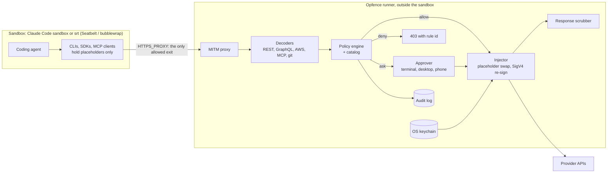
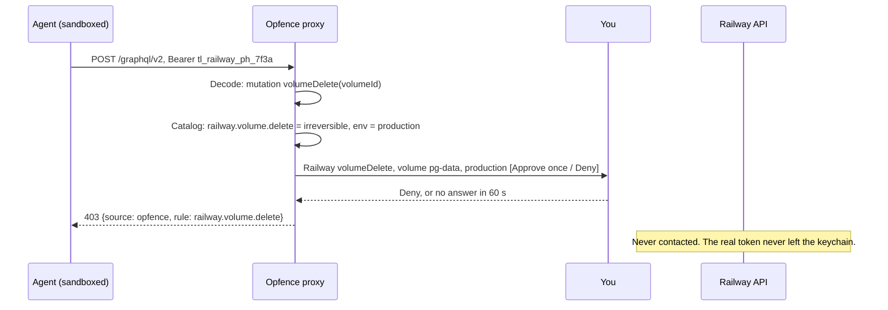
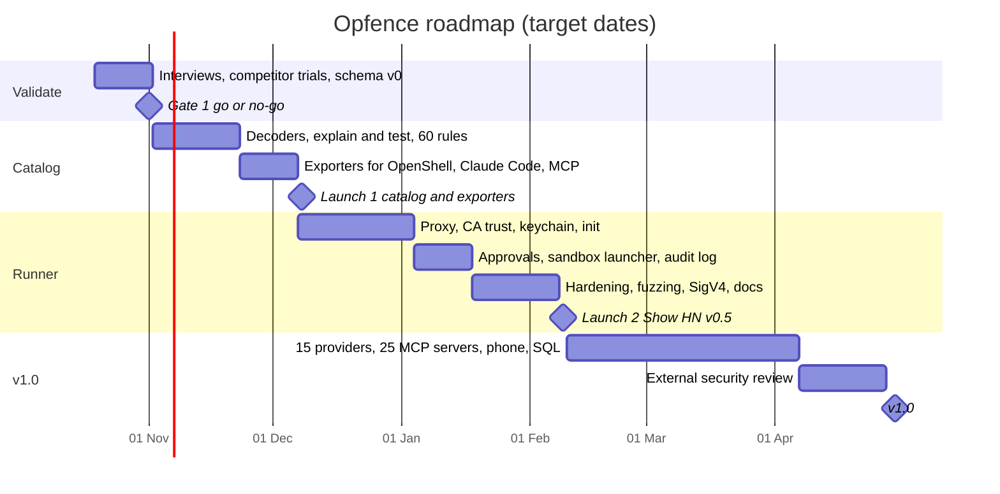

# Agent Credential Proxy — Research & Build Plan

Oct 16, 2026 · @ss

> **Status:** building started 16 Oct 2026; see [BUILD_PLAN.md](BUILD_PLAN.md) for stages and [ARCHITECTURE.md](ARCHITECTURE.md) for the design. Review notes from 16 Oct 2026 are in [Review notes](#review-notes-16-oct-2026); facts they corrected are fixed inline below. **Name decided on 16 Oct 2026: Opfence** (formerly the working name "Opfence", which is taken on PyPI).

## Executive summary

Build **Opfence**: an open, tested catalog of dangerous operations for cloud APIs and MCP servers, a compiler that turns it into policy for existing agent proxies, and a thin local runner for people who have none. The credential-proxy idea stays; the proxy engine itself is already built by NVIDIA, Infisical and a YC startup, so Opfence supplies what they all lack: knowing which calls are dangerous.

- **Catalog (the core asset):** versioned YAML rules per provider (Railway, Vercel, Supabase, GitHub, AWS, Stripe and more) and per popular MCP server. Each rule labels an operation as read, write, destructive, irreversible, money-moving or secret-revealing, with matchers for REST, GraphQL, AWS actions, MCP tools and CLI commands, plus recorded test requests.
- **Compiler:** one command exports the catalog to NVIDIA OpenShell policy, Claude Code permission rules and hooks, MCP annotation overlays, and Opfence's own format. (Agent Vault was dropped as a Launch 1 target on 16 Oct 2026; see Decisions.) Write once, enforce in any engine.
- **Runner:** `opfence run -- claude` starts a local proxy that holds the keys, enforces the catalog, and asks you before anything destructive. The approval card is written by the proxy from the decoded request, never by the agent. It plugs into Claude Code's sandbox through its bring-your-own-proxy setting; no container, server or database.
- **Who it is for:** solo developers and small teams pointing Claude Code, Cursor, Codex or custom agents at real cloud accounts, and the maintainers of agent proxies who need rules.
- **Why now:** an agent wiped PocketOS's production database in April 2026, and prompt injection stole keys from three major coding agents the same month. The engines exist; every user still hand-writes the rules.

**The v1 promise:** "Install in one minute. Your agent keeps working, never sees a key, and cannot delete, wipe or pay for anything without your tap." v1.0 scope (April 2027): 15 providers, 25 MCP servers, exports to OpenShell and Claude Code (Agent Vault if it gains operation matching), macOS and Linux, Claude Code first.

## Review notes (16 Oct 2026)

Claims the plan leans on were checked against primary sources (the OpenShell and Agent Vault source trees as of 16 Oct 2026, and the Claude Code docs). Four findings change the plan.

| # | Finding | Evidence | What it changes |
| --- | --- | --- | --- |
| 1 | **OpenShell does not ship operation-level rule packs.** The `_provider_` prefix is reserved for rules that *provider profiles* contribute. The repo has 17 example profiles (`providers/*.yaml`: anthropic, aws, aws-s3, github, openai, pypi and others). They are host-level (credential binding, endpoints, `read-only`/`read-write`/`full` presets), say "OpenShell does not compile them into any binary", and must be imported by an operator. None cover Railway, Vercel or Supabase. | `providers/README.md`, `providers/github.yaml`; [policy schema](https://docs.nvidia.com/openshell/how-it-works/policies/schema) | The biggest risk is **not** realised today. But the profile mechanism is exactly where a catalog would plug in, so NVIDIA could fill it. Pitch the catalog as importable provider profiles. |
| 2 | **OpenShell is allow-list first, with an approval loop.** Its GitHub profile is read-only by default; writes need a policy proposal. RFC 0002 (accepted) adds agent-drafted proposals with a human review inbox. Its GitHub tutorial policy already hand-writes GraphQL `deny_rules` for `deleteRepository` and `deleteRef`. | `rfc/0002-agent-driven-policy-management`, [GitHub sandbox tutorial](https://docs.nvidia.com/openshell/latest/tutorials/github-sandbox) | A list of only *dangerous* operations is less useful to an allow-list engine. The catalog should classify **every** operation (including safe writes), so an engine or its policy advisor can auto-approve safe writes and flag dangerous ones. |
| 3 | **Agent Vault cannot express operation-level rules.** Services match host plus optional path glob; there is no HTTP method or GraphQL matching. Railway's `volumeDelete` is a `POST /graphql/v2` like every other Railway call. | `internal/proposal/proposal.go`, `internal/broker` | Drop `--target agent-vault` from Launch 1, or make it an upstream contribution (method + GraphQL matching) instead of an exporter. |
| 4 | **Claude Code's sandbox now injects credentials itself.** `sandbox.credentials` masks env vars and credential files with a per-session placeholder, injects the real value only on `injectHosts`, terminates TLS (`network.tlsTerminate`) and re-signs AWS SigV4. Setting `sandbox.network.httpProxyPort` replaces Claude Code's proxy, and with it these controls. MCP servers, hooks and file tools run **outside** the sandbox, so the proxy never sees MCP traffic. | [Sandboxing docs](https://code.claude.com/docs/en/sandboxing) (Mask credentials, Custom proxy configuration) | "Anthropic adds credential injection" has happened. Key-hiding is no longer Opfence's edge for Claude Code users; operation-level classification and approvals still are. MCP rules must be enforced through Claude Code permission rules and hooks, not the proxy. |

Smaller corrections:

- **PocketOS:** confirmed by mainstream reporting (Cursor agent on Claude Opus 4.6, Railway, one GraphQL call, volume backups wiped; [Decrypt](https://decrypt.co/365897/ai-agent-deletes-startup-database-9-seconds-founder-says)). The mutation name `volumeDelete` is **not** confirmed in reporting. Railway's founder said the call hit a legacy endpoint without "delayed delete"; Railway volumes otherwise have a [48-hour restore window](https://railway.com/changelog/2025-08-22-restore-deleted-volumes). Verify the mutation and whether it is still immediate before calling it `irreversible` in the hero demo.
- **New competitor for MCP classification:** [PolicyLayer](https://policylayer.com/tools/mh8974-railway-mcp/volume-delete) is an MCP gateway with a registry claiming 515,000+ classified MCP tools and allow/deny/approval policies. It does not say how labels are made or whether it is open. Opfence's edge there is open, human-reviewed, fixture-tested labels, plus REST, GraphQL and AWS coverage.
- **macOS Go CLIs:** Claude Code now documents `sandbox.enableWeakerNetworkIsolation: true` for Go CLIs behind a MITM proxy with a custom CA. `opfence trust` still has to install the CA, but the Seatbelt half of the problem has a documented switch.
- **Star counts** (Agent Vault 2.4k, OneCLI about 3k) could not be re-checked from here.

**Suggested changes to the plan** (resolved 16 Oct 2026: 1 adopted, 2 and 3 decided below in Decisions, 4 is in [outreach drafts](outreach/)):

1. Make the catalog an operation *classifier*, not a deny list: every operation gets a class, including `read` and safe `write`.
2. Launch 1 targets: OpenShell (as provider profiles plus `rules`/`deny_rules`), Claude Code (permission rules and PreToolUse hooks, which also cover MCP tools), and MCP annotation overlays. Agent Vault becomes an upstream PR, not an exporter.
3. Re-scope the runner at Gate 1: for Claude Code, test whether running beside Claude Code's own masking (hooks for MCP, catalog for Bash traffic) beats replacing its proxy. Keep the full runner for agents with no sandbox of their own.
4. Add a "Day 1" item: check whether NVIDIA plans operation-level content for provider profiles (ask in their discussions alongside the import question).


Coding agents run with real, over-powered credentials in reach. They fail in two ways, and today's defenses act on the wrong layer for both.

**Failure 1 — a confused agent uses a key it should not have.**

- **PocketOS, April 2026:** a Cursor agent hit a credential mismatch on a staging task. It found an API token in an unrelated file, and that token had blanket permissions. It deleted the production database and its backups in one API call ([DZone](https://thenote.app/post/en/designing-safe-agent-permissions-why-least-privilege-must-exist-outside-the-ngfxtduant), [Cyber Security News](https://cybersecuritynews.com/ai-coding-agent-deletes-data/amp/)).
- **Replit, July 2025:** an agent ran destructive commands on a live database during a code freeze ([DEV](https://dev.to/joylo/why-replits-ai-agent-deleted-a-production-database-389p)).

**Failure 2 — prompt injection makes the agent leak keys.**

- **"Comment and Control", April 2026:** malicious PR titles and comments made Claude Code Security Review (CVSS 9.4), Gemini CLI Action and Copilot's coding agent leak CI secrets. The leak went out through GitHub's own API ([Waxell](https://waxell.ai/blog/ai-coding-agent-prompt-injection-cicd-2026)).
- **Google Antigravity, June 2026:** a poisoned web page made the agent dump its environment variables and send a key out inside an image URL. The approval prompt passed because the agent described the action to the user itself ([0DIN](https://0din.ai/blog/faking-the-pipeline-data-exfiltration-in-google-antigravity)).
- **Amazon Kiro, disclosed August 2026:** a crafted workspace made the agent read a key from `.env` and put it in a config URL ([Vibe Graveyard](https://vibegraveyard.ai/story/amazon-kiro-powers-secret-exfiltration/)).

**How big the problem is**

| Signal | Number | Source |
| --- | --- | --- |
| New hardcoded secrets on public GitHub, 2025 | 28.65M, up 34% | [GitGuardian via Passwork](https://passwork.pro/blog/the-state-of-secrets-sprawl-in-2026/) |
| AI-assisted commits leak secrets vs baseline | about 2× | [DevOps.com](https://devops.com/?p=199818) |
| Unique secrets in MCP config files, 2025 | 24,008 (2,117 valid) | [The Hacker News](https://thehackernews.com/2026/03/the-state-of-secrets-sprawl-2026-9.html?m=1) |
| Secrets valid in 2022 still valid in 2026 | 64% | [DevOps.com](https://devops.com/?p=199818) |
| Orgs with an AI agent security incident in 12 months | 65% | [CSA](https://labs.cloudsecurityalliance.org/research/csa-research-note-cisa-agentic-ai-guidance-practitioner-2026/) |
| Orgs confident their IAM can govern agents | 18% | [CSA](https://labs.cloudsecurityalliance.org/research/csa-research-note-cisa-agentic-ai-guidance-practitioner-2026/) |
| Orgs giving AI more access than a human doing the same job | 70% | [NHIMG](https://nhimg.org/?p=9135) |
| Developers using coding assistants or agents | 65.9% | [IT Brief / Stack Overflow 2026](https://itbrief.com.au/story/stack-overflow-survey-finds-developers-wary-of-ai-tools) |

**Why current defenses fail**

| Defense | Why it fails |
| --- | --- |
| Rules in the system prompt | The PocketOS agent knew the rules and broke them anyway. |
| Regex command guards | They match command text. A script or a raw API call never matches. |
| "Are you sure?" prompts | The agent writes the description the human approves, as in Antigravity. |
| Sandbox domain allowlists | Comment and Control leaked through GitHub, an allowed domain. |
| Sandbox alone | Anthropic says its sandbox is not a secrets manager; credentials need a proxy. |

**Design principle that follows:** if a secret never enters the sandbox, injection has nothing to steal. If a token's power is cut at the proxy, a confused agent cannot delete production.

## Prior art and landscape

The enforcement engines are built and well funded; the shared knowledge of which operations are dangerous is not. Every engine below asks the user to write their own rules.

| Tool | What it does | How it runs | What it lacks |
| --- | --- | --- | --- |
| [NVIDIA OpenShell](https://docs.nvidia.com/openshell/latest/about/overview.html) | Sandboxed agent runtime with YAML egress policy at method and path level, plus [GraphQL, MCP and JSON-RPC inspection](https://docs.nvidia.com/openshell/how-it-works/policies/schema), credential injection and [AWS re-signing](https://docs.nvidia.com/openshell/latest/providers/aws-sigv4) | Container per sandbox, gateway control plane | 17 example provider profiles, host-level only, imported by hand; operation rules are hand-written or agent-proposed (RFC 0002) |
| [Infisical Agent Vault](https://github.com/Infisical/agent-vault) | MITM credential broker; swaps placeholders for real keys; egress filtering by service and endpoint; `agent-vault run -- claude` | Single Go binary, SQLite; MIT; recommends a separate host | Host and path matching only (no method or GraphQL matching), no approvals, no catalog |
| [OneCLI](https://www.ycombinator.com/launches/RoJ-onecli-your-ai-agents-shouldn-t-be-holding-raw-secrets) | Credential gateway matching host and path; [approvals for writes](https://onecli.sh) in its hosted product | One Docker container; Apache-2.0 core; YC S26 | Moving toward hosted "AI teammates" for business apps |
| [Cloudflare Outbound Workers](https://developers.cloudflare.com/changelog/post/2026-04-13-sandbox-outbound-workers-tls-auth/) | Credential injection and egress policy in code | Cloudflare Sandboxes only | Platform-locked |
| [Fly.io tokenizer](https://github.com/superfly/tokenizer) | Proxy that unseals encrypted secrets into requests | Server you deploy | A building block, no agent policy |
| [agent-airlock](https://github.com/es617/agent-airlock) | Allow/deny rules on GraphQL operations and MCP tool names | Local proxy | Users still write every rule |
| [httpjail](https://www.simonwillison.net/2025/Sep/19/httpjail) (Coder) | Process-level HTTP(S) filtering with JavaScript rules | Local CLI | No credentials, no catalog |
| [Anthropic sandbox-runtime](https://code.claude.com/docs/en/agent-sdk/secure-deployment) | OS-level file and network isolation | macOS Seatbelt, Linux bubblewrap | Accepts a [bring-your-own proxy](https://github.com/Electroid/sandbox-runtime) |
| [Claude Code sandbox credentials](https://code.claude.com/docs/en/sandboxing) | Masks env vars and credential files with placeholders, injects real values only on listed hosts, TLS termination, AWS SigV4 re-signing | Built into Claude Code's sandboxed Bash | Host-level only; no operation classes or approvals; does not cover MCP servers |
| [PolicyLayer](https://policylayer.com/tools/mh8974-railway-mcp/volume-delete) | MCP gateway with a registry of risk-graded MCP tools; allow, deny, rate-limit, approval | Hosted proxy URL | MCP only; labelling method and licence not stated |
| [Destructive Command Guard](https://skills.cat/skills/dicklesworthstone/destructive-command-guard), [AgentLint](https://pypi.org/project/agentlint/) | Block risky shell commands in Claude Code hooks | Hook | Text matching; bypassed by scripts and raw API calls |
| [Delego](https://pypi.org/project/delego/) | Policy and approval layer in front of a broker | Library | Broker is a stub; no provider knowledge |

**The gap Opfence fills**

- **Knowledge is re-invented per user.** To be safe, a user must already know that Railway's `volumeDelete` mutation is fatal or which Supabase MCP tools drop data. OpenShell even ships an agent skill that drafts policy from API docs, which shows the knowledge gap is real.
- **Rules are locked to one engine.** An OpenShell policy cannot be reused in Agent Vault or Claude Code hooks.
- **Nobody tests rules.** No engine ships recorded requests proving a rule catches what it claims.

Security has solved this shape of problem before: engines compete, while one shared rule repository becomes the standard (Sigma for SIEMs, nuclei-templates for scanners, gitleaks rules for secret scanning). Opfence aims to be that repository for agent actions, and partners with the engines instead of fighting them.

## Product definition

Opfence serves two audiences with one asset: developers who want a safe agent in a minute, and proxy maintainers who want rules they did not have to write.

**Target users**

| User | Situation | What they need from Opfence |
| --- | --- | --- |
| Solo developer | Runs Claude Code or Cursor against Railway, Vercel, Supabase or GitHub with keys in `.env` | `opfence run -- claude` and nothing else to learn |
| Small-team lead | Several people and agents share cloud accounts | One reviewed policy file in the repo, an audit log |
| Engine user (OpenShell, Agent Vault) | Already has a proxy, hand-writes YAML | `opfence export` to generate tested policy |
| MCP server author | Ships tools without clear risk labels | A catalog entry and a badge that says the server is classified |

**Jobs to be done**

1. Let my agent work on real infrastructure without any risk of irreversible loss.
2. Keep real keys out of the agent's reach, even if it is tricked.
3. Reuse a vetted policy instead of studying every API's dangerous calls.
4. Know afterwards exactly what my agent did with my accounts.

**v1 user stories**

- `opfence init` scans the repo, `.env` files and MCP configs, moves found secrets into the local store, and leaves placeholders behind.
- `opfence run -- claude` starts the proxy, configures Claude Code's sandbox to use it, and launches the agent.
- A destructive call pauses. A native notification and a terminal prompt show the proxy's own reading of it, for example "Railway `volumeDelete` · volume `pg-data` · environment `production`". No answer within 60 seconds means deny.
- `opfence export --target openshell` (and `--target claude-hooks`, `--target mcp-annotations`) writes policy for another engine.
- `opfence test` replays every rule's recorded requests and fails if any rule misses.
- `opfence log` lists every keyed request, its decision and who approved it.

**Non-goals for v1**

- Windows support (WSL works through the Linux path).
- Non-HTTP protocols: Postgres wire, SSH, raw TCP. Use hoop.dev for those.
- Detecting prompt injection in content. Opfence limits what an injected agent can do; it does not judge text.
- Teams features: identity providers, multi-tenant vaults, a hosted service.
- Replacing OpenShell or Agent Vault. Opfence exports to them.

## Architecture and technical design

The agent runs inside an OS sandbox whose only exit is the Opfence proxy; the proxy decodes each request, looks it up in the catalog, and only then attaches a real key.



The PocketOS request, replayed through Opfence:



**Components**

| Component | Responsibility | Key design decision |
| --- | --- | --- |
| MITM proxy | Terminate TLS for keyed hosts, pass others through or block | Intercept only hosts in the catalog or config; everything else is denied in strict mode |
| Decoders | Turn a request into an operation: method and path, GraphQL operation and root fields, AWS action, MCP tool name, git ref updates | Buffer at most 64 KiB of body; anything larger or unparseable fails closed |
| Policy engine | Map operation plus environment to allow, ask, deny or log | Unknown operations on a keyed host default to *ask* in v1 |
| Environment resolver | Decide whether a target is production | `opfence.yaml` maps project, environment and resource ids; read-only lookups fill gaps |
| Injector | Swap placeholders in headers, query, basic auth and JSON bodies; re-sign AWS SigV4 | Real values come from the OS keychain at request time and never touch disk |
| Approver | Ask a human | The card is written from the decoded request, never from agent text; a grant is single-use and bound to a hash of that exact operation |
| Response scrubber | Stop real secrets echoing back into model context | Replace any real secret bytes in a response with its placeholder |
| Audit log | Record every keyed request and decision | Append-only JSONL with a hash chain; bodies are never stored |
| Launcher | `opfence run -- <agent>` | Writes Claude Code sandbox settings or wraps other agents in Anthropic's `srt` |

**Sandbox integration**

- **Claude Code:** set `sandbox.enabled`, point [`sandbox.network.httpProxyPort`](https://claudeissues.com/issue/10653-bug-documentation-custom-proxy-configuration-example-missing-network-wrapper-blo) at Opfence, and add Opfence's data folder to `denyRead`. Anthropic's guide already says credentials should be [injected through a proxy](https://code.claude.com/docs/en/agent-sdk/secure-deployment).
- **Claude Code caveats (checked 16 Oct 2026):** setting `httpProxyPort` turns off Claude Code's own allowlist and credential masking for that traffic, so Opfence does both (decided 16 Oct 2026, see Decisions). `opfence run` also adds `sandbox.credentials` `deny` entries for every key it moved to the keychain, so a leftover copy can't be read inside the sandbox. MCP servers run outside the sandbox, so MCP tool rules go into Claude Code permission rules and PreToolUse hooks. On macOS, `sandbox.enableWeakerNetworkIsolation` lets Go CLIs verify a custom CA.
- **Cursor, Codex, Gemini CLI, custom agents:** wrap the process in [sandbox-runtime](https://github.com/Electroid/sandbox-runtime) with Opfence as its proxy.
- **No sandbox available:** fall back to environment variables only and label it clearly as *weak mode*. Keys are still safe, because none are in the sandbox; only bypass of non-keyed egress is possible.

**Certificate trust: the hardest usability problem**

- Set the variables the main runtimes read: `SSL_CERT_FILE`, `NODE_EXTRA_CA_CERTS`, `REQUESTS_CA_BUNDLE`, `CURL_CA_BUNDLE`, `GIT_SSL_CAINFO`, `DENO_CERT`. This is the same list [Agent Vault's SDK](https://github.com/Infisical/agent-vault) sets.
- **Go CLIs on macOS ignore these.** `gh`, `supabase`, `terraform` and `flyctl` use the system keychain, so they [fail until the CA is trusted there](https://docs.rs/crate/httpjail/0.3.0/source/AGENTS.md); Claude Code's own proxy [hits the same bug](https://claudeissues.com/issue/26466-go-based-cli-tools-gh-terraform-etc-fail-with-tls-error-due-to-built-in-https-pr). `opfence trust` must install a name-constrained, per-user CA with one prompt and remove it cleanly on uninstall.
- Generate the CA per machine, keep its key in the keychain, and limit it with X.509 name constraints to catalog hosts where clients support that.

## Threat model and security design

Opfence assumes the agent may be confused or fully controlled by an attacker, and keeps two promises anyway: no real key leaves the host, and no catalogued destructive operation runs without a human.

**Who we defend against**

- **Confused agent:** no malice, wrong action, as at PocketOS and Replit.
- **Prompt-injected agent:** follows instructions hidden in a web page, issue, PR title or file.
- **Hostile code in the sandbox:** a malicious dependency or MCP server the agent installed.

**Attack paths and mitigations**

| # | Attack path | Mitigation |
| --- | --- | --- |
| 1 | Read keys from `.env`, configs or environment | `opfence init` moves them to the OS keychain; the sandbox denies reads of Opfence's folder and keychain access |
| 2 | Steal a placeholder | Worthless outside the proxy; the proxy also requires a per-session token, bound to localhost |
| 3 | Send a placeholder to an attacker host | Each placeholder is bound to its provider's hosts and is never injected anywhere else |
| 4 | Make an allowed API echo the key back | Response scrubber replaces real key bytes before the agent sees them |
| 5 | Use a legitimate key for a destructive call | Catalog classifies the operation; destructive or irreversible means ask or deny |
| 6 | Get approval for A, then run B | Grant is single-use and bound to a hash of the exact decoded operation and arguments |
| 7 | Mislead the human with a friendly description | The card is generated from the decoded request; agent text appears only under an "agent says (unverified)" label |
| 8 | Wear the human down with prompts | Reads never prompt; scoped grants such as "this resource, 10 minutes"; prompt-rate statistics in the log |
| 9 | Bypass the proxy | The sandbox only allows the proxy as an exit; in weak mode, bypass still yields no keys |
| 10 | Edit `opfence.yaml` to loosen policy | Repository policy can only tighten rules; loosening lives in user config outside the sandbox's write paths |
| 11 | Evade the decoder: GraphQL aliases, batching, persisted queries, compression | Real GraphQL parser, batch arrays expanded, unknown persisted-query hashes denied, bodies decompressed, size limit fails closed |
| 12 | Poison the catalog with a loosening rule | Signed releases, two-reviewer rule changes, `opfence update` shows a diff; local overrides always win |
| 13 | Steal the interception CA key | Key stays in the keychain, is per machine, and is name-constrained where clients allow |

**Explicitly out of scope for v1**

- A compromised host or kernel. If malware runs as the user outside the sandbox, Opfence cannot help.
- Leaking data (not keys) through allowed reads and writes, such as posting repository contents in a GitHub comment as in Comment and Control. v1 can mark comment and issue creation as *ask* in untrusted sessions, but full data-flow control is a later project.
- DNS tunnelling and raw TCP. These are the sandbox's job; document the gap honestly.

**Security process from day one:** a `SECURITY.md` with a private reporting address, fuzzing of every decoder in CI, and an external review of the proxy and approver before v1.0.

## Policy model and the catalog

The catalog labels operations; the user's policy decides what each label means in each environment. Keeping the two apart lets one tested catalog serve every user and every engine.

**Seven risk classes**

| Class | Meaning | Example |
| --- | --- | --- |
| `read` | No change to state | List Vercel projects |
| `write` | Creates or changes state, recoverable | Trigger a Railway deploy |
| `delete` | Removes something that can be restored | Delete a Supabase development branch |
| `irreversible` | Data or resources gone for good | Railway `volumeDelete`; RDS `DeleteDBInstance` with no final snapshot |
| `money` | Spends, refunds or moves money | Stripe refund |
| `credential` | Creates, reveals or rotates secrets | AWS IAM `CreateAccessKey` |
| `access` | Changes who can see or do what | Make a GitHub repository public |

**Default decisions (users can override)**

| Class | Development | Staging | Production |
| --- | --- | --- | --- |
| read | allow | allow | allow |
| write | allow | allow | ask |
| delete | allow | ask | ask |
| irreversible | ask | ask | ask + type the resource name |
| money | ask | ask | ask |
| credential | ask | ask | deny |
| access | ask | ask | ask |
| unknown operation | ask | ask | ask |

**A catalog rule**

```yaml
# catalog/railway/volume.yaml
provider: railway
hosts: [backboard.railway.com]
auth: { header: Authorization, scheme: Bearer, alt: [Team-Access-Token, Project-Access-Token] }
operations:
  - id: railway.volume.delete
    match: { graphql: { type: mutation, field: volumeDelete } }
    class: irreversible
    resource: { arg: volumeId, kind: volume }
    card: "Delete Railway volume {volumeId} and all data on it"
    status: verified          # verified | community | draft
    sources: ["https://docs.railway.com/integrations/api"]
    tests:
      - fixture: fixtures/railway/volume-delete.http
        expect: irreversible
```

**A user policy**

```yaml
# opfence.yaml (in the repo; may only tighten)
environments:
  production:
    railway:  { environments: [production] }
    vercel:   { projects: [web], target: production }
    supabase: { projects: [abcd1234] }
mode: strict            # deny hosts not in the catalog or config
approvals: { timeout: 60s, channels: [desktop, cli, ntfy] }
```

**First providers for v1**

| Provider | API style | Dangerous operations to catalog first |
| --- | --- | --- |
| [Railway](https://providers.apievangelist.com/providers/railway-app/) | One GraphQL endpoint at `backboard.railway.com/graphql/v2` | `volumeDelete`, `variableDelete` and the other delete mutations |
| [Vercel](https://vercel.com/docs/rest-api/projects/delete-a-project) | REST with a public OpenAPI spec | `DELETE /v9/projects/{idOrName}`, project pause, env var and domain removal |
| [Supabase MCP](https://github.com/supabase-community/mcp-server-supabase) | Remote MCP at `mcp.supabase.com/mcp` | `delete_branch`, `reset_branch`, `pause_project`, `apply_migration`, and `execute_sql` classified by its SQL |
| GitHub | REST plus git over HTTPS | Delete repository, change visibility, delete a branch or force-push via `git push` |
| AWS | SigV4 with Query and JSON protocols | RDS `DeleteDBInstance`, S3 `DeleteBucket`, EC2 `TerminateInstances`, IAM `CreateAccessKey` |

**How the catalog grows without one person writing it all**

1. **Draft automatically** from machine-readable sources: Vercel's [OpenAPI spec](https://vercel.com/docs/rest-api/projects/delete-a-project), Railway's GraphQL schema by introspection, and each MCP server's `tools/list`.
2. **Start from MCP annotations.** The spec already defines `readOnlyHint` and `destructiveHint`, but clients must [treat them as untrusted](https://stacklok.com/blog/tool-annotations-are-becoming-the-risk-vocabulary-for-agentic-systems-that-matters-more-than-it-might-seem/) from untrusted servers. Opfence's reviewed labels become the trusted overlay that tools like [Codex CLI already use to decide approvals](https://codex.danielvaughan.com/2026/04/12/mcp-tool-annotations-risk-vocabulary-codex-cli/).
3. **Review by a human, prove by a fixture.** A rule reaches `verified` only with a recorded request and a passing `opfence test`.
4. **SQL inside tools.** v1 classifies `execute_sql` by keyword with a fail-to-ask default (`DROP`, `TRUNCATE`, `DELETE` without `WHERE` are irreversible); v2 uses a real Postgres parser.

## Tech stack and repo structure

Write it in **Go**: one static binary for macOS and Linux, a mature TLS and HTTP standard library, and the same language as Infisical Agent Vault, which makes contributions and integrations easier.

| Need | Choice | Why |
| --- | --- | --- |
| MITM proxy | `net/http` + `crypto/tls` with a per-host leaf cert cache; `elazarl/goproxy` as a fallback | Full control over CONNECT handling and body buffering |
| GraphQL decoding | `vektah/gqlparser/v2` | Real parser; handles aliases, fragments and batches |
| AWS re-signing | `aws-sdk-go-v2` SigV4 signer | Official signer; copy OpenShell's documented chunked-upload limits |
| Secret discovery | `gitleaks` v8 as a library | Hundreds of tested detectors for `opfence init` |
| Key storage | `zalando/go-keyring` | macOS Keychain and Linux Secret Service, nothing on disk |
| Policy conditions | `google/cel-go` | Safe, fast expressions for advanced overrides |
| Terminal approvals | `charmbracelet/huh` | Clear prompts with minimal code |
| Phone approvals | [ntfy](https://ntfy.sh) with action buttons | Free, self-hostable push with no account |
| Config and schema | YAML plus JSON Schema | Editor autocomplete and CI validation for catalog PRs |
| Release | GoReleaser, Homebrew tap, GitHub build attestations, cosign | Verifiable binaries for a security tool |

**Licence:** Apache-2.0 for code and catalog, so open-source engines such as Agent Vault (MIT) and commercial vendors can embed the catalog without friction.

**Repository layout**

```text
opfence/
  cmd/opfence/          CLI entry point
  internal/proxy/        MITM, CA, connection handling
  internal/decode/       rest, graphql, aws, mcp, gitsmart, sql
  internal/policy/       classes, environment resolver, decisions
  internal/inject/       placeholders, header and body swap, SigV4
  internal/approve/      terminal, desktop, ntfy, single-use grants
  internal/store/        keychain, migration from .env and MCP configs
  internal/launch/       Claude Code settings, srt wrapper, CA variables
  internal/audit/        hash-chained JSONL
  internal/export/       openshell, claudehooks, mcp-annotations
  schema/                JSON Schema for catalog and policy
  catalog/               one folder per provider, rules + fixtures (own repo later)
  docs/
```

Until Launch 1 the catalog lives in `catalog/` in this repository, so schema, decoders and rules change together while the format settles. Before Launch 1 it moves to its own repository (`opfence-catalog`, history kept with `git filter-repo`) so contributors never touch proxy code and other engines can depend on it alone. The binary embeds a snapshot and `opfence update` pulls signed newer versions.

**CLI surface**

| Command | What it does |
| --- | --- |
| `opfence init` | Scan repo, `.env` and MCP configs; move secrets to the keychain; write placeholders and `opfence.yaml` |
| `opfence trust` | Create the per-machine CA and trust it, including the macOS keychain for Go CLIs; `--uninstall` removes it |
| `opfence run -- <agent>` | Start the proxy, configure the sandbox, launch the agent |
| `opfence doctor` | Check that the sandbox is active and each runtime trusts the CA |
| `opfence explain <file.http>` | Decode a saved request and show the rule and decision |
| `opfence test` | Replay every fixture; fail if any rule misses |
| `opfence export --target <engine>` | Write OpenShell policy, Claude Code permission rules and hooks, or MCP annotation overlays |
| `opfence log` | Show keyed requests, decisions and approvals |
| `opfence update` | Fetch a signed catalog update and show the diff |

## Roadmap and milestones

Ship the catalog and exporters first, around 8 December 2026, and the local runner second, around 9 February 2027. The catalog is useful on day one to everyone already running OpenShell or Agent Vault, and it builds an audience before the hardest engineering starts. Dates are targets, not a capacity estimate: the owner is building Opfence with Claude, so the plan does not budget weekly hours (decided 16 Oct 2026). Phases move forward as soon as each one's exit criteria are met.



| Phase | Deliverables | Exit criteria |
| --- | --- | --- |
| 0 · Validate (2 weeks) | 10 user interviews; hands-on trials of OpenShell, Agent Vault and OneCLI; catalog schema v0; 20 hand-written rules | At least 5 of 10 interviewees describe the problem unprompted and agree to try a beta; one engine maintainer replies with interest |
| 1 · Catalog (3 weeks) | REST, GraphQL and MCP decoders; `opfence explain` and `opfence test`; 60 verified rules across Railway, Vercel, Supabase MCP, GitHub, AWS | Every rule has a fixture; CI fails on any miss; decoders fuzzed for 1 hour each |
| 2 · Exporters (2 weeks) | `opfence export` to OpenShell, Claude Code (permission rules and hooks) and an MCP annotation overlay | OpenShell blocks the replayed PocketOS `volumeDelete` using only exported policy |
| **Launch 1** | Catalog split into its own repo, blog post, integration offer to OpenShell, issue to Agent Vault proposing method and GraphQL matching | Posted; first outside contributor rule merged within 3 weeks |
| 3 · Runner (6 weeks, includes holidays) | MITM proxy, `opfence trust`, keychain store, `opfence init`, placeholder injection, terminal and desktop approvals, Claude Code launcher, audit log | `opfence run -- claude` works on macOS and Ubuntu with `gh`, `vercel`, `supabase` and Railway API calls |
| 4 · Harden (3 weeks) | Response scrubber, SigV4, `opfence doctor`, docs site, 2-minute demo video | No open high-severity issues; install-to-first-blocked-call under 5 minutes for 5 test users |
| **Launch 2** | Show HN, Reddit, Claude Code community | See Success metrics |
| 5 · v1.0 (11 weeks) | 15 providers, 25 MCP servers, ntfy phone approvals, Postgres SQL parser, srt launcher for Cursor and Codex, external security review | Review findings fixed; 3 or more regular outside catalog contributors |

The runner phase starts during the exporters phase on purpose: proxy and CA work does not depend on exporter design and is the longest pole.

## Launch and adoption plan

Lead with one story everyone already knows, the PocketOS deletion, and show it stopped in under 90 seconds. Launch twice: the catalog to engine users in December, the runner to every Claude Code user in February.

**Positioning**

- One line: *The open list of things your AI agent must never do without asking, and the tool that enforces it.*
- Against OpenShell and Agent Vault: "Keep your engine. We give it the rules."
- Against command guards: "We read the request, not the command text."

**Name: decided, Opfence.** Background: "Tripline" is already used on [PyPI by an agent-safety tool](https://pypi.org/project/tripline/) that includes a network proxy, and "Airlock" by [agent-airlock](https://github.com/es617/agent-airlock). Shortlist 5 names, then check the GitHub org, PyPI, npm, crates.io, Homebrew and a `.dev` domain for each. Prefer a short noun that works as a CLI command and suggests a list or a boundary.

<a id="name-candidates"></a>**Name candidates (checked 16 Oct 2026). Decision: Opfence**, chosen by the owner on 16 Oct 2026. "Agent Vault" is Infisical's product, so it is out. All below were free on PyPI, npm, crates.io and Homebrew core on 16 Oct 2026; GitHub org and domains could not be checked from the review environment and must be checked by hand.

| Name | Why | Notes |
| --- | --- | --- |
| Brakeline | The brake on an agent; keeps the "line" of Opfence; `brakeline run -- claude` reads well | No product found with this name in a web search |
| Stopcard | Names the product's signature move, the proxy-written approval card | |
| Vetoline | "You hold the veto" | |
| Blastwall | Limits blast radius | Slightly aggressive tone |
| **Opfence** (chosen) | "Operation fence"; short CLI | Free on PyPI, npm, crates.io, Homebrew core on 16 Oct 2026; check GitHub org and domains |

Rejected: Holdline (an AI-agent guardrail tool already uses it), Redline, Tollgate, Agentfence, Keyward, Keyfence, Guardlist (taken on PyPI or npm).

**The hero demo (record it once, use it everywhere)**

1. A fresh repo that looks like PocketOS's stack, with a Railway token in a config file.
2. `opfence init` finds the token and moves it to the keychain.
3. Claude Code is asked to "clean up the staging volume" and reaches for `volumeDelete` on production.
4. The proxy's card appears, written from the decoded request; the user taps Deny; the agent reports it was blocked and why.
5. Final frame: the same rule exported to OpenShell, blocking the same call there.

**Channels, in order**

| When | Channel | Message |
| --- | --- | --- |
| Launch 1 | GitHub issues or PRs to OpenShell (rules in its format) and Agent Vault (a proposal for method and GraphQL matching, so it can use the catalog) | "Here are 60 tested rules in your format; want them upstream?" OpenShell already has an [open issue on MCP policy](https://github.com/NVIDIA/OpenShell/issues/1531) to build on |
| Launch 1 | MCP server authors | A PR adding correct `destructiveHint` annotations, plus a "classified" badge for their README |
| Launch 1 | Security newsletters and writers who cover agent sandboxing, such as [Simon Willison](https://www.simonwillison.net/2025/Sep/19/httpjail) | The catalog as a public good |
| Launch 2 | Show HN, Tuesday to Thursday, US morning | The 90-second demo and the honest threat model |
| Launch 2 | r/ClaudeAI, r/cursor, r/devops, r/netsec | Tailored posts, not cross-posts |
| Ongoing | MCP and agent meetups, including India's MCP community events | Talks built around the catalog data, such as "we classified 1,000 cloud operations" |

**Making contributors out of users**

- "Add a rule in 10 minutes" guide, a rule template, and a CI bot that runs the fixture and comments on the PR.
- One `good first issue` per uncovered provider, generated from that provider's OpenAPI or GraphQL schema.
- Credit every contributor in release notes and in the rule file itself.

**Docs that build trust:** a 30-second install in the README, the full threat model, and a page titled "What this does not protect against". For a security tool, honesty about limits is part of the product.

## Risks and mitigations

The biggest risk is that the engines build their own catalogs; the answer is to become their upstream before they need to.

| Risk | Likelihood | Impact | Mitigation |
| --- | --- | --- | --- |
| OpenShell or Agent Vault ship their own rule packs | Medium (OpenShell's provider profiles are the natural home; today they are host-level examples) | High | Offer the catalog in their format at Launch 1; Apache-2.0 so adoption is free; consider moving the catalog to a neutral foundation once it has outside maintainers |
| Anthropic or OpenAI add credential injection to their sandboxes | **Happened** (Claude Code `sandbox.credentials`) | Medium | The runner shrinks in importance, the catalog does not; add their sandbox as an export target |
| Catalog rots as APIs change | High | Medium | Nightly job diffs OpenAPI specs, GraphQL schemas and MCP `tools/list`, then opens issues; every rule shows a "last verified" date |
| Users feel safer than they are | Medium | High | Unknown operations ask by default; weak mode is labelled; a "What this does not protect against" page |
| Approval fatigue makes users click Approve blindly | High | High | Reads never prompt; scoped time-boxed grants; prompt-rate shown in `opfence log` |
| CA install blocked on managed laptops | Medium | Medium | `opfence doctor` explains each failure; per-runtime variable fallback; docs for IT admins |
| TLS edge cases: pinning, HTTP/3, WebSockets, gRPC | Medium | Medium | Intercept only catalog hosts; block HTTP/3 so clients fall back to TCP; WebSockets in v1.x |
| A vulnerability in Opfence itself | Medium | High | Fuzzed decoders, few dependencies, signed releases, `SECURITY.md`, external review before v1.0 |
| Solo-maintainer burnout | High | High | Catalog contributions are decentralised by design; recruit 2 co-maintainers by v1.0; strict scope |
| Name clash | Certain | Low | Rename before Launch 1 (see [Name candidates](#name-candidates)) |
| PolicyLayer or a similar registry becomes the default MCP risk source | Medium | Medium | Compete on open data, human review and fixtures; cover REST, GraphQL and AWS, which an MCP-only registry does not |
| Blame after data loss despite the tool | Low | Medium | Licence disclaimer; never promise a guarantee; publish the threat model |

## Success metrics

Success at six months means matching today's leading brokers on adoption (Agent Vault has [2.4k stars](https://github.com/Infisical/agent-vault), OneCLI [about 3k](https://onecli.sh)) while owning the one asset they lack. These are targets to steer by, not forecasts.

| Metric | 30 days after Launch 1 | 90 days | 180 days |
| --- | --- | --- | --- |
| Verified catalog rules | 100 | 250 | 600 |
| Providers / MCP servers covered | 5 / 5 | 8 / 12 | 15 / 25 |
| Outside contributors with a merged rule | 3 | 10 | 25 |
| Engines importing the catalog (merged integration) | 0, one in discussion | 1 | 2 |
| Upstream MCP annotation PRs merged | 2 | 8 | 20 |
| GitHub stars, catalog and runner combined | 300 | 1,500 | 4,000 |
| Runner downloads (releases plus Homebrew) | n/a | 1,000 | 5,000 |
| Public "it blocked a real mistake" reports | 0 | 1 | 3 |

**What not to measure:** no usage telemetry by default. A security tool that phones home loses trust; use download counts, GitHub activity and an opt-in survey instead.

**Leading indicator to watch weekly:** time from install to first blocked call for a new user. Target under 5 minutes; if it is higher, fix onboarding before adding providers.

## Decisions

| Date | Decision | Why |
| --- | --- | --- |
| 16 Oct 2026 | Name: **Opfence** | "Tripline" taken on PyPI; Opfence free on PyPI, npm, crates.io, Homebrew |
| 16 Oct 2026 | One repository with a `catalog/` folder until Launch 1, then split out | While the format settles, schema, decoders and rules change together; a separate repo matters only once outside contributors arrive |
| 16 Oct 2026 | Runner for Claude Code **replaces** Claude Code's sandbox proxy (`httpProxyPort`) rather than chaining behind it | One code path for Claude Code, Cursor, Codex and custom agents; Opfence must see decrypted requests to classify them and write approval cards, so it terminates TLS either way; Claude Code's masking settings are only honoured from user settings, which makes a chained setup fragile to install. Opfence also writes Claude Code `sandbox.credentials` `deny` entries for the keys it holds, and enforces MCP rules through Claude Code permission rules and hooks because MCP servers run outside the sandbox. Revisit chaining (Claude Code proxy → Opfence as upstream `HTTPS_PROXY`) only if the Gate 1 spike shows it is simpler for users |
| 16 Oct 2026 | No weekly-hours budget in the plan | The owner builds Opfence with Claude; dates are targets and phases advance on exit criteria |
| 16 Oct 2026 | Agent Vault dropped as a Launch 1 export target | It matches host and path only, so it cannot tell a Railway delete from a read; an exporter would give users false safety. Offer an upstream proposal instead; saves about a week for OpenShell and Claude Code |
| 16 Oct 2026 | Catalog classifies **every** operation: explicit rules plus per-provider defaults (GraphQL queries, safe HTTP methods); everything else is `unknown` | Allow-list engines need to know what is safe; review suggestion 1 |
| 16 Oct 2026 | Approvals use a desktop dialog and `opfence approve` over a local socket, not a terminal prompt | During `opfence run -- claude` the agent's TUI owns the terminal |
| 16 Oct 2026 | Runner sets both `httpProxyPort` and `socksProxyPort` and passes settings with `claude --settings` | Claude Code docs: an unset proxy port stays reachable and uncontrolled; `--settings` is a trusted scope and leaves user files untouched |
| 16 Oct 2026 | Secret discovery is catalog-driven, not gitleaks | Only catalogued providers can be injected; fewer dependencies in a security tool |
| 16 Oct 2026 | Unmapped environments default to production | Fail safe; `opfence explain` shows how to map ids |

## Next 14 days

Use the first two weeks to prove three things before writing the proxy: users feel the pain, engine maintainers want the catalog, and macOS certificate trust can be made painless. Gate 1 decision on Nov 1, 2026.

**Validate the demand**

- [ ] Days 1–3: install OpenShell, Agent Vault and OneCLI; run Claude Code through each; note setup time and confirm none ships provider rules.
- [ ] Days 1–7: interview 10 developers who use coding agents on real cloud accounts. Ask when an agent last touched production, where their keys live, and what would make them install a tool.
- [ ] Day 3: open a discussion on OpenShell and Agent Vault asking whether a tested, shared catalog of dangerous operations would be useful as an import.

**Prove the core asset**

- [ ] Days 4–8: write catalog schema v0 as YAML plus JSON Schema.
- [ ] Days 6–10: hand-write 20 rules (5 each for Railway, Vercel, Supabase MCP, GitHub), each with a fixture captured through mitmproxy.
- [ ] Days 8–12: Go spike of `opfence explain`: decode a saved GraphQL request and print the matched rule.

**De-risk the hardest engineering**

- [ ] Days 10–13: Go spike of a MITM proxy on macOS that `gh` and `supabase` CLIs trust after one keychain prompt.

**Decide**

- [ ] Day 14: shortlist names; write a one-page Gate 1 memo with interview results and maintainer replies; choose go, narrow (catalog only), or stop.

## Sources

**Incidents and evidence**

- [DZone: Designing safe agent permissions (PocketOS)](https://thenote.app/post/en/designing-safe-agent-permissions-why-least-privilege-must-exist-outside-the-ngfxtduant)
- [Cyber Security News: AI agent deletes production database](https://cybersecuritynews.com/ai-coding-agent-deletes-data/amp/)
- [DEV: Why Replit's agent deleted a production database](https://dev.to/joylo/why-replits-ai-agent-deleted-a-production-database-389p)
- [Waxell: Comment and Control prompt injection](https://waxell.ai/blog/ai-coding-agent-prompt-injection-cicd-2026)
- [0DIN: Data exfiltration in Google Antigravity](https://0din.ai/blog/faking-the-pipeline-data-exfiltration-in-google-antigravity)
- [Vibe Graveyard: Amazon Kiro secret exfiltration](https://vibegraveyard.ai/story/amazon-kiro-powers-secret-exfiltration/)
- [Passwork: GitGuardian State of Secrets Sprawl 2026 findings](https://passwork.pro/blog/the-state-of-secrets-sprawl-in-2026/)
- [DevOps.com: AI-assisted commits leak secrets at twice the rate](https://devops.com/?p=199818)
- [The Hacker News: State of Secrets Sprawl 2026](https://thehackernews.com/2026/03/the-state-of-secrets-sprawl-2026-9.html?m=1)
- [CSA: CISA agentic AI guidance](https://labs.cloudsecurityalliance.org/research/csa-research-note-cisa-agentic-ai-guidance-practitioner-2026/)
- [NHIMG: Least privilege for AI agents](https://nhimg.org/?p=9135)
- [IT Brief: Stack Overflow 2026 survey](https://itbrief.com.au/story/stack-overflow-survey-finds-developers-wary-of-ai-tools)

**Prior art**

- [NVIDIA OpenShell overview](https://docs.nvidia.com/openshell/latest/about/overview.html), [policy schema](https://docs.nvidia.com/openshell/how-it-works/policies/schema), [AWS SigV4](https://docs.nvidia.com/openshell/latest/providers/aws-sigv4), [MCP policy issue #1531](https://github.com/NVIDIA/OpenShell/issues/1531)
- [Infisical Agent Vault](https://github.com/Infisical/agent-vault)
- [OneCLI YC launch](https://www.ycombinator.com/launches/RoJ-onecli-your-ai-agents-shouldn-t-be-holding-raw-secrets), [OneCLI site](https://onecli.sh)
- [Cloudflare: credential injection for Sandboxes](https://developers.cloudflare.com/changelog/post/2026-04-13-sandbox-outbound-workers-tls-auth/)
- [Fly.io tokenizer](https://github.com/superfly/tokenizer)
- [agent-airlock](https://github.com/es617/agent-airlock)
- [Simon Willison on httpjail](https://www.simonwillison.net/2025/Sep/19/httpjail)
- [Delego](https://pypi.org/project/delego/)
- [Destructive Command Guard](https://skills.cat/skills/dicklesworthstone/destructive-command-guard), [AgentLint](https://pypi.org/project/agentlint/)
- [Tripline on PyPI (name clash)](https://pypi.org/project/tripline/)

**Technical references**

- [Claude Code secure deployment](https://code.claude.com/docs/en/agent-sdk/secure-deployment)
- [sandbox-runtime README](https://github.com/Electroid/sandbox-runtime)
- [Claude Code proxy settings issue](https://claudeissues.com/issue/10653-bug-documentation-custom-proxy-configuration-example-missing-network-wrapper-blo)
- [Go CLIs fail behind Claude Code's proxy](https://claudeissues.com/issue/26466-go-based-cli-tools-gh-terraform-etc-fail-with-tls-error-due-to-built-in-https-pr)
- [httpjail notes on macOS certificate trust](https://docs.rs/crate/httpjail/0.3.0/source/AGENTS.md)
- [Stacklok: MCP tool annotations](https://stacklok.com/blog/tool-annotations-are-becoming-the-risk-vocabulary-for-agentic-systems-that-matters-more-than-it-might-seem/)
- [Codex CLI and MCP annotations](https://codex.danielvaughan.com/2026/04/12/mcp-tool-annotations-risk-vocabulary-codex-cli/)
- [Railway public API](https://docs.railway.com/integrations/api), [Railway API profile](https://providers.apievangelist.com/providers/railway-app/)
- [Vercel: Delete a project](https://vercel.com/docs/rest-api/projects/delete-a-project)
- [Supabase MCP server](https://github.com/supabase-community/mcp-server-supabase)
